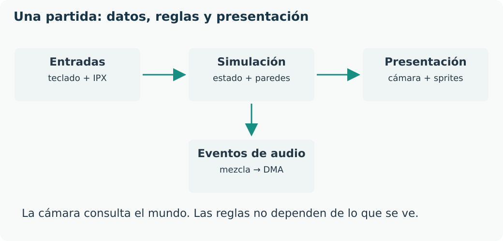

# 00. El juego como sistema

Al terminar sabrás qué piezas necesitas construir y por qué no conviene empezar leyendo las casi tres mil líneas de `main.c` de arriba abajo.

Imagina un tablero con dos fichas. Para jugar necesitas recordar dónde está cada ficha, aceptar órdenes y decidir cuáles son válidas. Para enseñarlo necesitas dibujar. Para escucharlo necesitas convertir eventos en sonido. Para compartirlo con otro ordenador necesitas que ambos estén de acuerdo sobre lo ocurrido.

Son responsabilidades distintas, aunque acaben reunidas en una misma vuelta del programa.

La flecha entre simulación y cámara va en una dirección. La cámara lee dónde está el tanque para decidir qué enseñar. El tanque no pregunta qué parte estás mirando para decidir si su bala existe.

*Las entradas cambian el estado compartido; imagen y sonido se derivan de ese estado.*

## Qué significa programar este juego

Un programa es una secuencia de instrucciones. Algunas asignan valores, otras comparan y otras repiten un trabajo. Un juego añade una repetición fundamental: el **bucle principal**. Cada vuelta obtiene órdenes, cambia el estado y presenta un resultado.

Un **estado** es el conjunto de datos que describe la situación actual. «El tanque está en `(166,299)`, mira arriba y no tiene bala en vuelo» es estado. «Pinta el tanque usando esta imagen» es una instrucción que consulta ese estado.

Una **regla** transforma estado. Si el movimiento candidato toca un muro, conserva la posición. Si una bala alcanza al rival, suma un punto. Un **recurso** aporta datos preparados fuera del programa: mapas BMP, sprites y sonidos WAV.

## Qué se construirá de verdad

El juego tiene dos tanques, movimiento en cuatro direcciones y una bala en vuelo por jugador. Puede jugarse en un teclado sobre un mapa de 320 × 200. En red permite un mundo de 640 × 400, con una ventana de 320 × 200 para cada jugador, temas visuales y cinco niveles adicionales.

El radar indica cercanía, sin señalar una ruta. Los efectos de la intro transforman imágenes antes de la partida. La música se lee por partes porque no cabe entera en la memoria convencional disponible.

Es importante reconocer estas decisiones de alcance. No construirás todavía una cámara 3D, un servidor para cien jugadores ni un editor de niveles integrado. Cuando comprendas este juego podrás razonar qué habría que ampliar para hacerlo.

## Abre el repositorio con una pregunta

En [main.c](../src/main.c), busca `draw_to_buffer`. Lee sus llamadas: actualiza cámara, copia fondo, pinta tanques, balas y radar. No necesitas entender aún los punteros; identifica el orden.

Después abre [players.h](../header/players.h) y busca `struct player`. Localiza `position_x`, `bullet_is_flying` y `wins`. Ya has encontrado tres datos que corresponden a ideas del tablero.

Finalmente abre [Makefile](../Makefile). Cada archivo `.c` se transforma en un `.obj`; después se enlazan los objetos para producir `bin\game.exe`. Los BMP no son código compilado: el ejecutable los leerá al arrancar.

## Tu primera práctica

Dibuja tres columnas en un cuaderno: «datos», «reglas» y «presentación». Clasifica estas seis cosas: posición de una bala, color de un ladrillo, prueba contra un muro, cámara, marcador de victorias y sumar una victoria.

**Solución razonada:** posición y marcador son datos; la prueba de muro y sumar una victoria son reglas; color y cámara pertenecen a presentación. El marcador numérico es estado, pero dibujar sus cifras es presentación. Una misma idea visible puede tener dos responsabilidades separadas.

**Puedes continuar cuando** expliques por qué cambiar el color de un tanque no debería cambiar el resultado de una colisión.

[Índice](README.md) · [Siguiente: preparar el taller](ch01.md)
