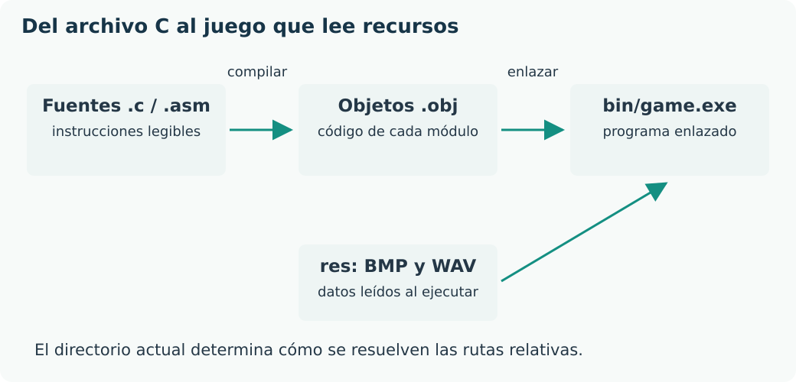

# 01. Preparar el taller

Vas a distinguir el ordenador donde editas, el entorno donde compilas y el directorio desde el que ejecutas. Muchos aparentes errores de gráficos empiezan con una ruta equivocada.




*Los recursos se leen en ejecución; no se convierten en objetos durante el enlace.*

## Herramientas y archivos

El destino de este proyecto es **Turbo C++ 3.0 trabajando con C y modelo `-mh`**. Su `tcc` produce programas DOS de 16 bits. El `make` de las instrucciones es el MAKE de Borland ejecutado desde DOS, no GNU Make de Linux. El juego completo también ensambla `src/video.asm` con NASM en formato de objeto `obj`; los 24 capítulos no necesitan NASM.

Necesitas tu instalación de Turbo C con sus cabeceras y bibliotecas accesibles. Un fallo que dice que no encuentra `stdio.h` se resuelve revisando esa instalación y sus rutas; no borrando el `#include`.

| Extensión | Qué representa |
|---|---|
| `.c` | Instrucciones y datos escritos por una persona |
| `.h` | Declaraciones que varios archivos necesitan conocer |
| `.obj` | Resultado de compilar o ensamblar una unidad |
| `.exe` | Programa enlazado que puede ejecutar DOS |
| `.bmp`, `.wav` | Recursos que el programa lee desde disco |

## El directorio actual también es una entrada

En DOS, `dir` muestra el contenido y `cd` cambia de carpeta. `..` significa «carpeta padre». Una ruta relativa se interpreta desde el directorio actual, aunque el ejecutable esté en otro sitio.

Desde la raíz del proyecto, el juego se ejecuta así después de compilarlo tú:

```text
cd bin
game.exe
```

Busca sus recursos como `..\res\cutre.bmp`: desde `bin`, subir un nivel llega a la raíz. Lanzar `bin\game.exe` desde la raíz no equivale a entrar en `bin`; las rutas pueden dejar de apuntar a `res`.

Los laboratorios viven dos niveles por debajo de la raíz:

```text
cd tutorial\ch01
make
chap01
```

Desde `tutorial\ch02`, el recurso `..\..\res\cutre.bmp` sube dos niveles. Cada ejecutable del tutorial se queda en su capítulo. No lo muevas solo a otra carpeta: cambiarías el significado de sus rutas.

## Compilación y enlace

El Makefile de cada capítulo enumera sus fuentes. Para trabajar con otro capítulo, sal a `tutorial` y entra en su carpeta. El comando `makeall` desde `tutorial` compila los 24; `makeall 07` selecciona el 07. Durante el aprendizaje conviene compilar únicamente lo que estás estudiando.

El Makefile principal enlaza mediante `bin\link.rsp`. Ese archivo contiene la lista de objetos: evita que una orden larguísima supere el límite de argumentos de DOS. Si añades un módulo propio, necesitas compilar su objeto **y** incorporarlo al enlace.

Para el juego completo, la orden documentada se ejecuta desde la raíz en DOS:

```text
make
cd bin
game.exe
```

## Jugar desde Linux y estudiar un capítulo son recorridos diferentes

[play.sh](../play.sh) utiliza un ejecutable ya existente. `./play.sh both` prepara dos instancias y arranca **el juego**. Su configuración también sale del emulador al terminar; no ofrece un selector de capítulos.

```bash
./play.sh local
./play.sh both -b -t sky -l 1
```

Para un capítulo abre una sesión DOS propia y ve a su carpeta. Para los capítulos de red, sigue el montaje manual de [la lección 17](ch17.md). Allí se explica cómo tener dos terminales DOS conectadas sin arrancar antes el juego.

En máquina real utiliza `COMMAND.COM`, conforme al entorno de prueba del proyecto. Conserva nombres 8.3 para archivos y rutas que vaya a leer DOS. La copia local del repositorio puede tener un nombre largo en Linux, pero el directorio que montas como unidad DOS permite acceder a su contenido mediante rutas cortas.

## Diagnosticar el primer fallo

| Mensaje o síntoma | Primera comprobación |
|---|---|
| No se encuentra `make` o `tcc` | Instalación de Borland y `PATH` de DOS |
| No se encuentra una cabecera | Rutas de inclusión y directorio actual |
| Símbolo sin resolver al enlazar | Falta el `.c` o `.obj` que define esa función |
| Ejecutable arranca pero no abre BMP | Ruta relativa desde el directorio de ejecución |
| Cambié un `.h` y veo lo anterior | Las dependencias del Makefile no cubren todos los headers; recompila los objetos afectados |

**Práctica:** escribe qué ruta resuelve `..\..\res` estando en `tutorial\ch21`. Después explica por qué esa misma cadena sería incorrecta desde `bin`.

**Solución:** en el primer caso llega al `res` del proyecto; desde `bin` subiría por encima de la raíz del proyecto. Una cadena correcta no lo es independientemente de su contexto.

[Anterior](ch00.md) · [Índice](README.md) · [Siguiente: C desde cero](ch02.md)
