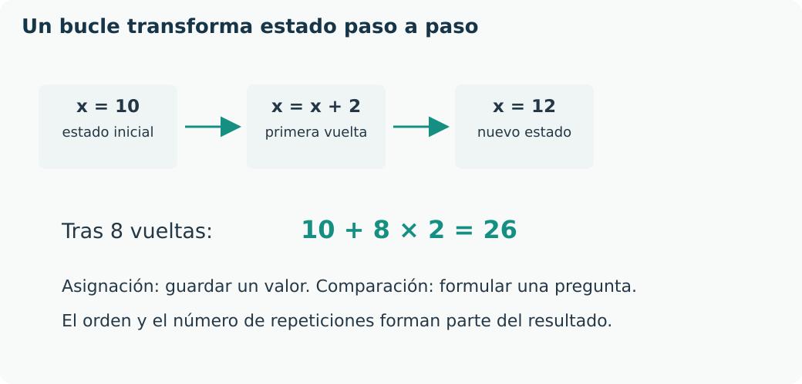

# 02. C desde la primera variable

Vas a escribir un programa de consola y a seguir su ejecución sin gráficos. Lo que aprendas aquí reaparecerá en cada píxel y cada frame.




*El estado siguiente se calcula usando el estado actual, no la posición que imaginas en pantalla.*

## Un programa completo de ocho movimientos

Guarda este ejemplo en tu copia de ejercicios como `first.c`. Es un programa de consola completo; no necesita módulos del juego.

```c
#include <stdio.h>

int main(void)
{
    int x;
    int frame;

    x = 10;
    for (frame = 0; frame < 8; frame++) {
        x = x + 2;
        printf("Frame %d: x = %d\n", frame, x);
    }
    return 0;
}
```

Desde DOS, en la carpeta donde lo guardaste: `tcc -mh first.c`, después `first`. Estas órdenes son para tu práctica; el curso documental no las ejecuta por ti.

`#include` incorpora declaraciones de una biblioteca; aquí permite llamar a `printf`. `main` es el punto de entrada. Las llaves delimitan un bloque. `int x` reserva un dato entero llamado `x`. Un punto y coma termina una instrucción.

`x = x + 2` lee el valor anterior, le suma dos y guarda el resultado. El símbolo `=` **asigna**; para comparar igualdad se utiliza `==`.

## Entender el bucle antes de memorizarlo

El `for` contiene tres partes: inicialización, condición y avance. Primero asigna `frame = 0`. Si `frame < 8`, ejecuta el cuerpo. Después `frame++` suma uno y vuelve a comprobar.

| Vuelta | `frame` al entrar | `x` antes | `x` después |
|---|---:|---:|---:|
| Primera | 0 | 10 | 12 |
| Segunda | 1 | 12 | 14 |
| Última | 7 | 24 | 26 |

Al llegar a 8 la condición es falsa. Hay ocho vueltas, aunque la primera se llame cero. Esa convención permite que una imagen de ancho 320 tenga columnas `0..319`.

Un `while` repite mientras su condición sea cierta. Un `do ... while` ejecuta al menos una vez antes de comprobar. `break` sale del bucle; `continue` salta a la siguiente vuelta. En el juego, esperar paquetes y recorrer filas son dos usos diferentes de estas herramientas.

## Decisiones

Este es un fragmento para una función, no otro programa completo:

```c
if (x > 302) {
    x = 302;
} else if (x < 0) {
    x = 0;
}
```

Un tanque de 18 píxeles cabe dentro de 320 si su esquina izquierda no pasa de `320 - 18 = 302`. La comparación pregunta por la esquina; el tamaño también cuenta.

`&&` significa que deben cumplirse ambas condiciones, `||` que basta una y `!` invierte una condición. No confundas `&&` con `&`: este último opera sobre bits y lo usaremos para entradas y paredes.

## Tipos y tamaños en este compilador

| Tipo en Turbo C de 16 bits | Uso razonable aquí | Rango relevante |
|---|---|---|
| `unsigned char` | Píxel, tecla empaquetada | 0..255 |
| `int` | Coordenada que puede ser negativa | −32768..32767 |
| `unsigned int` | Offset de pantalla, contador pequeño | 0..65535 |
| `long` | Producto grande o distancia escalada | Entero con signo de 32 bits |
| `unsigned long` | Offset del mundo, frame de red | 0..4294967295 |

Estos tamaños describen el destino DOS. No deduzcas el comportamiento de Turbo C a partir del `int` de un compilador moderno.

El tipo del **cálculo** importa antes de guardar su resultado:

```c
unsigned long bytes;
int width;
int height;

width = 640;
height = 400;
bytes = (unsigned long)width * (unsigned long)height;
```

El producto es 256000. Si escribieras únicamente `bytes = width * height`, ambos operandos serían `int` de 16 bits y el producto no cabría. El destino grande llega demasiado tarde. `640L * 400L` expresa también un cálculo largo.

La división de enteros positivos descarta la fracción: `7 / 2` vale 3; `7 % 2` vale 1. El resto servirá para extraer cifras y elegir bits. El desbordamiento de enteros **sin signo** es modular; el de enteros **con signo** no es un recurso válido para programar.

## Funciones: poner nombre a una operación

```c
int clamp_x(int x)
{
    if (x < 0) {
        return 0;
    }
    if (x > 302) {
        return 302;
    }
    return x;
}
```

`int x` es un parámetro: un dato que recibe la función. `return` devuelve un resultado y termina esa llamada. Para usarla, escribe `x = clamp_x(x);`. Pasar un número entrega su valor; la función no modifica por arte de magia la variable del llamador.

Un prototipo como `int clamp_x(int x);` anuncia la función antes de utilizarla. En proyectos con varios `.c`, ese anuncio suele vivir en un `.h` y la definición con su cuerpo en un `.c`.

## Práctica y solución

Predice `clamp_x(-9)`, `clamp_x(150)` y `clamp_x(400)`. Después cambia el primer programa para avanzar solo en los frames pares.

**Solución:** 0, 150 y 302. La condición `if (frame % 2 == 0)` rodea `x = x + 2`; se ejecuta en 0, 2, 4 y 6. El valor final pasa de 26 a 18. Si `printf` permanece fuera de la condición, imprime ocho líneas aunque solo haya cuatro movimientos.

**Puedes continuar cuando** distingas el número de vueltas, el número de cambios de estado y el número de líneas dibujadas o impresas.

[Anterior](ch01.md) · [Índice](README.md) · [Siguiente: memoria y estructuras](ch03.md)
