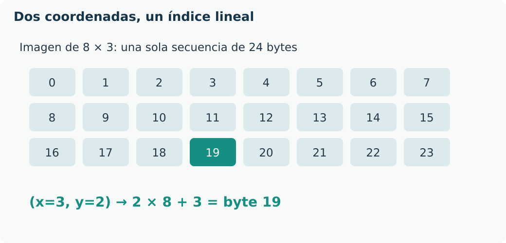

# 03. Arrays, punteros y estructuras

Vas a representar una fila de píxeles y un tanque. El objetivo es entender las expresiones del código, no aprender una lista de símbolos de memoria.




*La fila multiplica la anchura; la columna desplaza dentro de esa fila.*

## Un array es una secuencia con posiciones

```c
unsigned char row[8];
int x;

for (x = 0; x < 8; x++) {
    row[x] = (unsigned char)x;
}
```

Hay ocho bytes: `row[0]` hasta `row[7]`. `row[8]` ya está fuera. Un array no amplía su reserva porque le pidas otra posición, ni C comprueba automáticamente el índice.

Una imagen de 4 × 3 se puede almacenar como doce bytes. Para leer `(x,y)` calculas `y * 4 + x`. El punto `(2,1)` corresponde a la posición 6. No hay un objeto especial «fila»: lo crea nuestra manera de interpretar la secuencia.

## Un puntero guarda una dirección

```c
unsigned char row[8];
unsigned char *pixel;

pixel = &row[3];
*pixel = 42;
```

`&row[3]` obtiene la dirección de esa casilla. `pixel` guarda esa dirección. `*pixel` accede a lo que hay allí. Al escribir 42 a través del puntero, `row[3]` vale 42.

En una declaración, el asterisco anuncia «puntero a». En una expresión, permite acceder al objeto apuntado. `pixel + 1` avanza un elemento de su tipo: un byte si apunta a `unsigned char`, no necesariamente un byte si apunta a otra cosa.

`NULL` representa que no tienes un objeto al que acceder. Antes de utilizar una reserva dinámica debes comprobar que no devolvió `NULL`.

## La estructura agrupa lo que pertenece a una cosa

Ejemplo didáctico; el juego utiliza la estructura más amplia de [players.h](../header/players.h):

```c
struct tank_state {
    int x;
    int y;
    int direction;
};

void move_right(struct tank_state *tank)
{
    tank->x = tank->x + 2;
}
```

Si tienes `struct tank_state blue;`, accedes con `blue.x`. Al llamar a `move_right(&blue)`, pasas la dirección. Dentro, `tank->x` significa «campo `x` de la estructura apuntada por `tank`». Equivale a `(*tank).x`.

Así una función puede trabajar sobre azul o rojo sin escribir dos versiones de la misma regla.

## Reservar, usar y liberar

Una imagen grande no debe vivir como una enorme variable automática dentro de una función. La **pila** mantiene llamadas y variables locales y tiene un tamaño limitado. La memoria dinámica o **heap** permite pedir un bloque y conservarlo hasta que lo devuelvas.

Fragmento de una función con declaraciones al principio:

```c
unsigned char *sprite;

sprite = (unsigned char *)malloc(18 * 18);
if (sprite == NULL) {
    return;
}
memset(sprite, 0, 18 * 18);
/* Use the sprite here. */
free(sprite);
sprite = NULL;
```

Para usarlo necesitas las declaraciones de `malloc`/`free` y `memset`, por ejemplo `<stdlib.h>` y `<string.h>`. No copies el fragmento fuera de una función como si fuera un programa completo.

`malloc` no inicializa los bytes. `memset` escribe el mismo valor en cada byte. `memcpy(destino, origen, cantidad)` copia bytes entre regiones que no se solapan. `memmove` permite solapamiento. Liberar una reserva no borra todas las copias de su dirección: después de `free`, ningún puntero conservado autoriza seguir leyendo ese bloque.

Para el mapa de 256000 bytes necesitaremos `farmalloc` y un puntero `huge`; su aritmética se estudia en [23](ch23.md).

## Declaración, definición y duración

En `bmp.h`, `extern int camera_x;` anuncia una variable que existe en otro archivo. En `bmp.c`, `int camera_x = 0;` la define y le da almacenamiento. Definirla de nuevo en otro módulo produciría dos propietarios incompatibles para el enlazador.

Una variable global dura todo el programa y comienza a cero si no tiene otro inicializador. Una variable local automática sin inicializar contiene un valor indeterminado. `static` en una función o variable de archivo limita su visibilidad a esa unidad; en una variable local hace que conserve su almacenamiento entre llamadas. Lee cada caso por su contexto.

## Práctica

Reserva mentalmente una fila de 8 bytes. Un puntero señala a `row[2]`; escribes 9 en `pixel[3]`. ¿Qué elemento cambió? Después pasa una estructura a una función por valor y explica por qué modificar esa copia no mueve el tanque original.

**Solución:** `pixel[3]` llega a `row[5]`. Pasar la estructura por valor crea un valor independiente para la llamada. Pasar `&blue` permite acceder a los campos de `blue`. No confundas compartir una dirección con copiar el contenido.

[Anterior](ch02.md) · [Índice](README.md) · [Siguiente: VGA](ch04.md)
