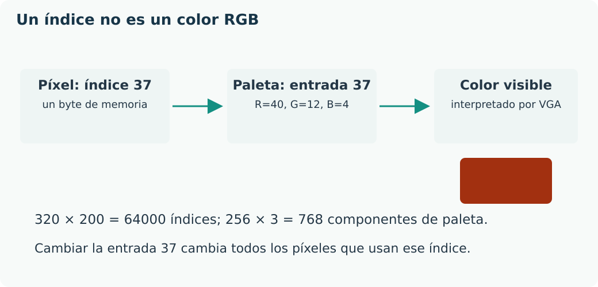

# 04. Encender la VGA y dibujar un píxel

**Laboratorio:** [chap01.c](../tutorial/ch01/chap01.c). Ejecútalo desde `tutorial\ch01`. Primero muestra instrucciones en texto; después una rejilla de colores. Una tecla permite continuar o salir según la fase.




*En modo 13h, imagen y paleta son recursos distintos.*

## Lo que cambia al elegir un modo

El modo 13h configura una pantalla de 320 × 200 píxeles y 256 índices de color. Sus píxeles ocupan `320 × 200 = 64000` bytes. El modo 03h devuelve el texto habitual de DOS.

El capítulo pide el modo mediante la BIOS. Esta función completa puede integrarse en un programa de Turbo C que incluya `<dos.h>`:

```c
static void set_video_mode(unsigned int mode)
{
    union REGS regs;

    regs.x.ax = mode;
    int86(0x10, &regs, &regs);
}
```

`union REGS` representa los registros usados para comunicarse con la BIOS. `AX=0x0013` selecciona la función de cambio de modo y el modo 13h. No confundas la interrupción solicitada por el programa, `int86`, con la interrupción de hardware del teclado que llegará por su cuenta más adelante.

El juego completo realiza la selección gráfica en [video.asm](../src/video.asm). El laboratorio utiliza C para evitar introducir ensamblador antes de entender un píxel.

## Una dirección que se ve

En [bmp.c](../src/bmp.c), `vga` señala a `A000:0000`. En ese modo, escribir un byte en esa región modifica el índice de un píxel de la pantalla.

| Punto | Cuenta | Offset |
|---|---|---:|
| Esquina superior izquierda | `0 * 320 + 0` | 0 |
| Primera posición de la segunda fila | `1 * 320 + 0` | 320 |
| Centro elegido para el ejemplo | `100 * 320 + 160` | 32160 |
| Esquina inferior derecha | `199 * 320 + 319` | 63999 |

Usa un offset `unsigned int` o un cálculo largo: 63999 no cabe en un `int` con signo de 16 bits. Por ejemplo, `offset = (unsigned int)y * 320U + (unsigned int)x;` es válido después de comprobar los límites de `x` e `y`.

## Índice y color son dos datos diferentes

Un píxel que contiene 37 consulta la entrada 37 de la paleta. Si esa entrada pasa de azul a amarillo, todos los píxeles 37 cambian sin reescribir la imagen.

La VGA guarda 256 tripletas de componentes. En el DAC clásico utilizado aquí cada componente va de 0 a 63. Un índice de 8 bits selecciona uno de esos colores; no codifica directamente sus componentes.

Esto explica dos capacidades del juego: fundir toda la pantalla modificando la paleta y animar colores sin mover píxeles. También explica una restricción: mapa y sprites visibles a la vez necesitan índices compatibles con la paleta activa. Los temas tienen paletas distintas; no todos los BMP del repositorio comparten una única tabla.

## Construcción guiada

Estudia los dos bucles de la rejilla. El exterior elige una fila y el interior sus columnas. Localiza dónde calculan `color` y dónde calculan `offset`: una cosa decide qué escribir y la otra dónde hacerlo.

Antes de adaptar el ejemplo, dibuja una cruz de cinco puntos en papel: `(160,100)`, `(159,100)`, `(161,100)`, `(160,99)` y `(160,101)`. Calcula sus offsets y luego cambia únicamente esos píxeles en tu copia del ejercicio.

**Resultado esperado:** cinco píxeles formando una cruz pequeña. Si aparece una diagonal, revisa el paso entre filas. Si la forma es correcta pero el tono no es el previsto, revisa el índice y la paleta.

## Ejercicio resuelto

¿Por qué `(320,0)` no es un píxel válido aunque su offset calculado, 320, esté dentro de 64000 bytes?

**Solución:** el índice lineal coincide con `(0,1)`. La dirección pertenece al buffer, pero la coordenada incumple el ancho de la imagen. Debes comprobar la geometría antes de convertir a offset. «La dirección cabe» no garantiza «es el píxel que quería».

[Anterior](ch03.md) · [Índice](README.md) · [Siguiente: BMP](ch05.md)
