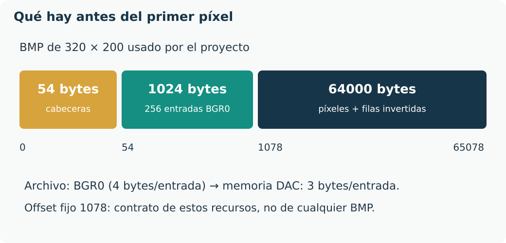

# 05. Cargar un BMP: archivo, memoria y paleta

**Laboratorio:** [chap02.c](../tutorial/ch02/chap02.c). Carga el mapa, lo enseña con la paleta anterior y después cambia solo la paleta. Antes de probarlo, lee la discrepancia de reserva de paleta en [ERRATAS](ERRATAS.md): el ejemplo enlaza con el cargador real que contiene esa limitación.




*La paleta del archivo ocupa 1024 bytes; la paleta convertida para el DAC ocupa 768.*

## El contrato concreto del cargador

BMP es una familia de formatos. Este proyecto trabaja con un subconjunto: cabecera de archivo de 14 bytes, cabecera DIB de 40, tabla de 256 entradas de cuatro bytes, 8 bits por píxel, sin compresión y altura positiva.

```text
0          14                  54                         1078
| archivo  | cabecera DIB       | 256 entradas B,G,R,0     | píxeles...
```

En estos archivos el comienzo de los píxeles es `14 + 40 + 256 * 4 = 1078`. El cargador busca directamente allí. Un BMP válido con otra cabecera, paleta corta, compresión o filas en otro sentido puede incumplir este contrato. Tener extensión `.bmp` y 8 bits no basta.

Los recursos activos revisados cumplen ese formato: los de 320 × 200 ocupan 65078 bytes; los de 640 × 400, 257078. Los recursos de respaldo son históricos y no deben seleccionarse suponiendo que tienen las mismas dimensiones.

## Leer de abajo hacia arriba sin otra imagen temporal

Para estos BMP, la primera fila almacenada corresponde a la última fila visible. En el mapa grande el cargador lee secuencialmente y coloca las filas en posiciones 399, 398, ... hasta 0.

Una fila de 8 bits se alinea a cuatro bytes en el archivo:

```text
padding = (4 - (width % 4)) % 4
file_stride = width + padding
```

Con ancho 320 o 640 el relleno vale cero. Con ancho 5, cada fila del archivo ocupa 8 bytes, aunque solo cinco sean píxeles. Tras cargarla, puedes guardar esos cinco juntos en RAM: el stride del archivo y el de tu buffer no tienen por qué coincidir.

`bmp_fill_background_in_main_buffer` utiliza una fila temporal de como máximo `MAP_MAX_WIDTH`, actualmente 640, y copia a un puntero `huge`. Abrir una imagen más ancha no aumenta ese buffer automáticamente.

## Transformar la paleta

En disco cada entrada es azul, verde, rojo y un byte reservado. En RAM el cargador conserva tres componentes por entrada, divididos entre cuatro para pasar de 0..255 a 0..63. Al escribir al DAC reordena a rojo, verde y azul.

La reserva necesaria para esa representación es:

```text
256 colores × 3 componentes = 768 bytes
```

El símbolo `PALLETA_DATA_SIZE` del código actual vale 309. Eso no define un formato reducido: `bmp_load_pallete_data` escribe las 256 tripletas. Una reconstrucción correcta debe reservar 768 y comprobar que la carga tuvo éxito. La documentación no convierte esa discrepancia en una recomendación.

## Secuencia de trabajo

En [bmp.c](../src/bmp.c), sigue estas funciones:

1. `bmp_init_buffers`: establece dimensiones y reserva memoria.
2. `bmp_fill_background_in_main_buffer`: lee el dibujo del mundo.
3. `bmp_extract_pallete_from_file`: carga su paleta.
4. `bmp_draw_world_window`: prepara el fondo de pantalla.
5. `bmp_paint_image_data_to_vga`: presenta píxeles.
6. `bmp_write_pallete_data_into_dac`: cambia cómo se ven sus índices.

Para un cargador propio, añade respuestas claras ante archivo ausente, lectura corta, dimensiones incompatibles y reserva fallida. Algunas rutinas actuales imprimen un error y retornan sin comunicar éxito al llamador; estudia ese comportamiento como una limitación, no como una garantía de recuperación.

## Práctica y diagnóstico

Predice dos fallos por separado: quitar la carga de paleta y omitir la inversión de filas. El primero mantiene la geometría con colores diferentes; el segundo invierte verticalmente el dibujo. No intentes arreglar una orientación equivocada cambiando colores.

**Ejercicio:** una imagen didáctica de 5 × 3 con la cabecera descrita, ¿cuánto ocupa?

**Solución:** `1078 + 3 * 8 = 1102` bytes. En un buffer compacto sus píxeles ocupan 15 bytes, y la paleta de trabajo otros 768. Tamaño de archivo, dibujo en memoria y memoria total son tres cuentas distintas.

[Anterior](ch04.md) · [Índice](README.md) · [Siguiente: fotogramas](ch06.md)
