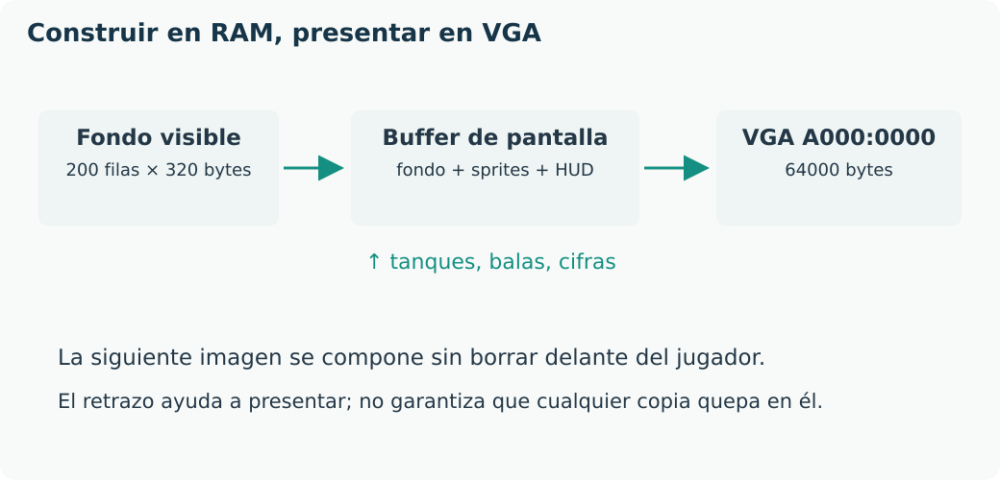

# 06. Construir un fotograma sin dejar rastros

**Laboratorio:** [chap03.c](../tutorial/ch03/chap03.c). Observa las tres pasadas de la barra: dibujo directo, composición en RAM y composición con espera de retrazo.




*El buffer de composición permanece de 320 × 200 incluso al ampliar el mundo.*

## Mover significa borrar y volver a dibujar

Cuando escribes un tanque en una pantalla, los bytes permanecen hasta que alguien los sustituye. Cambiar `position_x` no borra la imagen anterior. Si pintas otra pose en otro sitio, has creado dos dibujos.

El juego conserva un fondo limpio. En cada frame lo copia al buffer de trabajo y dibuja encima el estado actual. Así la antigua posición vuelve a contener fondo y no hace falta memorizar qué había detrás de cada tanque.

```text
mapa limpio ── ventana visible ──> buffer de trabajo
                                      + tanques
                                      + balas
                                      + explosiones
                                      + radar
                                           |
                                           v
                                    memoria VGA
```

No pintes los tanques en `buffer_original_background_bmp`: esa imagen es la fuente a la que vuelves para borrarlos. Si la ensucias, el rastro reaparece al copiar el siguiente fondo.

## Doble buffer no significa dos mundos

Hay una zona donde preparas la imagen y otra que se presenta. El mapa limpio es además un recurso de fondo. Cuando crezca a 640 × 400, el buffer de trabajo seguirá midiendo 320 × 200. Dos jugadores tampoco necesitan dos buffers de pantalla en la misma máquina: se componen juntos en un fotograma.

Este proyecto copia de RAM a VGA con `memcpy`. No intercambia páginas gráficas ni utiliza una API de ventanas. Distingue esa implementación de otras técnicas llamadas también doble buffer.

## Retrazo: elegir cuándo empezar la copia

El monitor actualiza la imagen mientras tu programa trabaja. Si observa distintas partes durante una copia puede enseñar una mezcla de dos frames: un corte horizontal o *tearing*.

`wait_retrace` consulta el bit `0x08` del puerto VGA `0x3DA`. Primero espera a que termine un retrazo que ya esté ocurriendo; después espera a que comience el siguiente. Así no llega a una ventana que está a punto de terminar.

Esto ayuda a estabilizar la presentación, pero no demuestra que una copia de 64000 bytes termine dentro del intervalo en cualquier equipo. El ancho de banda de memoria, la VGA y el emulador importan.

## Tres ritmos que no debes confundir

| Ritmo | Quién lo determina | Consecuencia |
|---|---|---|
| Refresco VGA | Modo de vídeo, alrededor de 70 Hz | Oportunidades de presentación |
| Frames de simulación completados | CPU, esperas y lógica | Cuántos movimientos ocurren |
| Muestras de audio | Tarjeta, 44100 por segundo aquí | Plazo para rellenar DMA |

Si el trabajo cabe y no hay esperas largas, un movimiento de 2 píxeles por frame equivale aproximadamente a 140 píxeles por segundo. Si se completan 35 frames por segundo, equivale a 70. La espera de retrazo impone un techo aproximado; no garantiza 70 frames por segundo en cualquier situación.

## Construcción guiada

En tu copia del laboratorio, dibuja dos barras en el buffer después de restaurar el fondo. Una avanza a la derecha y la otra a la izquierda. Presenta una sola vez al final. Debes ver ambas sin que una borre a la otra.

Ahora predice qué ocurriría con este orden: fondo, barra A, **fondo otra vez**, barra B. Desaparece A porque la segunda copia la tapa. La composición es una secuencia de escrituras y el orden importa.

**Ejercicio:** el mundo limpio ocupa 256000 bytes y el fotograma 64000. ¿Cuántos bytes de píxeles se escriben hacia VGA por frame completo?

**Solución:** 64000. El tamaño del mundo determina cuánto almacenas, no cuánto cabe en la pantalla. La copia de ventana es otro paso previo, también de 64000 bytes.

[Anterior](ch05.md) · [Índice](README.md) · [Siguiente: sprites](ch07.md)
