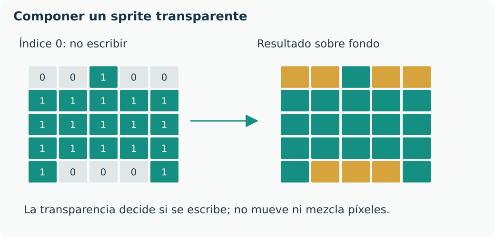

# 07. Un tanque es una imagen pequeña

**Laboratorio:** [chap04.c](../tutorial/ch04/chap04.c). Primero enseña sprites quietos y después un tanque entrando y saliendo por los bordes.




*Ejemplo esquemático de transparencia; el tanque real mide 18 × 18.*

## Tres imágenes, tres pasos entre filas

La hoja `sprites.bmp` mide 320 × 200. El tanque recortado mide 18 × 18. El buffer donde lo dibujas vuelve a medir 320 × 200.

| Lugar | Paso de fila en píxeles compactos |
|---|---:|
| Hoja de sprites | 320 |
| Sprite extraído | 18 |
| Buffer de pantalla | 320 |

Extraer y dibujar son operaciones distintas. Extraer decide qué rectángulo de la hoja representa al tanque. Dibujar decide dónde colocarlo esta vez.

```c
bmp_extract_sprite(2, 5, TANK_WIDTH, TANK_HEIGHT, tank_up);
```

La esquina `(2,5)` se mide desde arriba a la izquierda de la hoja. [bmp_extract_sprite](../src/bmp.c) traduce cada fila a su posición real en el BMP invertido:

```text
offset_archivo = 1078 + (199 - (src_y + fila)) * 320 + src_x
offset_sprite  = fila * ancho_sprite
```

La primera fila del tanque del ejemplo empieza en `1078 + 194 * 320 + 2 = 63160`. Lees 18 bytes allí y los guardas en el inicio de tu sprite. La siguiente fila visible está 320 bytes antes en el archivo, pero 18 después en el destino.

## Abrir no es cargar la hoja entera

`bmp_open_sprite_sheet` mantiene un `FILE *`. Cada extracción hace pequeñas lecturas del archivo y al final `bmp_close_sprite_sheet` lo cierra. Esto evita mantener una copia de 64000 bytes de una hoja que solo se necesita durante la carga.

Los punteros a sprites, en cambio, sí deben sobrevivir durante la partida. Guardar un puntero al interior de un buffer que vas a liberar no sustituye una extracción: dejaría un sprite apuntando a memoria liberada.

## Transparencia por índice

En el dibujo se lee cada píxel del sprite. Si vale cero, no se escribe nada; queda el fondo. Si vale otro índice, se copia.

```c
if (pixel != 0) {
    destination[offset] = pixel;
}
```

La transparencia es una regla de esta función, no una propiedad mágica del byte 0. Un `memset(screen,0,64000)` sí escribe píxeles de índice 0, que se verán negros si la entrada 0 de la paleta es negra. Esta diferencia permitirá pintar un contorno negro alrededor del radar.

## Dibujar una parte también es dibujar bien

Un tanque con esquina en `x=-9` y ancho 18 tiene nueve columnas visibles. No puedes convertir `-9` a un índice antes de recortarlo: en 16 bits sin signo se convierte en 65527.

De momento conserva la función real `draw_sprite_to_buffer`, que calcula la zona visible antes de copiar. En [24](ch24.md) la reconstruiremos paso a paso. Las coordenadas de dibujo son `int`; los offsets solo se convierten a tipos sin signo cuando sabes que caen dentro.

## Construcción guiada

Recorta la pose de derecha en `(124,8)` y dibújala en `(100,90)`. Después dibuja la misma reserva en `(160,90)`. Son dos dibujos que leen una imagen compartida, no dos reservas nuevas.

Si experimentas con un rectángulo de 40 × 40, amplía también la reserva a 1600 bytes. Cambiar solo los parámetros de extracción haría que una función escribiese 1600 bytes en los 324 reservados para un tanque.

**Ejercicio:** un sprite de 18 × 18 se coloca en `(315,198)`. ¿Cuántos píxeles de su caja pueden verse, antes de considerar transparencia?

**Solución:** cinco columnas (`315..319`) y dos filas (`198..199`), diez píxeles. La zona transparente puede reducir las escrituras, pero no ampliar ese rectángulo visible.

[Anterior](ch06.md) · [Índice](README.md) · [Siguiente: teclado](ch08.md)
