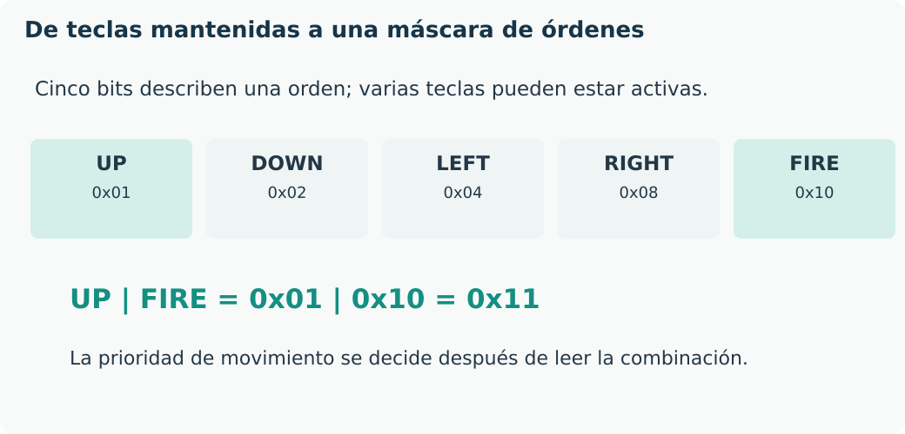

# 08. El teclado: saber qué sigue pulsado

**Laboratorio:** [chap05.c](../tutorial/ch05/chap05.c) y el comienzo de [tutlib.h](../tutorial/tutlib.h). Flechas para mover; ESC para salir.




*El mismo byte de entrada puede obtenerse del teclado o recibirse por red.*

## Carácter escrito y tecla mantenida

`getch` es útil para «pulsa una tecla para continuar». No representa por sí solo una tabla actual de teclas mantenidas. El juego necesita saber que arriba y disparo siguen pulsados mientras el otro jugador mantiene W.

El controlador entrega códigos físicos o **scancodes**. Para las teclas simples usadas aquí, un código anuncia pulsación y el correspondiente con bit 7 activado anuncia liberación. Arriba es `0x48`; liberarla produce `0xC8`.

Una tabla `keys[128]` guarda ceros y unos. El manejador actualiza la casilla; el bucle del juego consulta varias casillas sin quedarse esperando.

## Qué hace la interrupción

La IRQ del teclado conduce al vector INT 9 en este entorno. El programa guarda el manejador anterior, instala el suyo y lo restaura antes de salir. La rutina tiene la forma especial `interrupt far` de Turbo C para volver correctamente al código interrumpido.

El trabajo dentro es pequeño: leer `0x60`, actualizar una casilla y avisar al controlador de interrupciones con el EOI. No debe cargar imágenes, imprimir mensajes ni ejecutar una ronda del juego.

```text
Pulsar arriba  → IRQ → keys[0x48] = 1
Frame 1       → leer tabla → mover
Frame 2       → leer tabla → mover
Soltar arriba → IRQ → keys[0x48] = 0
Frame 3       → leer tabla → mantener posición
```

## Dos límites del ejemplo que hay que reconocer

El teclado también produce secuencias extendidas con prefijos como E0/E1. La rutina del proyecto es sencilla; no constituye un decodificador completo de todos los teclados y teclas especiales.

Además, `tutlib.h` declara la tabla como `volatile`, mientras `src/main.c` no lo hace. `volatile` indica que su contenido puede cambiar fuera del flujo ordinario que analiza el compilador. Está documentado en [ERRATAS](ERRATAS.md); no atribuyas al juego una declaración que solo aparece en el tutorial.

## Decidir una dirección

La lectura simultánea no obliga a permitir diagonales. Una cadena `if/else if` da prioridad a arriba, abajo, izquierda y derecha. Si mantienes arriba e izquierda, ambos bits pueden estar presentes, pero la lógica elige arriba.

El disparo debe procesarse en otro bloque: disparar no es una quinta dirección. Más adelante esa separación permitirá moverse y disparar en el mismo frame.

## La salida forma parte del programa

Si el vector conserva la dirección de tu manejador después de liberar el programa, una futura tecla intentará ejecutar código que ya no te pertenece. La restauración no es solo orden: es parte de la corrección.

Para estudiar el scancode, sigue la variable `scancode` dentro del manejador y la tabla desde el bucle. Un `printf("%02X", getch())` muestra valores devueltos por la biblioteca, no una captura general de los bytes de `0x60`. Tampoco añadas ese `printf` dentro de la IRQ.

## Práctica

Mantén arriba, pulsa izquierda, suelta arriba y luego suelta izquierda. Predice la dirección de cada tramo. Repite con dos jugadores cuando llegues a [11](ch11.md).

**Solución:** arriba; sigue arriba por prioridad; izquierda al soltar arriba; quieto al soltar ambas. Si el teclado físico no registra cierta combinación, la limitación puede estar en su matriz de teclas, además de en el programa.

**Puedes continuar cuando** expliques por qué el programa sigue dibujando aunque nadie pulse nada y por qué no debe esperar a una tecla dentro de cada frame.

[Anterior](ch07.md) · [Índice](README.md) · [Siguiente: animación](ch09.md)
