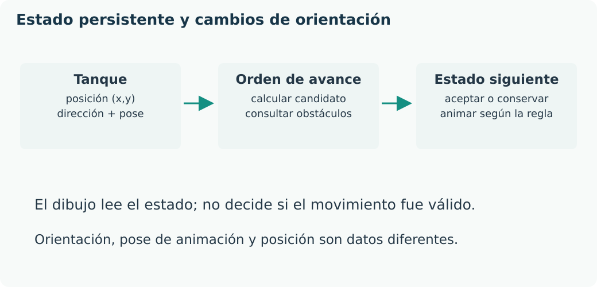

# 09. Dar vida al tanque

**Laboratorio:** [chap06.c](../tutorial/ch06/chap06.c). Flechas y ESC. Estudia también `player_init` y `player_reset` en [players.c](../src/players.c).




*Una pose visual no sustituye la posición ni la orientación lógica del tanque.*

## Posición, orientación y animación no son lo mismo

La posición responde «¿dónde está?». La dirección responde «¿hacia dónde mira?». El frame de animación responde «¿qué dibujo de las orugas toca?». Si mezclas los tres datos en una variable, cada giro complica el movimiento y cada pausa complica el dibujo.

Por dirección hay dos imágenes. Cuatro direcciones por dos poses dan ocho sprites de tanque. Elegir una pose consiste en consultar primero `current_direction` y después `current_frame`.

El juego también guarda una bala y dos imágenes de explosión dentro de cada jugador. Una reserva no implica que esa imagen deba dibujarse en todos los frames.

## Inicializar no significa una única operación

`player_init` reserva buffers de sprites. **No asigna todos los valores iniciales del tanque.** `player_reset` coloca posición y dirección y reinicia estado de ronda, bala y explosión. El llamador establece `total_frames`, `speed_total` y otros datos de partida.

En el tutorial, `tut_load_tank_sprites` establece dos frames y un periodo de animación de dos. En el juego completo, `init_players` prepara esos valores. Sigue las asignaciones reales en lugar de asumir que el nombre `init` lo hace todo.

## Un contador convierte frames en ritmo

Versión didáctica de la actualización de animación, para una estructura ya inicializada:

```c
void advance_tracks(struct player *tank)
{
    tank->speed_counter = tank->speed_counter + 1;
    if (tank->speed_counter >= tank->speed_total) {
        tank->speed_counter = 0;
        tank->current_frame = tank->current_frame + 1;
        if (tank->current_frame >= tank->total_frames) {
            tank->current_frame = 0;
        }
    }
}
```

Con periodo 2 y estado inicial cero:

| Actualización | Contador final | Pose final |
|---|---:|---:|
| 1 | 1 | 0 |
| 2 | 0 | 1 |
| 3 | 1 | 1 |
| 4 | 0 | 0 |

Si esa función se llama una vez por frame de movimiento a 70 fps, habrá unos 35 cambios por segundo. En `src/main.c` existe además `FRAMES_COUNTER=3`: `update_game` no llama a `update_player_animation` en cada vuelta. No uses el periodo de un laboratorio para afirmar la frecuencia exacta de la animación final.

## Mover y animar con una condición coherente

En una reconstrucción, decide qué significa `is_moving`: ¿se mantiene la orden de avanzar o ha cambiado la posición? Para las orugas normalmente interesa el segundo significado. Para el motor puede interesar el primero: acelerar contra una pared puede producir sonido aunque no haya desplazamiento.

El juego calcula `is_driving` a partir de la orden y solo marca movimiento cuando se acepta la posición candidata. Son dos preguntas distintas sobre el mismo intento.

## Práctica

Pon `speed_total=6` en tu copia del laboratorio. Mantén una dirección doce actualizaciones aceptadas. Anota contador y pose. Después deja `total_frames=0` solo en una traza en papel: al intentar pasar a 1, la condición lo devolvería inmediatamente a 0.

**Resultado:** con dos poses y periodo 6, cambia en las actualizaciones 6 y 12. Tras doce queda otra vez en la pose 0. Un movimiento visible no demuestra que la animación se esté actualizando correctamente.

[Anterior](ch08.md) · [Índice](README.md) · [Siguiente: paredes](ch10.md)
