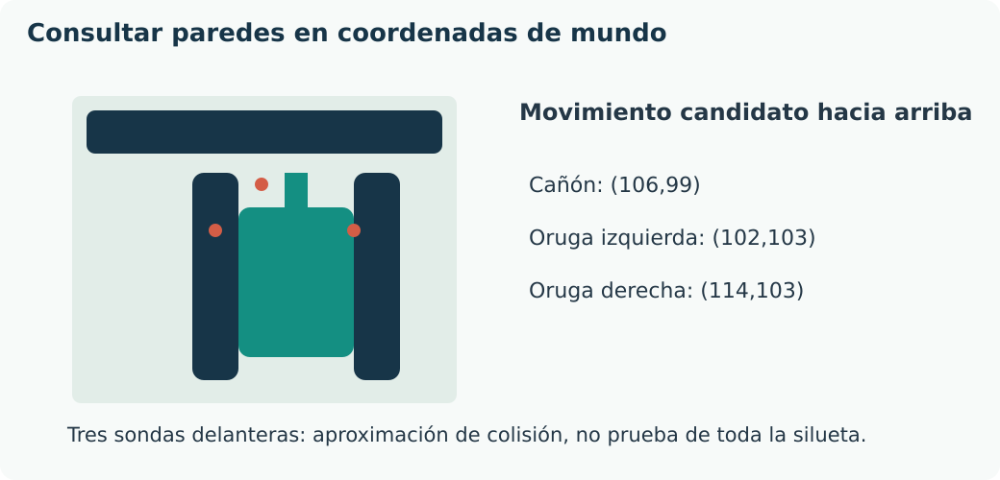

# 10. Chocar con el mundo antes de entrar en él

**Laboratorio:** [chap07.c](../tutorial/ch07/chap07.c). TAB alterna dibujo y colisiones. Flechas mueven el tanque.




*Ejemplo de movimiento desde (100,100) a (100,98), con los puntos que comprueba el tanque.*

## La apariencia no decide la geometría

Un ladrillo puede contener sombras, grietas y píxeles negros. Un arbusto puede ser decorativo. Si conviertes «color oscuro» en «se puede pasar», el dibujo artístico se convierte accidentalmente en una regla.

El juego utiliza `cutre.bmp` para presentar el escenario y `cutrecol.bmp` para definir paredes. En este último el **índice** 252 significa muro; otros índices no se marcan como muro. El nombre o el tono que parezca tener ese índice en un editor no cambia la comparación del cargador.

La máscara se consulta con `bmp_is_wall(x,y)`. Sus coordenadas pertenecen al mundo y seguirá funcionando cuando la cámara enseñe solo un fragmento.

## Proponer, comprobar, aceptar

Para avanzar dos píxeles a la derecha, no hace falta modificar inmediatamente la posición real. Calcula dónde estaría el tanque, pregunta por esa posición y acepta el cambio solo si está libre.

```text
posición actual  → posición candidata → ¿hay obstáculo?
                                             |
                               sí: conservar | no: aceptar
```

Es una forma sencilla de evitar estados intermedios inválidos. Otros motores pueden mover y resolver penetraciones después; aquí estudiamos la estrategia concreta del proyecto.

## Las tres sondas del frente

`player_update_future_collision_points` calcula la futura punta del cañón y dos puntos de las orugas según la dirección. `is_blocked_by_wall` consulta esos tres puntos.

Ejemplo real para avanzar hacia arriba desde `(100,100)`:

```text
posición futura de referencia = (100,98)
punta usada para colisión      = (106,99)
oruga 1                       = (102,103)
oruga 2                       = (114,103)
```

Los valores salen de las constantes `CANNON_TIP_OFFSET_*` y `TRACK*_OFFSET_*`; la consulta superior incluye el ajuste `+2`. No asumas que la caja completa de 18 × 18 se prueba píxel a píxel.

Tres puntos son una aproximación elegida para estos tanques, pasos y mapas. Pueden dejar huecos entre sondas o saltarse detalles finos. Si cambias el tamaño, la silueta, los muros o la velocidad, necesitas volver a comprobarla.

## El problema de saltar un obstáculo

Una bala que consulta `x=10` y luego `x=13` no consulta necesariamente `x=11`. Un muro en esa columna puede quedar entre muestras. El tanque avanza dos píxeles; la bala, tres.

Para los mapas del curso usa obstáculos de varios píxeles de grosor y prueba todas las direcciones. Una futura ampliación podría recorrer el segmento entre posición anterior y nueva o dividir cada paso en subpasos. Eso cambia el algoritmo y no está implementado por estas tres sondas.

## Qué hace y qué no hace el laboratorio

`chap07` permite visualizar la máscara mediante TAB, preguntando por cada píxel. Es una herramienta didáctica; el juego no recompone normalmente el fondo haciendo 64000 consultas de pared.

La utilidad `tut_try_move` gira el tanque antes de probar el muro. En el juego completo, `process_player_input` llama a `move_sprite` después de aceptar el movimiento y esa función asigna la dirección. Si estás bloqueado, no supongas que ambos programas giran igual.

## Práctica y solución

Con TAB, elige una sombra del muro y un adorno del suelo. Explica qué dato consulta el tanque al aproximarse. Después imagina que la cámara está en `(100,50)` y el punto candidato es `(106,99)`.

**Solución:** se consulta la máscara en `(106,99)`. En pantalla ese punto aparecería en `(6,49)`, pero consultar la pared en `(6,49)` probaría otro lugar. El dibujo de depuración se transforma; la decisión permanece en el mundo.

[Anterior](ch09.md) · [Índice](README.md) · [Siguiente: dos jugadores](ch11.md)
