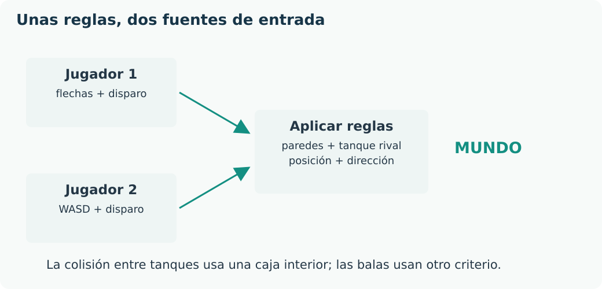

# 11. Dos jugadores y una frontera para las órdenes

**Laboratorio:** [chap08.c](../tutorial/ch08/chap08.c). J1 usa flechas; J2, WASD. El choque entre tanques del juego completo se estudia en `is_blocked_by_tank` de [main.c](../src/main.c).




*Las entradas se normalizan para aplicar las mismas reglas a ambos jugadores.*

## Duplicar datos y compartir reglas

Dos jugadores necesitan dos posiciones, dos orientaciones y dos contadores. No necesitan dos implementaciones de «intentar mover». Una función recibe el jugador sobre el que trabaja y, cuando haga falta, el otro contra el que debe probar.

La entrada también se separa. Primero se consulta el teclado; después se entrega a la simulación una orden compacta. Esa orden no necesita recordar de qué tecla física salió.

| Acción | Bit | Valor hexadecimal |
|---|---:|---|
| Arriba | 0 | `0x01` |
| Abajo | 1 | `0x02` |
| Izquierda | 2 | `0x04` |
| Derecha | 3 | `0x08` |
| Disparar | 4 | `0x10` |

Arriba y disparar forman `0x01 | 0x10 = 0x11`, decimal 17. `bits & 0x10` comprueba disparo sin perder la información de movimiento.

## Una función no debe adivinar de dónde vino el byte

Un fragmento de construcción de entrada puede hacer `bits = bits | NET_INPUT_UP` cuando la tecla está pulsada. `process_player_input` recibe ese byte y aplica reglas.

Más adelante el byte podrá llegar por IPX. También podrías escribirlo en un archivo y reproducirlo o generarlo mediante una IA. Esas ampliaciones requieren gestionar estado inicial y tiempos, pero la regla de movimiento puede conservar su interfaz.

Cada jugador recibe su propia llamada. Una única cadena `if/else if` que englobe a ambos impediría actuar al segundo cuando entre el primero.

## La colisión entre cajas

El juego completo usa para el choque entre tanques una caja interior: margen 2 en cada lado, `18 - 4 = 14` píxeles de ancho y alto. Comprueba la caja futura del que quiere avanzar contra la caja actual del otro.

Dos cajas no se solapan si una queda totalmente a izquierda, derecha, arriba o abajo de la otra. Basta encontrar una separación para devolver «no chocan».

Con bordes inclusivos:

```text
left   = x + 2
right  = left + 14 - 1
top    = y + 2
bottom = top + 14 - 1
```

No mezcles este criterio con el de una bala: `bullet_has_hit_tank` usa la caja completa del tanque. Distintas interacciones pueden tener formas de colisión distintas.

## Un orden estable también es una regla

`main.c` procesa P1 y después P2. Al probar P2, la posición de P1 puede estar ya actualizada. El orden puede dar prioridad en un encuentro estrecho, pero ambas máquinas deben aplicar **ese mismo orden**, independientemente de cuál sea el jugador local.

Ordenar siempre «mi tanque primero» introduce una diferencia de simulación en red. P1/P2 son identidades compartidas; local/remoto son perspectivas distintas.

## Práctica

Calcula la caja interior de un tanque cuya esquina es `(100,100)`: `x=102..115`, `y=102..115`. El rival está en `(114,100)`, con caja `116..129`. ¿Se solapan? ¿Qué pasa si el primero intenta avanzar dos píxeles a la derecha?

**Solución:** antes no se solapan. Después la primera caja sería `104..117`, que sí se solapa con `116..129`; el movimiento se rechaza. Compara luego el laboratorio y el juego final: `tut_try_move` comprueba paredes, no contiene por sí solo este choque entre jugadores.

[Anterior](ch10.md) · [Índice](README.md) · [Siguiente: disparos](ch12.md)
