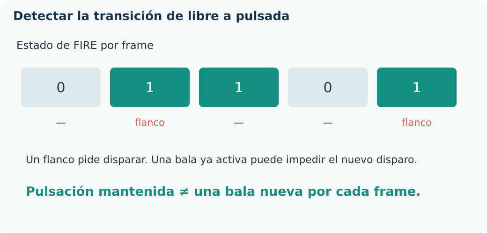
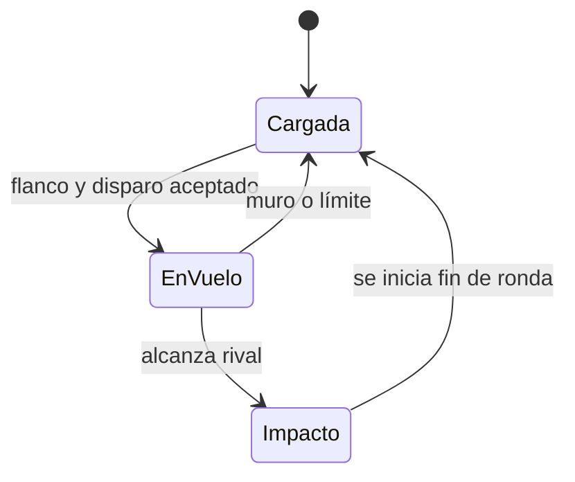

# 12. Disparar una bala que siga su propio camino

**Laboratorio:** [chap09.c](../tutorial/ch09/chap09.c). Flechas y 5 numérico para J1; WASD y G para J2. Este capítulo demuestra balas contra el mapa; los impactos que puntúan llegan en el siguiente.

*La secuencia tiene dos flancos de subida, pero solo uno se acepta si la primera bala sigue activa.*

## La regla limita la estructura necesaria

Solo puede existir una bala en vuelo por tanque. Basta guardar posición, dirección y `bullet_is_flying` dentro de `struct player`. No hace falta reservar memoria al pulsar disparo.

`player_fire_bullet` comprueba si ya hay una, copia la dirección del tanque, actualiza la salida del cañón y marca la bala activa. Devuelve 1 si realmente disparó. Ese resultado es el evento que debe activar el sonido, no simplemente «la tecla está pulsada».

## El detector de flanco

Si mantienes el botón durante veinte frames, el bit de disparo aparece veinte veces. Para disparar una vez por pulsación necesitas recordar el valor anterior.

| Antes | Ahora | Acción |
|---:|---:|---|
| 0 | 0 | Nada |
| 0 | 1 | Intentar disparar |
| 1 | 1 | Mantener, sin otro intento |
| 1 | 0 | Preparar la próxima pulsación |

Si pulsas mientras una bala sigue en vuelo, el intento se rechaza. Mantener el botón después de que desaparezca no crea otro flanco; tendrás que soltar y volver a pulsar. Esta consecuencia se deduce de la tabla, no de un temporizador.

El bloque de disparo va separado de la cadena de direcciones para permitir mover y disparar juntos.

## Dirección y posición de salida

Una vez lanzada, la bala usa `bullet_direction`, no `current_direction`. Girar el tanque no puede doblar la trayectoria que ya comenzó.

La salida se calcula desde la posición de mundo del tanque mediante offsets del cañón. El dibujo de la bala se transformará a pantalla más adelante. Aplicar la cámara al crear la bala mezclaría su posición real con una preferencia visual local.

## Movimiento y colisiones

`player_move_bullet` avanza tres píxeles y desactiva al alcanzar el límite del mundo. El llamador vuelve a comprobar si sigue activa antes de continuar.

Su sprite mide 4 × 3. Para la pared se consulta el centro, con offsets `(2,1)`. Es una aproximación puntual: el dibujo puede rozar un muro antes de que el centro lo alcance.

En el juego completo, `update_bullet` prueba primero el impacto en el tanque rival y después la pared. Ese orden es parte del comportamiento. No intercambies comprobaciones en una sola máquina esperando que el lockstep lo corrija.

## Práctica y solución

Partiendo sin bala, aplica entradas `[0,16,16,0,16]` en cinco frames. Supón que la primera bala todavía vuela durante todos ellos.

**Solución:** un disparo aceptado en el segundo frame. El tercer frame mantiene la pulsación. El cuarto rearma el detector. El quinto crea un flanco nuevo, pero `player_fire_bullet` lo rechaza porque sigue habiendo una bala. «Dos flancos» no equivale a «dos proyectiles creados».

[Anterior](ch11.md) · [Índice](README.md) · [Siguiente: rondas](ch13.md)
