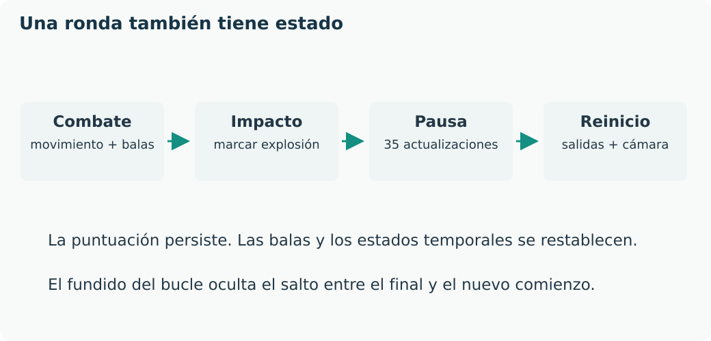

# 13. Impacto, explosión y nueva ronda

**Laboratorio:** [chap10.c](../tutorial/ch10/chap10.c). Construye una partida local con disparos y puntuación. Consulta `EXPLOSION_*` en [players.h](../header/players.h): la pausa actual es de **35 frames**.




*El reinicio debe distinguir datos de ronda de la puntuación acumulada.*

## Una máquina de estados pequeña

Mientras `explosion_pause_counter` vale cero se aceptan movimientos y se actualizan balas. Cuando un tanque recibe un impacto se inicia su explosión y el contador pasa a 35. Durante esa fase avanzan las imágenes de explosión y el contador disminuye.

No uses una espera bloqueante de medio segundo para representar esta pausa. El programa necesita seguir presentando imagen y, en la integración final, atendiendo sonido y red.

```text
JUGANDO → impactos del frame → EXPLOSIÓN → contador llega a cero → reinicio
```

A unos 70 frames completados por segundo, 35 frames equivalen aproximadamente a medio segundo. Esa equivalencia temporal cambia si la simulación se frena.

## Recoger ambos impactos antes de reaccionar

Primero se actualiza la bala de P1; después la de P2. Solo cuando se han recogido ambos resultados se inicia la pausa general. Eso permite un impacto doble en el mismo frame.

Si iniciar la explosión del primer tanque abortara inmediatamente el procesamiento del segundo, el orden de llamadas impediría algunos empates. Separar detección y reacción hace explícita la regla.

Al comenzar la pausa se desactivan ambas balas para que ninguna quede congelada en pantalla. En el juego se detienen también los motores y se reproduce una sola explosión sonora para el evento de ronda.

## Centrar la imagen sin cambiar el estado

El tanque mide 18 × 18 y la explosión 13 × 13. El desplazamiento usado es `(18 - 13) / 2 = 2`. Queda un píxel de asimetría por la división entera: dos píxeles a un lado y tres al otro. Es un centrado discreto aproximado, no dos márgenes idénticos.

El tanque conserva la posición donde recibió el impacto. El dibujo añade ese desplazamiento y, cuando exista cámara, resta también la cámara. No traslades el tanque al origen de la explosión: es una decisión de presentación.

## Qué se reinicia y qué sobrevive

`player_reset` restablece posición, dirección y estados transitorios, pero no borra `wins`. Esa diferencia permite acumular victorias entre rondas.

Haz una tabla antes de ampliar el juego:

| Dato | Al comenzar otra ronda |
|---|---|
| Posición y orientación | Vuelven al punto de salida |
| Bala en vuelo | Se desactiva |
| Animación de explosión | Se reinicia |
| Victorias | Se conservan |
| Cámara | Se coloca sobre el objetivo reiniciado |
| Reservas de sprites y sonido | Se reutilizan |

No cargues BMP ni WAV de nuevo en cada reinicio. Los recursos pertenecen a la sesión; la posición pertenece a la ronda.

## Práctica

Anota el resultado de tres rondas: gana P1, empate con doble impacto, gana P2. ¿Cuántas victorias guarda cada uno? ¿En qué momento deben volver los tanques al spawn?

**Solución:** P1 tiene 2 y P2 tiene 2. El empate suma una a cada uno. Los tanques regresan después de la pausa, para que la explosión se vea en el lugar del impacto.

**Puedes continuar cuando** puedas reconstruir la ronda usando una variable de estado o un contador, sin detener el servicio del bucle principal.

[Anterior](ch12.md) · [Índice](README.md) · [Siguiente: hardware de sonido](ch14.md)
