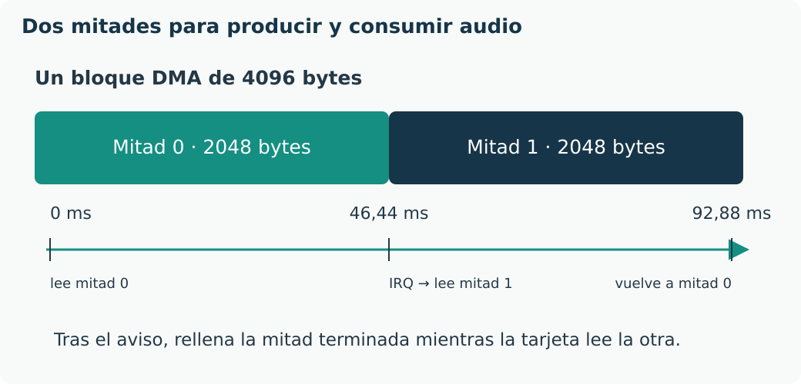

# 14. De una tarjeta muda a un WAV

**Laboratorios:** [chap11.c](../tutorial/ch11/chap11.c), detección en texto, y [chap12.c](../tutorial/ch12/chap12.c), reproducción. En el segundo, 1 y 2 disparan efectos y U permite observar qué ocurre al dejar de atender el mezclador.




*A 44100 muestras por segundo, una mitad de 2048 muestras dura aproximadamente 46,44 ms.*

## Tres interlocutores

El **DSP** de la Sound Blaster recibe órdenes de reproducción. El controlador **DMA** transfiere bytes desde memoria sin que el bucle tenga que entregar cada muestra. La **IRQ** informa de que hay trabajo pendiente.

DOS puede cargar drivers y programas residentes; IPX será un ejemplo. Lo específico aquí es que `sound.c` programa los puertos de la tarjeta directamente, sin una API multimedia general del sistema operativo.

La variable `BLASTER` describe la configuración acordada con el hardware:

```text
SET BLASTER=A220 I5 D1 H5 T6
```

`A220` indica el puerto base hexadecimal; `I5`, la IRQ; `D1`, el DMA de 8 bits. Si falta la variable, el código prueba sus valores predeterminados. Cambiar la variable no reconfigura físicamente una tarjeta que escucha en otro puerto.

## Detectar y preparar

`sound_start` realiza el reset del DSP y espera `0xAA`. Después prepara memoria, interrupción y reproducción de silencio. Devuelve 1 si el módulo queda listo y 0 si falla. No es una detección exhaustiva de capacidades de toda tarjeta compatible: las órdenes usadas deben ser compatibles con el dispositivo o la emulación elegida.

El proyecto programa salida mono de 8 bits a 44100 Hz. El silencio es el byte 128. Cero representa una amplitud extrema negativa una vez centradas las muestras, no silencio.

## Dos mitades, dos responsabilidades

El DMA recorre 4096 bytes repartidos en mitades de 2048. Al terminar una mitad, la tarjeta genera una IRQ y continúa leyendo la otra. La ISR marca `sound_buffer_ready`; `sound_update` realiza la mezcla fuera de la interrupción.

```text
Tiempo                 DMA                       Programa
0                      lee mitad 0               puede preparar trabajo
≈46,4 ms               empieza mitad 1           IRQ: toca rellenar mitad 0
≈92,9 ms               vuelve a mitad 0          IRQ: toca rellenar mitad 1
```

La cuenta es `2048 / 44100 ≈ 0,04644 s`. Tienes aproximadamente una mitad para preparar la siguiente desde el aviso. Un indicador booleano no cuenta varias IRQ pendientes: si abandonas el servicio durante demasiado tiempo, no basta con suponer que luego recuperarás todas las mitades perdidas.

## La frontera de 64 KiB

Un bloque DMA de 8 bits no debe cruzar una frontera física de 65536 bytes. Un puntero `huge` no elimina esta restricción del hardware.

`sound_alloc_dma_buffer` pide el doble del tamaño, 8192 bytes para 4096 útiles, y selecciona una región que no cruce la frontera. Conserva el puntero original para `farfree` y usa el ajustado para DMA.

Ejemplo: si una reserva comienza 2000 bytes antes de la frontera, 4096 no caben antes de ella. Se avanza esos 2000 hasta la siguiente página y quedan suficientes bytes dentro de la reserva doble. Se libera la reserva original, no esa dirección interior.

## Secuencia de uso

Con [sound.h](../header/sound.h), el llamador configura log, llama `sound_start`, carga efectos con `load_sound`, pide reproducción con `play_sound` y atiende `sound_update`. Al terminar llama a `sound_end`, que para la actividad y libera recursos.

`load_sound` devuelve un identificador de muestra o −1. `play_sound` devuelve una voz o −1. Ambos son enteros, pero representan cosas diferentes; esa distinción es el siguiente capítulo.

**Ejercicio:** ¿por qué `free` antes de parar DMA es un error aunque el juego ya no vaya a dibujar otro frame?

**Solución:** la tarjeta sigue leyendo por su cuenta. Que el bucle termine no revoca la dirección programada en DMA. La limpieza debe detener a quien usa la memoria antes de devolverla.

[Anterior](ch13.md) · [Índice](README.md) · [Siguiente: mezclador](ch15.md)
