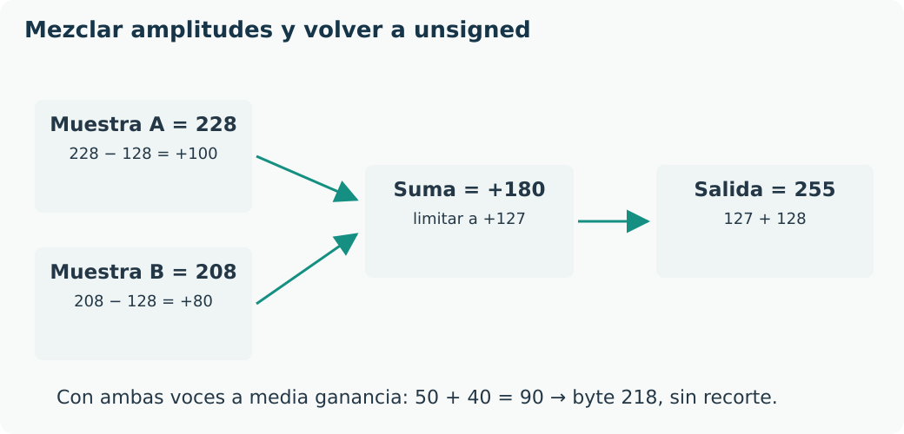

# 15. Mezclar motores, disparos y explosiones

**Laboratorio:** [chap13.c](../tutorial/ch13/chap13.c). Lee sus controles de texto: 1/2 efectos, 3/4 motores, 5 comparación de volúmenes y 0 parada de efectos.




*Primero se centra y escala cada voz; después se suma, satura y devuelve el desplazamiento de 128.*

## Muestra almacenada y voz activa

Una **muestra** es un sonido cargado, con datos y longitud. Una **voz** es una reproducción de esa muestra, con posición actual, volumen y estado de bucle.

Dos disparos cercanos pueden compartir el mismo archivo cargado y avanzar por él desde dos posiciones diferentes. El módulo ofrece ocho muestras y ocho voces. La canción tiene su propio buffer y se suma aparte; no consume uno de esos ocho huecos de efectos.

## La suma se hace alrededor de cero

Los bytes de audio van de 0 a 255, pero para mezclar se convierten a amplitudes con signo restando 128.

```text
salida = limitar(suma de contribuciones, -128, 127) + 128
contribución = (muestra - 128) * volumen / 32
```

Ejemplo con dos sonidos y volúmenes moderados:

| Fuente | Byte | Centrada | Volumen | Contribución |
|---|---:|---:|---:|---:|
| A | 200 | 72 | 16 | 36 |
| B | 160 | 32 | 8 | 8 |

La suma es 44; la salida es 172. Sumar directamente `200+160` ignoraría el centro de silencio y produciría otra señal.

Si la suma da 150, se limita a 127 y se escribe 255. Ese recorte o saturación impide dar la vuelta al rango, pero deforma la onda y puede escucharse como distorsión.

## Qué significa volumen 32

`SOUND_VOLUME_MAX=32` es la unidad de ganancia: 32 reproduce el nivel original, 16 la mitad y 64 el doble. Las funciones actuales no imponen un límite universal al parámetro. Ganancias arbitrariamente grandes pueden desbordar los productos de `int` antes de saturar la salida; utiliza valores moderados y revisa rangos si amplías la API.

En `main.c`, disparo usa 16, motores 12 y explosión 34. La explosión se reproduce tras parar motores. Son decisiones de mezcla que reservan espacio para eventos importantes, no una prueba de que la suma jamás recorte.

## Repetir una petición no debe reiniciar un motor

`loop_sound(id)` busca primero si esa muestra ya está sonando en bucle. Si existe devuelve la misma voz. Por eso puedes pedir motor en cada frame con orden de movimiento y pararlo al dejar de conducir.

`play_sound(id)` inicia otra reproducción, por lo que llamarlo continuamente produce ataques repetidos y consume voces. Para cortar un bucle por muestra existe `stop_looping_sound(id)`; para cortar una reproducción concreta, `stop_sound(voice)`.

Cuando todas las voces están ocupadas, el código busca una que no sea de bucle y esté cerca de terminar. Solo si todas están protegidas como bucles falla el nuevo sonido. No es simplemente «ocho ocupadas, noveno rechazado».

`stop_all_sounds` detiene las voces de efectos. Para silencio total también hay que llamar `stop_song` si la música está activa.

## Construcción guiada

Recorre `sound_mix_half` en [sound.c](../src/sound.c): limpiar acumulador, sumar voces, sumar música y convertir con saturación. Cada voz avanza su posición una vez por muestra producida; al llegar al final, se detiene o vuelve al inicio.

**Ejercicio:** dos voces producen amplitudes centradas 100 y 80, ambas a volumen 32. ¿Qué byte sale? ¿Qué ocurre si ambas pasan a volumen 16?

**Solución:** 180 se recorta a 127, salida 255. A media ganancia la suma es 50+40=90, salida 218 sin recorte. Reducir volumen antes de sumar conserva mejor la forma que intentar repararla después de saturar.

[Anterior](ch14.md) · [Índice](README.md) · [Siguiente: streaming](ch16.md)
