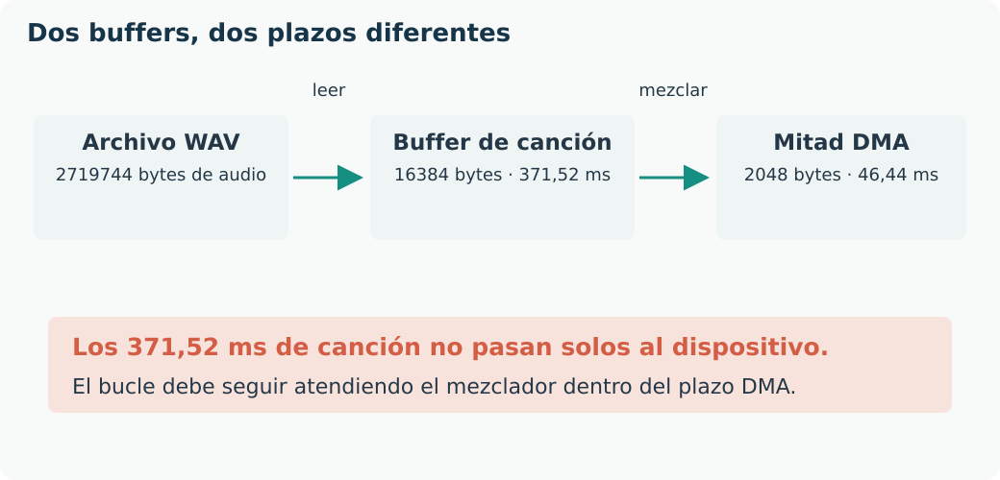

# 16. Música que no cabe en memoria

**Laboratorio:** [chap14.c](../tutorial/ch14/chap14.c). Usa 1 para superponer un efecto, +/− para volumen y P para parar la música. La implementación está en `play_song`, `song_refill` y `sound_mix_half` de [sound.c](../src/sound.c).




*Tener datos leídos por adelantado no autoriza a bloquear el bucle hasta agotar ese buffer.*

## Cargar todo y conservar una ventana son estrategias distintas

`res/prody8.wav` ocupa 2719788 bytes de archivo y contiene 2719744 bytes de audio. A 44100 bytes por segundo son unos 61,67 segundos. La memoria convencional disponible debe alojar también DOS, el programa, mapas, sprites y efectos.

La canción se mantiene abierta y se lee por partes. `song_buffer` tiene 16384 bytes, suficientes para unos 371,5 ms de audio. Cuando queda una cantidad baja, `song_refill` desplaza al principio lo que no se ha consumido y añade más datos.

```text
Antes:    [ consumido ][ pendiente ]
Después:  [ pendiente ][ datos nuevos ........ ]
```

Se usa `memmove` porque las regiones dentro del mismo buffer pueden solaparse. El tamaño reservado es fijo, aunque cambie la duración de la canción.

## Hay dos reservas de tiempo, no una

El buffer de canción alimenta al mezclador. El DMA reproduce el buffer de salida de 4096 bytes. Dejar de llamar a `sound_update` no entrega automáticamente los 16384 bytes de canción a la tarjeta.

| Buffer | Capacidad temporal aproximada | Qué problema ayuda a absorber |
|---|---:|---|
| Canción, 16384 bytes | 371,5 ms | Lectura anticipada del archivo |
| Una mitad DMA, 2048 bytes | 46,4 ms | Plazo para mezclar y rellenar |
| DMA completo, 4096 bytes | 92,9 ms | Audio ya mezclado en la salida |

Por tanto, «puedo bloquear el juego 0,37 segundos porque tengo streaming» es incorrecto. Una lectura de disco también consume tiempo de CPU del bucle y puede hacerte perder el plazo de una mitad DMA.

## El formato admitido

`play_song` espera PCM mono de 8 bits a **44100 Hz** con la disposición simple de 44 bytes de cabecera que comprueba el código. Los WAV permiten chunks adicionales, pero el lector actual no los recorre: no todos los WAV válidos son compatibles.

`load_sound` puede remuestrear efectos al cargar. Sigue necesitando frecuencia válida y longitudes adecuadas a sus punteros y lecturas de 16 bits. Para los recursos actuales evita conversión en tiempo de carga y usa los WAV ya preparados del repositorio.

No aumentes `SONG_BUFFER_SIZE` a 65536 sin rediseñar contadores: `song_fill`, `space` y otros son `unsigned int` de 16 bits. Tampoco una reserva estática gigante es gratuita para el modelo de memoria. Aumentar un número no garantiza una ampliación válida.

## Llegar al final

Cuando se acaba el bloque de datos de la canción, el lector busca `song_data_start` y sigue rellenando. No inserta deliberadamente silencio entre vueltas. Eso no garantiza que cualquier canción enlace sin clic: el último valor y el primero pueden formar un salto audible en el propio recurso.

El módulo reproduce una canción a la vez. `play_song` cierra la anterior. `sound_end` debe cerrar también el archivo, además de devolver el hardware y las reservas.

## Práctica

Dibuja el flujo completo: archivo → buffer de canción → mezcla con efectos → mitad DMA libre → altavoz. Marca qué función trabaja en cada flecha y dónde una lectura lenta bloquearía el siguiente servicio.

**Ejercicio:** quedan 7000 bytes sin consumir de una canción larga. Se rellena hasta 16384. ¿Cuántos bytes nuevos hacen falta y dónde queda `song_position`?

**Solución:** 9384 bytes, salvo que haya lectura corta o se alcance el final de datos. Tras compactar, `song_position` queda en 0 y `song_fill` crece desde 7000. El consumidor y el productor deben ponerse de acuerdo sobre qué parte sigue siendo válida.

[Anterior](ch15.md) · [Índice](README.md) · [Siguiente: IPX](ch17.md)
