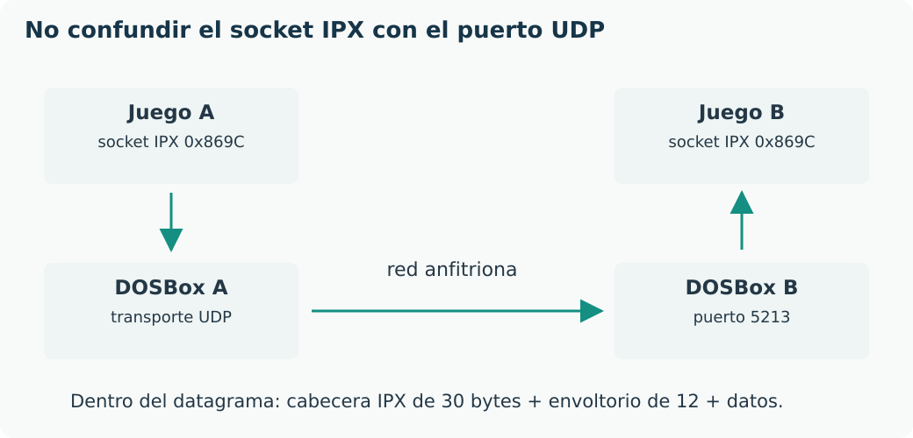

# 17. Preparar la red y abrir un socket IPX

**Laboratorio:** [chap15.c](../tutorial/ch15/chap15.c). Este primer capítulo detecta el driver y abre el módulo; puedes comprobar detección con una instancia. Para encontrar al compañero y conversar necesitarás dos.




*El encapsulado del emulador no cambia la API IPX que utiliza el juego DOS.*

## Dos capas de red distintas

Dentro del programa se usa **IPX**: direcciones de red y nodo, sockets y datagramas. En DOSBox, un túnel transporta esos paquetes mediante UDP en el ordenador anfitrión.

`5213/UDP` pertenece al túnel. `0x869C` es el socket IPX del juego. Cambiar uno no cambia el otro. La IP del anfitrión se utiliza para unir DOSBox al túnel; el juego descubre después a su compañero mediante IPX.

## Montaje manual para los ejercicios

Abre dos sesiones DOSBox con `ipx=true` en su configuración. Necesitas sesiones que te dejen en el prompt, sin un bloque de arranque que ejecute `game.exe` y luego `exit`. `play.sh both` está diseñado para jugar y no cumple ese propósito.

En cada sesión monta **su copia de trabajo** del proyecto como C:. Sustituye las rutas de ejemplo por las tuyas. Con dos directorios separados, los capítulos de red no escribirán sobre el mismo `GAME.LOG`.

Primera sesión, en el prompt de DOSBox:

```text
mount c /ruta/a/copiaA
c:
ipxnet startserver 5213
cd tutorial\ch15
chap15
```

Segunda sesión, si está en el mismo ordenador:

```text
mount c /ruta/a/copiaB
c:
ipxnet connect 127.0.0.1 5213
cd tutorial\ch15
chap15
```

Para dos ordenadores sustituye `127.0.0.1` por la dirección del anfitrión que inició el túnel. Antes de pasar al 16, compila en DOS las versiones del capítulo que utilizarás y conserva el mismo código en ambos lados. `ipxnet status` e `ipxnet ping` ayudan a comprobar el túnel.

En hardware DOS real no existe ese túnel: se necesita la pila IPX y el controlador adecuados. El montaje ODI descrito por el proyecto carga LSL, el controlador de la tarjeta e IPXODI, con un tipo de trama compatible en ambas máquinas. Consulta [las pruebas de red](../doc/ES/NETWORK-TESTING.md) para separar ambos entornos.

## Detectar la interfaz del driver

`net_start` consulta INT 2F con `AX=0x7A00`. Si `AL=0xFF`, recibe en `ES:DI` la dirección de entrada de IPX. Las operaciones siguientes utilizan una llamada lejana a esa dirección, con el código de operación en BX.

No necesitas memorizar el ensamblador el primer día. Entiende su contrato: guardar registros que no debes destruir, preparar los requeridos, llamar a la dirección correcta y restaurar el contexto.

## El buzón del driver

Un **ECB** describe una operación: dirección de buffer, longitud, socket y estado. El programa deja cuatro ECB de recepción preparados. Mientras un ECB está ocupado por el driver, no puedes reutilizar alegremente su almacenamiento.

El código espera estos tamaños en Turbo C: ECB 42 bytes, cabecera IPX 30 y sobrecarga total IPX + envoltorio propio 42. Su log de arranque dice:

```text
NET sizes: ecb=42 header=30 overhead=42 (want 42/30/42)
```

Eso describe el formato esperado, no una medida de un compilador moderno. Una estructura C enviada como bytes depende de tamaños, alineación y orden de campos.

## Práctica y solución

Escribe tres comprobaciones, en orden: el emulador está unido al túnel, el driver IPX responde y el socket se abre. ¿Cuál comprueba `net_start` y cuál no?

**Solución:** detecta la interfaz IPX y abre el socket; eso no demuestra por sí solo que haya otro juego disponible ni que se complete el emparejamiento. Esas son las pruebas del próximo capítulo.

[Anterior](ch16.md) · [Índice](README.md) · [Siguiente: descubrimiento](ch18.md)
