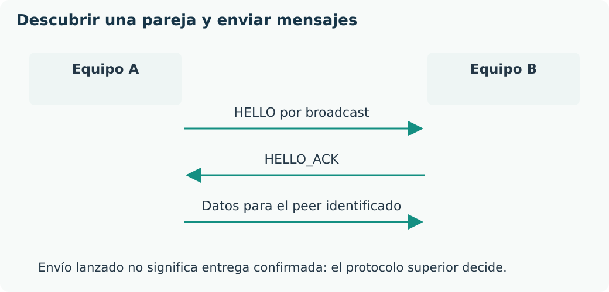

# 18. Encontrarse y enviarse mensajes

**Laboratorios:** [chap16.c](../tutorial/ch16/chap16.c) y [chap17.c](../tutorial/ch17/chap17.c). Utiliza las dos sesiones preparadas en [17](ch17.md), entra en `tutorial\ch16` o `tutorial\ch17` y ejecuta el mismo capítulo en ambas.




*El descubrimiento establece una identidad y una dirección; los datagramas siguen necesitando reglas de uso.*

## Descubrir antes de conversar

El nodo de broadcast `FF:FF:FF:FF:FF:FF` permite anunciar HELLO sin conocer al destinatario. Al recibirlo, el otro extremo responde HELLO_ACK y aprende la dirección del emisor.

`net_wait_for_client` escucha; `net_connect_to_server` anuncia; `net_find_peer` anuncia y escucha. El juego utiliza emparejamiento entre iguales. Esos papeles pertenecen al protocolo de aplicación, no transforman IPX en un transporte con conexiones garantizadas.

`net_find_peer` espera las dos partes del intercambio. Un «ya he visto algo del otro» no siempre demuestra «el otro sabe que estoy listo»; esa diferencia explica los ACK y las repeticiones.

## Elegir P1 y P2

Cada instancia genera un identificador. En la versión actual se combina `rand()` sembrado con el tick BIOS y parte del nodo local. La identidad con valor menor se convierte en P1.

La elección no depende de quién abrió el túnel como servidor. Las etiquetas local/remoto tampoco son P1/P2. Ambas máquinas deben conocer el mismo par de identidades y aplicar la misma comparación.

La mezcla con el nodo reduce coincidencias, pero no demuestra unicidad matemática. El código descarta paquetes con el mismo `instance_id` que el propio; una colisión de identidad puede impedir emparejar. No enseñes «dos números aleatorios nunca coinciden» como regla.

## Enviar devuelve aceptación, no confirmación remota

`net_send(data,length)` acepta hasta `NET_MAX_DATA=480` bytes. Un retorno 1 indica que se lanzó el envío; no garantiza entrega. Puede retornar 0 si el ECB de envío sigue ocupado, la longitud no es válida o el módulo no está conectado.

`net_update` atiende el driver, procesa recepciones terminadas y vuelve a publicar sus ECB. Los mensajes de datos pasan a una cola de ocho elementos. `net_receive` saca uno; si el buffer del llamador es demasiado pequeño, lo descarta en lugar de fragmentarlo.

Con mensajes de texto, deja espacio para el terminador `\0` antes de imprimir. Un paquete binario puede contener ceros internos: usa su longitud, no `strlen`, para interpretarlo.

## Un bucle de recepción bien planteado

Pseudocódigo de una aplicación, no programa completo:

```text
mientras la aplicación continúe:
    atender net_update
    sacar mensajes hasta vaciar la cola
    validar longitud y tipo antes de leer campos
    recoger entrada local sin bloquear
    intentar enviar si hay mensaje pendiente
    comprobar cancelación y tiempo de espera
```

Un datagrama conserva sus límites cuando se recibe. No implica que cada envío produzca exactamente una recepción: puede perderse, llegar duplicado o fuera de orden. Para transferir archivos necesitarías números de bloque, confirmaciones y reintentos; el chat es un laboratorio del transporte, no una transferencia fiable completa.

## Práctica

Envía una línea corta de A a B y otra de B a A. Luego predice qué sucedería si B dejara de llamar a `net_update` mientras A envía muchas líneas. Los ECB pueden llenarse y la aplicación no moverá mensajes nuevos a su cola.

**Ejercicio:** tu buffer mide 20 bytes y llega un mensaje de 21. ¿Puedes leer los primeros 20 y completar el resto en la siguiente llamada?

**Solución:** no con esta API. `net_receive` descarta el mensaje que no cabe. Decide un tamaño de mensaje y un contrato de recepción antes de interpretar datos.

[Anterior](ch17.md) · [Índice](README.md) · [Siguiente: lockstep](ch19.md)
