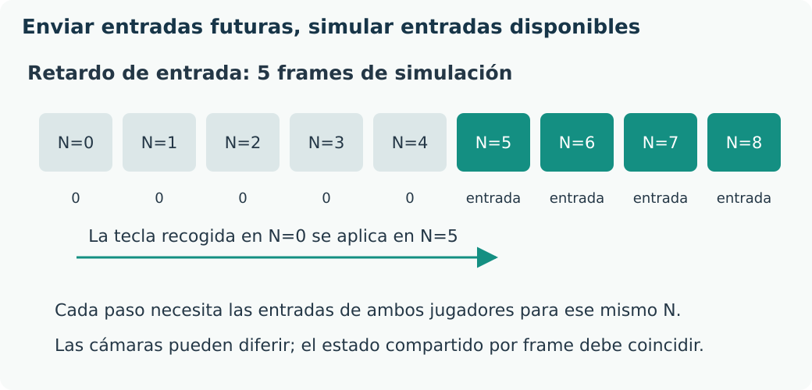

# 19. Lockstep: dos máquinas, una secuencia de decisiones

**Laboratorio:** [chap18.c](../tutorial/ch18/chap18.c), ejecutado en ambas sesiones de red. Su demostración se centra en movimiento. Los disparos, rondas y sonido del juego se integran en [31](ch31.md).




*El retardo inicial permite que los mensajes lleguen antes del frame donde se necesitan.*

## La condición matemática

Llama `S[n]` al estado antes del frame n. Llama `A[n]` y `B[n]` a las órdenes de P1 y P2 para ese frame. La simulación aplica:

```text
S[n+1] = avanzar(S[n], A[n], B[n])
```

Si los dos ordenadores empiezan con el mismo estado y ejecutan la misma operación con las mismas entradas, obtienen el mismo estado siguiente. Repitiendo el argumento, pueden simular la batalla sin intercambiar posiciones constantemente.

Para este juego es una estrategia económica. Enviar estados también es una arquitectura válida en otros juegos; necesita resolver otros problemas de autoridad, interpolación y latencia. No existe una prohibición general de enviar posiciones.

## Lo compartido debe ser determinista

Las reglas no dependen del reloj local ni de una llamada aleatoria independiente. Posiciones, balas, paredes y orden de actualización tienen que coincidir. El renderizado y la cámara podrán diferir.

Mover dos píxeles **por frame de simulación** mantiene esa regla aunque una máquina tarde más en completarlo. Las máquinas no tienen que estar en el mismo número de frame en cada instante de tiempo real; deben calcular lo mismo cuando comparas un mismo frame.

## El retardo de cinco frames

Las teclas leídas en el frame N se guardan para N+5. También las propias se aplican con ese retardo. A unos 70 fps eso añade unos 71,4 ms de demora de simulación, además de otros tiempos del sistema.

| Momento | Acción |
|---|---|
| N=100 | A lee derecha y guarda ese byte para 105 |
| 100 | A envía una ventana reciente de entradas |
| 101–104 | B puede recibir y guardar la entrada de 105 |
| 105 | Ambas simulaciones usan la entrada asociada a 105 |

Aplicar inmediatamente las órdenes propias y retrasar solo las remotas produciría dos historias distintas. El anillo local no es un adorno: evita esa asimetría.

## El anillo y sus etiquetas

Se guardan 64 posiciones. La casilla se calcula con `frame & 63`, equivalente al resto de dividir por 64 para el frame sin signo. El frame 5 y el 69 utilizan la misma casilla, en momentos distintos.

Por eso la entrada remota almacena valor, indicador de validez y **número de frame**. Leer solo el índice del array no distingue una orden vieja de la correcta.

Los primeros cinco frames se preparan con entradas cero. Así el sistema tiene un comienzo definido antes de recibir los primeros comandos futuros.

## Redundancia con límites

`net_send_input` incluye hasta ocho entradas consecutivas. Con N suficientemente avanzado envía N−2 hasta N+5. Repetir información reciente permite recuperar muchas pérdidas sin un mecanismo de petición individual.

No es entrega garantizada. El bucle de espera actual sondea y atiende sonido, pero no contiene un reenvío periódico de entradas. Si ambos extremos se atascan sin la información necesaria y dejan de avanzar, no puedes asegurar que llegará «el siguiente paquete» por sí solo. La desconexión es un resultado posible.

El mensaje lockstep mide 20 bytes en el formato esperado, no un único byte: contiene frames, campos de checksum y la ventana de entradas. El byte es el comando lógico por jugador y frame.

## El orden de un frame completo

1. Leer teclas locales y guardarlas para N+5.
2. Enviar el mensaje de entradas.
3. Esperar la entrada remota de N atendiendo red y sonido.
4. Repartir local/remoto a P1/P2 según la identidad acordada.
5. Simular P1 y P2 en orden estable, luego balas y estados de ronda.
6. Presentar el fotograma y, al terminar la vuelta, calcular y guardar el checksum del resultado antes de avanzar el contador. La [lección 20](ch20.md) detalla esa etiqueta de frame.

La pausa por explosión cambia las reglas que se ejecutan, pero no elimina la necesidad de intercambiar entradas y avanzar frames de forma coherente.

**Ejercicio:** se lee arriba en el frame 12. ¿Dónde se guarda, cuándo se usa y qué entrada propia debe usarse ahora?

**Solución:** se guarda para 17, en casilla 17 del anillo. En el frame 12 se usa la entrada local guardada para 12, no la recién leída. En la otra máquina el comando también pertenece a 17.

[Anterior](ch18.md) · [Índice](README.md) · [Siguiente: checksums](ch20.md)
