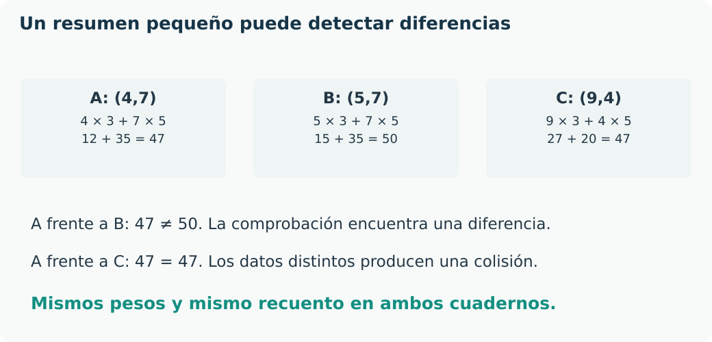
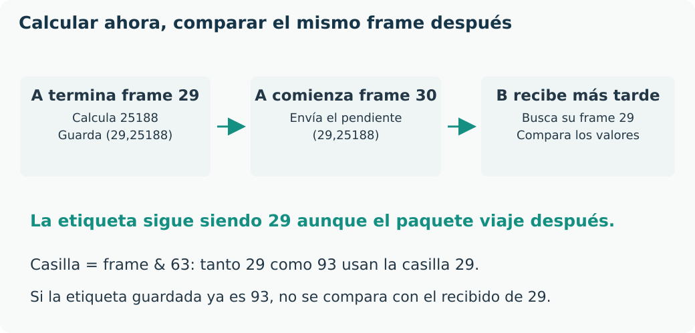

# 20A. Entender un checksum con dos cuadernos

[Abrir esta guía como PDF independiente](pdf/checksum_paso_a_paso.pdf).

Antes de hablar de IPX o de frames, vamos a comparar dos listas de fruta. Necesitamos aprender tres operaciones distintas: resumir unos datos, decidir qué datos son comparables y avisar si sus resúmenes difieren.

Esta guía prepara la [lección 20](ch20.md), donde recorreremos la fórmula y las funciones reales del juego. Puedes hacer todas las primeras cuentas con lápiz; la red aparecerá cuando ya sepamos qué queremos enviar.

## 1. Dos personas copian el mismo inventario

Ana y Bruno llevan, por separado, un cuaderno de una frutería. Al terminar un recuento deberían tener lo mismo:

```text
                 Manzanas   Peras
Cuaderno de Ana:      4        7
Cuaderno de Bruno:    4        7
```

La pareja `(4,7)` es el **estado** que queremos comparar: los datos que describen el inventario en ese momento.

Podrían leerse toda la lista. Con dos números resulta muy fácil; con cientos de datos, hacerlo continuamente cuesta más. Imaginemos que acuerdan calcular un número corto y comunicarse primero ese número.

Ese número calculado a partir de otros datos es un **checksum**, o suma de comprobación. Hay muchas maneras de construirlo. Vamos a empezar por una deliberadamente pequeña para poder seguir cada operación.

## 2. Una suma sencilla pierde información

Una primera receta sería sumar las cantidades:

```text
4 manzanas + 7 peras = 11
```

Pero `5 manzanas + 6 peras` también da 11. El total ya no nos dice cuántas piezas hay de cada fruta. Al resumir hemos perdido información.

Eso tiene dos consecuencias distintas:

- Si Ana obtiene 11 y Bruno obtiene 12 usando la misma receta, sus inventarios no pueden ser iguales.
- Si ambos obtienen 11, sus inventarios **podrían** ser iguales, pero también podrían ser `(4,7)` y `(5,6)`.

No hay contradicción. Un resumen ayuda a descubrir diferencias, pero no permite reconstruir todos los datos originales.

## 3. Dar un peso diferente a cada dato

Para distinguir mejor las columnas acordamos esta receta:

```text
checksum = manzanas * 3 + peras * 5
```

«Peso» significa aquí multiplicador. No se refiere a kilos. Las manzanas siempre usan 3 y las peras siempre usan 5, en ambos cuadernos.

Para `(4,7)`, hacemos tres cuentas:

```text
Contribución de manzanas: 4 * 3 = 12
Contribución de peras:   7 * 5 = 35
Resumen:               12 + 35 = 47
```

Si Bruno anota por error cinco manzanas, obtiene `5*3 + 7*5 = 50`. Basta comparar 47 y 50 para saber que algo difiere, suponiendo que ambos aplicaron la misma receta al mismo recuento.



*Cambiar una manzana cambia el resumen en tres unidades. También existen cambios que se compensan: igualdad de checksum no demuestra igualdad de inventario.*

## 4. Lo que sigue pudiendo coincidir

Compara `(4,7)` y `(9,4)`:

```text
Primer inventario:  4*3 + 7*5 = 12 + 35 = 47
Segundo inventario: 9*3 + 4*5 = 27 + 20 = 47
```

El segundo tiene cinco manzanas más y tres peras menos. Las manzanas añaden `5*3=15`; las peras restan `3*5=15`. Las variaciones se anulan.

Dos datos distintos que producen el mismo resumen forman una **colisión de checksum**. Aquí «colisión» no tiene relación con un tanque chocando contra una pared.

Usar pesos diferentes evita algunas coincidencias, como intercambiar simplemente las dos cantidades: `(7,4)` da `7*3+4*5=41`, distinto de 47. Pero ni usar números primos ni añadir más términos convierte esta suma en un identificador único.

| Resultado de comparar | Qué puedes concluir |
|---|---|
| Resúmenes diferentes | Hay una diferencia en los datos resumidos, si receta y momento coinciden |
| Resúmenes iguales | Esta comprobación no ha encontrado una diferencia |
| No se pudo comparar | No se ha obtenido ninguna conclusión |

La tercera fila será importante al llegar a la red. No recibir un resumen no equivale a recibir uno igual.

## 5. Cómo cabe el resultado en un número pequeño

El juego guarda el checksum en un `unsigned int` de Turbo C, de 16 bits. Puede representar 65.536 valores: desde 0 hasta 65.535.

Para imaginar el límite, piensa primero en un contador de dos cifras. Después de 99 vuelve a 00. Si parte de 94 y sumas 12, el total matemático es 106, pero el contador conserva 06.

El checksum de 16 bits funciona con una vuelta de 65.536, no de 100:

```text
65530 + 12 = 65542
65542 - 65536 = 6
```

Conservar el resto de dividir por 65.536 se llama trabajar **módulo 65.536**. Por ejemplo, 90.724 se convierte en 25.188. Aunque en un cálculo grande se den varias vueltas, ambas máquinas obtienen lo mismo si usan los mismos datos y las mismas operaciones.

Esto es comportamiento de aritmética **sin signo**. No extiendas esta explicación al desbordamiento de un `int` con signo. Tampoco supongas que `unsigned int` mide 16 bits en cualquier compilador moderno.

El número limitado introduce más coincidencias posibles: una diferencia de exactamente 65.536 en la suma tampoco cambia el resultado final.

## 6. Un ejemplo de consola completo

Este programa independiente del juego resume las cantidades de fruta. Usa un intermedio `unsigned long` y expresa el módulo de forma explícita para conservar el resultado de 16 bits también al estudiarlo en un compilador con `int` más grande.

```c
#include <stdio.h>

unsigned int checksum_pair(unsigned int apples,
                           unsigned int pears)
{
    unsigned long total;

    total = (unsigned long)apples * 3UL;
    total = total + (unsigned long)pears * 5UL;
    return (unsigned int)(total % 65536UL);
}

int main(void)
{
    unsigned int a;
    unsigned int b;
    unsigned int c;

    a = checksum_pair(4, 7);
    b = checksum_pair(5, 7);
    c = checksum_pair(9, 4);

    printf("A=%u B=%u C=%u\n", a, b, c);
    if (a != b) {
        puts("A and B differ.");
    }
    if (a == c) {
        puts("A and C match; their data may differ.");
    }
    return 0;
}
```

Su salida es:

```text
A=47 B=50 C=47
A and B differ.
A and C match; their data may differ.
```

`3UL` significa constante de tipo `unsigned long`. `%` obtiene el resto de la división. El molde `(unsigned int)` convierte el resultado final al tipo de retorno. No hace falta introducir un algoritmo distinto para entender el juego: su idea central sigue siendo multiplicar cada campo por su peso y sumar.

## 7. El momento de la comparación también es un dato

Supongamos ahora que la frutería hace recuentos numerados. En el recuento 7 hay `(4,7)`, y en el 8 llega una manzana y pasa a `(5,7)`.

| Recuento | Ana | Su resumen | Bruno | Su resumen |
|---:|---|---:|---|---:|
| 7 | `(4,7)` | 47 | `(4,7)` | 47 |
| 8 | `(5,7)` | 50 | `(5,7)` | 50 |

Bruno termina antes el recuento 8. En ese momento le llega una nota de Ana diciendo «47». Si la compara con su 50 actual, parecerá que existe un error aunque ambos cuadernos están bien.

La nota debe decir **«recuento 7: checksum 47»**. Bruno busca su resultado del recuento 7 y compara 47 con 47.

Por tanto, lo que se comunica es una pareja:

```text
(número de recuento, resumen)
```

El número del recuento no es el checksum. Sirve para elegir con qué resultado local debe compararse. En el juego ese número es el **frame de simulación**.

## 8. Guardar resultados antiguos en pocas casillas

Para poder comparar una nota retrasada, Bruno conserva algunos resultados anteriores. Supongamos una libreta con solo cuatro casillas. Decide reutilizarlas dando vueltas:

```text
casilla = resto de dividir el número de recuento entre 4
```

Los recuentos 7 y 11 usan ambos la casilla 3. Necesita guardar en cada casilla tres datos:

| Dato | Pregunta que responde |
|---|---|
| Válido | ¿Se ha escrito ya un resultado utilizable aquí? |
| Número de recuento | ¿De qué recuento es el resultado guardado? |
| Checksum | ¿Cuál fue su resumen? |

Después de guardar el recuento 11, la casilla 3 ya no contiene el del 7. Si llega una nota antigua del 7, no basta con ver que la casilla contiene un valor: hay que leer su etiqueta 11 y descartar esa comparación.

Eso es un **buffer circular** o anillo. Evita reservar memoria para todos los recuentos de toda la vida. A cambio, solo conserva una historia limitada.

En el juego hay 64 casillas. `frame & 63` selecciona la casilla usando los seis bits inferiores; para un frame sin signo equivale a `frame % 64`. La equivalencia se debe a que 64 es una potencia de dos; no se puede sustituir cualquier módulo por un AND sin pensarlo.

## 9. Por qué el juego necesita este mecanismo

Cada ordenador simula la partida completa: tiene los datos de P1 **y** P2. Por red se mandan las órdenes de los jugadores. Con el mismo estado inicial, las mismas órdenes por frame y las mismas reglas, ambas copias deberían obtener el mismo estado siguiente.

Imagina que una copia añade por error un píxel a la X de P1. La otra no lo hace. Ambas pueden seguir dibujando una batalla aparentemente normal, pero ya están contando historias diferentes. Esta separación se llama **desincronización**, o *desync*.

El checksum permite descubrir algunas de esas diferencias sin enviar todos los campos del estado. Una diferencia puede nacer en las reglas, en una inicialización, en un error de memoria o en cómo se asignaron las entradas a frames. El aviso no acusa por sí solo al cable o a IPX.

Este checksum resume **el estado calculado de la partida**. No está revisando cada byte del paquete recibido ni reconstruyendo un paquete dañado.

## 10. Del inventario a los datos del juego

| Frutería | Juego |
|---|---|
| Lista de cantidades | Posiciones, direcciones, balas, puntos y otros campos seleccionados |
| Dos cuadernos | Dos copias de la simulación |
| Misma receta para ambos | `compute_state_checksum` |
| Recuento numerado | Frame de simulación |
| Libreta circular | Arrays `local_checksum_*` de [src/lockstep.c](../src/lockstep.c) |
| Nota con número y resumen | `checksum_frame` y `checksum_value` en el mensaje |
| Aviso de discrepancia | `NET DESYNC` en el log |

En la receta real, X de P1 lleva peso 3 e Y de P1 lleva peso 5. X de P2 lleva 31 e Y de P2 lleva 37. Cada máquina usa esos mismos nombres globales: no pone «mi tanque primero» si una controla a P2.

Si únicamente X de P1 aumenta en uno, el resumen aumenta en tres, módulo 65.536. Si hubiera otros cambios al mismo tiempo, sus contribuciones también contarían. Por eso una diferencia numérica de tres orienta un experimento controlado, pero no identifica por sí sola la causa de cualquier desync.

La [lección 20 ampliada](ch20.md) contiene todos los pesos y una cuenta completa que termina en **25.188**, desde un total matemático de 90.724.

## 11. Qué ocurre durante un frame

Lee primero esta secuencia sin preocuparte de los nombres de función:

1. Las máquinas consiguen las órdenes necesarias para un frame N.
2. Cada una calcula las consecuencias en su copia de la partida.
3. Cada una calcula el resumen del estado resultante y lo guarda con etiqueta N.
4. Cuando corresponde, prepara ese resumen para viajar en un mensaje posterior.
5. La otra máquina lo compara con **su resultado guardado de N**, si todavía lo tiene.

El cálculo es local. No hace falta consultar al otro ordenador para sumar. La comunicación sirve para **comparar después** los resultados calculados por separado.

El juego calcula y guarda un checksum al final de **cada frame**, pero selecciona uno para enviar cada **30 frames**. Son frecuencias distintas. Con contador de frame iniciado en cero, la primera selección corresponde al frame 29, después al 59, luego al 89.

El envío de entradas ocurre al comienzo del bucle y el cálculo del checksum al final. Por eso el resumen seleccionado al terminar el 29 puede viajar al comenzar el 30. La etiqueta del resumen sigue siendo 29.



*La hora de llegada no cambia el frame al que pertenece el resultado. El historial permite comparar el mismo momento de simulación.*

## 12. Cuándo puede faltar una comparación

Para comparar, el receptor tiene que disponer del resultado local del frame indicado. Hay varias situaciones:

| Situación al recibir | Qué hace esta implementación |
|---|---|
| Resultado local válido y del mismo frame | Compara los valores |
| Todavía no se calculó ese frame | Descarta esa comparación; no conserva una cola completa de resúmenes adelantados |
| La casilla ya pertenece a un frame posterior | Descarta esa comparación antigua |
| El paquete no llega | No hay valor remoto que comparar |

Un envío aceptado por el controlador local tampoco demuestra que el otro ordenador lo haya recibido. No confundas la redundancia de las entradas con repetir indefinidamente un mismo checksum: en este código el checksum pendiente se borra cuando `net_send` acepta el paquete.

Con esto se entiende una limitación práctica: una partida sin avisos no demuestra que se hayan comparado todos sus frames, ni que el estado completo coincida.

## 13. Lo que un aviso hace y lo que necesitas investigar

Si los dos valores comparables difieren, se marca una desincronización. El juego registra el primer aviso y puede continuar. El checksum no elige quién tiene razón ni envía un estado corregido para reparar la partida.

Para investigar una diferencia hacen falta datos más detallados: frame, entradas aplicadas y valores de los campos en ambas máquinas. Empieza por un frame comparado donde ya difieren y busca hacia atrás hasta localizar cuándo comenzó la separación.

No compares capturas como si fueran estados. Dos cuadernos pueden llevar las mismas cantidades con distinta letra; dos copias del juego pueden llevar los mismos tanques y usar cámaras diferentes. La vista es una elección local.

## 14. Ejercicios con respuestas

Usa la receta `manzanas*3 + peras*5` para los tres primeros:

1. Compara `(6,2)` y `(6,3)`. ¿Qué detecta el checksum?
2. Encuentra una pareja distinta de `(4,7)` que también produzca 47.
3. Llega «recuento 7: 47», y tu recuento actual 8 vale 50. ¿Qué resultado buscas?
4. En un anillo de 64, ¿qué casillas usan los frames 29 y 93? ¿Pueden distinguirse?
5. Ambas cámaras difieren, pero todos los campos seleccionados por la receta del juego coinciden. ¿Debe cambiar su checksum?
6. No apareció `NET DESYNC`. ¿Qué dos motivos impiden concluir que absolutamente todo fue igual?

### Soluciones

1. Los resultados son `18+10=28` y `18+15=33`: detecta la diferencia.
2. `(9,4)` da `27+20=47`. Es la compensación de +5 manzanas y −3 peras.
3. Buscas tu resultado del recuento 7. El resultado actual del 8 no corresponde a esa nota.
4. Ambos usan casilla 29. Se distinguen por la etiqueta de frame guardada, siempre que el resultado antiguo no se haya reemplazado ya.
5. No. La cámara no forma parte de la receta de estado compartido.
6. Pueden existir diferencias que no cambien el resumen y pueden faltar comparaciones. Además, la receta real no cubre todos los campos de las estructuras.

Ahora abre [la lección 20 ampliada](ch20.md). Sigue por orden la tabla de pesos, la cuenta completa y el recorrido desde `net_set_local_checksum` hasta `net_check_remote_checksum`.

[Índice](README.md) · [Continuar: checksum en el juego](ch20.md) · [Cámara desde cero](ch25-paso-a-paso.md)
