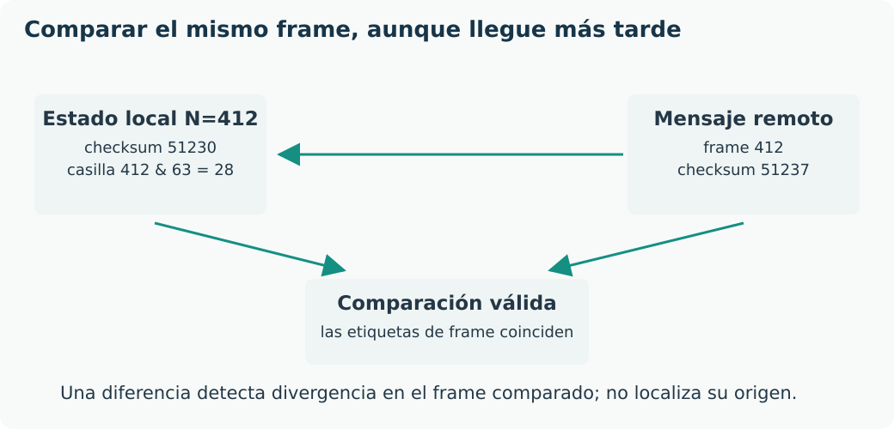

# 20. Detectar que las dos historias se separaron

**Laboratorio:** [chap19.c](../tutorial/ch19/chap19.c). D introduce una perturbación en una instancia. Sal con ESC y consulta el mensaje final y su log. No hay que pulsar D en el juego normal: es una herramienta del laboratorio.

**Empieza por [20A: checksum con dos cuadernos de fruta](ch20-paso-a-paso.md) si aún no distingues resumen, frame e historial.** Esa guía incluye un programa de consola y muestra una colisión con cuentas pequeñas. Aquí seguimos la implementación real.




*La etiqueta evita comparar un checksum nuevo con otro antiguo que ocupa la misma casilla del anillo.*

## Un resumen, no una copia del estado

Un checksum transforma varios datos en un número pequeño. En el juego es un `unsigned int` de 16 bits, calculado mediante sumas ponderadas. Si intercambias X e Y, usar pesos distintos evita algunas coincidencias triviales:

```text
(100,50): 100*3 + 50*5 = 550
(50,100):  50*3 +100*5 = 650
```

Eso no convierte el resumen en único. Por ejemplo, aumentar X en 5 y reducir Y en 3 conserva `3*X + 5*Y`. Los números primos tampoco eliminan estas colisiones. El checksum es una herramienta de diagnóstico económica, no una prueba exhaustiva de igualdad.

## Qué se incluye

`compute_state_checksum` en [main.c](../src/main.c) incorpora posiciones, direcciones, balas, victorias, indicadores de explosión, contador de pausa, dimensiones del mundo y nivel. No incluye todos los campos de `struct player`: hay datos derivados, visuales y también estado no cubierto por este resumen.

La cámara y el tema no entran. Una máquina puede seguir a P1 con aspecto militar y otra a P2 con aspecto neón. La partida compartida sigue siendo la misma si las paredes coinciden.

No compruebes las estructuras como bloques crudos: contienen punteros cuyas direcciones pueden ser distintas aun con datos equivalentes. La igualdad que necesitas es semántica, no igualdad de dónde se reservaron los sprites.

## Una cuenta completa con la receta del juego

Abre `compute_state_checksum` en [src/main.c](../src/main.c). Inicializa el acumulador a cero, añade nueve términos de P1, nueve de P2 y cuatro globales: **22 términos**. En esta tabla, cada nombre de campo corresponde al miembro de `player1` o `player2`.

Los valores del ejemplo son inventados para seguir las cuentas; no son una captura de una partida ni aseguran posiciones libres en un nivel concreto. Derecha vale 4 e izquierda vale 3 según [header/players.h](../header/players.h).

| Campo | P1: valor × peso = contribución | P2: valor × peso = contribución |
|---|---|---|
| `position_x` | 100 × 3 = 300 | 200 × 31 = 6200 |
| `position_y` | 50 × 5 = 250 | 80 × 37 = 2960 |
| `current_direction` | 4 × 7 = 28 | 3 × 41 = 123 |
| `bullet_position_x` | 120 × 11 = 1320 | 0 × 43 = 0 |
| `bullet_position_y` | 55 × 13 = 715 | 0 × 47 = 0 |
| `bullet_is_flying` | 1 × 17 = 17 | 0 × 53 = 0 |
| `bullet_direction` | 4 × 19 = 76 | 1 × 59 = 59 |
| `wins` | 2 × 23 = 46 | 1 × 61 = 61 |
| `is_exploding` | 0 × 29 = 0 | 0 × 67 = 0 |
| **Subtotal** | **2752** | **9403** |

La dirección de la bala de P2 aporta 59 aunque su indicador de vuelo sea cero: la receta no condiciona esos términos a que la bala esté activa. Debes inicializar y actualizar los campos de forma coherente en ambas máquinas, incluidos los que no se dibujan en ese momento.

Añadimos los términos globales:

| Dato | Valor × peso | Contribución |
|---|---|---:|
| `explosion_pause_counter` | 0 × 71 | 0 |
| `map_width` | 640 × 73 | 46720 |
| `map_height` | 400 × 79 | 31600 |
| `map_level` | 3 × 83 | 249 |

```text
Suma matemática = 2752 + 9403 + 0 + 46720 + 31600 + 249
                = 90724
Resultado de 16 bits = 90724 - 65536 = 25188
```

En Turbo C, el acumulador `unsigned int` conserva un resultado módulo 65.536. La suma puede dar la vuelta durante los pasos intermedios; aquí sumamos primero en papel para que se vea el total y aplicamos el módulo al final. Para esta receta da el mismo resultado.

Si solo P1 pasa de X=100 a X=101, la contribución 300 se convierte en 303 y el checksum queda en **25191**. La cámara podría variar a la vez sin añadir ningún término al checksum.

### Tener la misma receta incluye asignar los mismos papeles

P1 debe usar los pesos de P1 en **ambas** máquinas. La máquina que controla P2 no cambia el orden para poner su jugador local en el primer grupo. La identidad local decide qué entradas controla y qué cámara sigue; no renombra el estado compartido.

Tampoco basta con incluir dimensiones y nivel para comprobar cada pared: se comprueban esos identificadores, no los 32.000 bytes de la máscara. Dos recursos alterados que conservasen tamaño y número de nivel podrían superar esos términos de la comprobación.

## Comparar el mismo frame

Un checksum remoto llega después de enviarse. Debe compararse con el resultado local del **frame indicado en el paquete**, no con el resultado del frame que se está dibujando en ese momento.

El código guarda checksums locales en un anillo de 64, con su frame y validez. Si la casilla no corresponde al frame recibido, descarta la comparación. También puede llegar uno demasiado pronto, antes de que exista el resultado local; la implementación no guarda una cola completa de esos checksums adelantados.

Esto limita lo que demuestra una ejecución sin avisos. La comparación periódica ocurre cada 30 frames, pero pérdidas o descartes pueden retrasar o impedir la detección.

## El recorrido real: calcular, guardar, enviar y recibir

Estas tareas viven en lugares diferentes. `compute_state_checksum` conoce el juego; [src/lockstep.c](../src/lockstep.c) transporta y compara el número sin conocer qué es un tanque.

### 1. Calcular después de terminar el frame

Al final del bucle de `main.c`, después de aplicar las reglas y de la presentación correspondiente, el modo red ejecuta:

```c
net_set_local_checksum(compute_state_checksum());
net_advance_frame();
```

El orden importa. Primero se resume y se etiqueta el resultado del frame actual; después se incrementa `simulation_frame`. Si adelantas el contador, el resumen queda asociado al número equivocado.

En la notación de la [lección 19](ch19.md), el estado previo al frame N es `S[N]` y el resultado es `S[N+1]`. El checksum de **ese resultado** se etiqueta aquí como frame N: «resultado de ejecutar N». Comparar antes de simular en un equipo y después en el otro produciría diferencias sin que se hubiera ejecutado una regla distinta.

### 2. Guardar cada resultado y seleccionar uno de cada treinta

`net_set_local_checksum` calcula `index = simulation_frame & 63` y escribe tres arrays en esa casilla: `local_checksum_frame`, `local_checksum_value` y `local_checksum_valid`.

Lo hace **cada frame**, aunque no vaya a enviar ese checksum. Después reduce `checksum_countdown`, que empezó en 30. Cuando llega a cero, guarda una copia en `pending_checksum_frame` y `pending_checksum_value`, marca `pending_checksum_ready` y reinicia el contador a 30.

| Al terminar el frame | Contador después de restar | Resultado |
|---:|---:|---|
| 0 | 29 | Guarda el local |
| 28 | 1 | Guarda el local |
| 29 | 0; se reinicia a 30 | Guarda el local y selecciona el de 29 para enviar |
| 30 | 29 | Guarda el local de 30 |
| 59 | 0; se reinicia a 30 | Selecciona el de 59 |

Por eso «cada 30 frames» no significa «solo calcula el checksum en frames múltiplos de 30».

### 3. Enviar lo que quedó pendiente

Al comienzo de una vuelta posterior, `net_send_input` prepara su mensaje de entradas. Si hay checksum pendiente, activa `has_checksum` y copia los campos `checksum_frame` y `checksum_value`.

Por ejemplo, al comenzar el frame 30 puede enviar el checksum **del 29**. El mensaje también contiene entradas para otros frames, identificadas desde `base_frame`. Esos dos números tienen responsabilidades distintas; el frame del checksum no se deduce del de las entradas.

Si `net_send` devuelve 1, se limpia `pending_checksum_ready`. Si no acepta el envío, el valor queda pendiente para otro intento. Ese estado contiene un único resumen, no una lista: otra selección periódica puede reemplazarlo. La aceptación local tampoco confirma entrega remota; no hay un acuse específico que garantice esa comparación.

### 4. Buscar el resultado local adecuado al recibir

`net_handle_message` entrega los campos recibidos a `net_check_remote_checksum` si `has_checksum == 1`. El comparador hace estas preguntas en orden:

```text
1. ¿Es válida la casilla frame & 63?
   Si no: no hay resultado local utilizable; salir.
2. ¿Su etiqueta de frame coincide con el recibido?
   Si no: no representa el mismo momento; salir.
3. ¿Los checksums son iguales?
   Si sí: esta comparación no encuentra una diferencia; salir.
4. Son distintos: registrar el primer aviso y activar desync_detected.
```

Para recibir `(29,25188)`, la casilla es 29. Si conserva `(válido=1, frame=29, valor=25188)`, la comparación coincide. Si conserva frame 29 y valor 25191, detecta la discrepancia.

Al guardar el frame 93 se reutiliza esa misma casilla, porque `93 & 63 = 29`. Una llegada posterior del checksum de 29 se descarta por la etiqueta, aunque el valor numérico de la casilla por casualidad coincida.

## Interpretar un aviso sin inventar precisión

```text
NET DESYNC at frame 59: mine 25188 theirs 25191
```

Significa que en el frame comparado los resúmenes difieren. El primer error pudo ocurrir antes. La línea no identifica por sí sola el campo incorrecto ni demuestra que la red sea la causa.

El aviso es un ejemplo con los números anteriores, no una salida obtenida al ejecutar DOS. `mine` significa resultado local; `theirs`, resultado remoto. No significa «correcto» y «erróneo». Con la misma receta y el mismo punto del frame, al menos uno de los campos cubiertos difiere.

El flag queda activo y el comparador registra solo el primer desync detectado. Una comparación posterior igual no lo borra. El juego no repara el estado desde este mecanismo ni termina automáticamente por ese flag; al salir puede mostrar el aviso de que las máquinas perdieron el paso.

Para investigar, registra en ambas máquinas una selección de estado y entradas con su número de frame. Empieza por el último punto conocido donde coincidían y reduce el intervalo. No uses la posición de pantalla del tanque como comparación: depende de la cámara.

## Práctica

En el laboratorio, mueve ambos tanques, pulsa D en una sola instancia y observa la notificación. La perturbación cambia P1 en esa copia, aunque el jugador local pueda ser P2. Repite sin pulsarla como caso de control.

En `tutorial/ch19/chap19.c`, D suma exactamente uno a `player1.position_x`, una sola vez por ejecución. Su checksum es más pequeño que el de `main.c`: solo incluye X, Y y dirección de cada jugador. Si comparas justo el cambio aislado, añade 3 al resumen módulo 65.536. En una comprobación posterior, otros efectos de esa diferencia pueden haber cambiado más campos; no exijas que cualquier aviso conserve exactamente esa distancia de tres.

Pulsar D «a la vez» en ambos teclados no garantiza el mismo frame. Si quieres un experimento de cambios iguales, programa una perturbación para un número de frame compartido en una copia del ejercicio.

**Ejercicio:** las cámaras valen 10 y 300, pero ambas máquinas tienen P1 en `(400,200)`. ¿Son distintas las simulaciones? ¿Deben coincidir sus capturas?

**Solución:** ese dato de simulación coincide. P1 aparecerá en X=390 y X=100 respectivamente, por lo que las capturas pueden diferir. La cámara es el siguiente gran bloque del curso.

[Anterior](ch19.md) · [Índice](README.md) · [Siguiente: mundo y pantalla](ch21.md)
