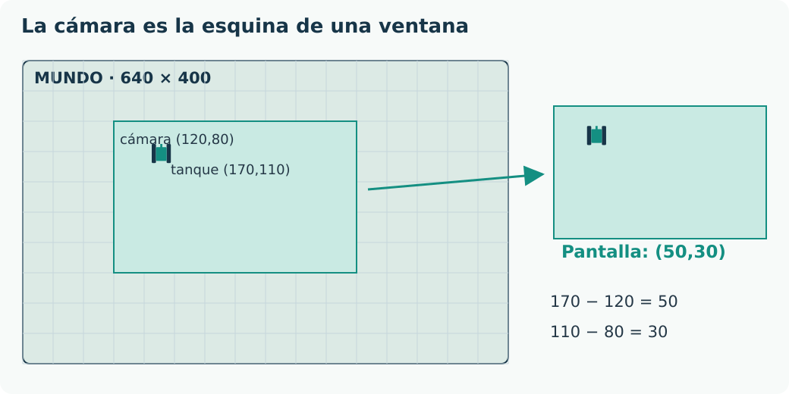

# 21. Un mundo que no cabe en la pantalla

**Vas a construir:** una separación clara entre dónde están las cosas y desde dónde las miras. **Laboratorio:** [chap20.c](../tutorial/ch20/chap20.c), que usa un mapa grande y una ventana fija; su tanque empieza en `(128,90)`.




*Los objetos conservan sus coordenadas de mundo. La resta de cámara solo calcula dónde dibujarlos.*

## La cámara es una esquina

Imagina un dibujo de 640 × 400 sobre una mesa. Colocas encima un cartón con un agujero de 320 × 200. Mover el cartón cambia lo que ves, pero no mueve los objetos del dibujo.

En este motor, la cámara guarda la coordenada **del píxel del mundo que aparece en la esquina superior izquierda de la pantalla**. No guarda el centro, ni la posición del tanque.

```text
Mundo: 640 columnas, 400 filas
(0,0) +---------------------------------------+
      |                                       |
      |         cámara (120,80)                |
      |         +-------------------+         |
      |         | tanque (170,110)  |         |
      |         |                   |         |
      |         +-------------------+         |
      |             ventana 320x200           |
      +---------------------------------------+ (639,399)
```

Las coordenadas empiezan en cero. X crece hacia la derecha, Y hacia abajo. El mundo contiene X de 0 a 639; decir «anchura 640» no convierte 640 en una columna válida.

## Dos operaciones inversas

```text
screen_x = world_x - camera_x
screen_y = world_y - camera_y

world_x = screen_x + camera_x
world_y = screen_y + camera_y
```

Con cámara `(120,80)` y tanque `(170,110)`, dibujas el tanque en `(50,30)`. Si avanzas la cámara a `(122,80)` y dejas quieto el tanque, aparece en `(48,30)`: el paisaje se desplaza hacia la izquierda.

| Objeto del mundo | Posición con cámara `(120,80)` | Consecuencia |
|---|---|---|
| Tanque `(170,110)` | `(50,30)` | Se ve entero si mide 18 × 18 |
| Bala `(118,100)` | `(-2,20)` | Puede verse una parte; necesita recorte |
| Enemigo `(500,300)` | `(380,220)` | No se dibuja, pero sigue simulándose |
| Píxel `(439,279)` | `(319,199)` | Último píxel de la ventana |
| Píxel `(440,279)` | `(320,199)` | Ya está fuera |

Los resultados negativos son información útil. No los conviertas a `unsigned int`: `-2` pasaría a 65534 en este entorno.

## Qué datos pertenecen a cada espacio

Posiciones de tanques, balas, explosiones y consultas de paredes usan **mundo**. La cámara se resta únicamente al dibujar esos objetos. Un radar o marcador fijo usa **pantalla** y conserva sus coordenadas cuando miras otra zona.

No mantengas dos posiciones independientes para cada tanque. Conserva la de mundo como verdad y calcula la de pantalla cuando la necesites. Dos copias editables terminarían contradiciéndose.

```text
entrada → movimiento en mundo → colisiones en mundo
                             ↓
                    actualizar cámara
                             ↓
              fondo visible + objetos transformados
                             ↓
                    HUD en pantalla
```

Una bala fuera de la ventana puede impactar en un enemigo. Si dejas de actualizar lo que no ves, cada ordenador resolvería una partida distinta al usar cámaras diferentes.

## Del mapa pequeño al grande

Para un mundo 320 × 200, la cámara solo puede ser `(0,0)`. Las fórmulas siguen funcionando: pantalla y mundo coinciden. Ese es un caso útil de la solución general.

Para 640 × 400, el límite de la esquina es `(320,200)`: al llegar ahí, la ventana acaba exactamente en `(639,399)`. No puedes colocar la cámara en `(639,399)`, porque todavía necesitas espacio para las otras 319 columnas y 199 filas.

## Práctica y solución

En una hoja, coloca cámara `(300,190)`, P1 `(310,210)` y P2 `(290,180)`, ambos de 18 × 18. Dibuja sus rectángulos con los límites finales excluidos.

**Solución:** P1 empieza en `(10,20)` y ocupa `[10,28) × [20,38)`. P2 empieza en `(-10,-10)` y solo quedan visibles sus últimas 8 columnas y 8 filas: `[0,8) × [0,8)`. La posición de P2 continúa siendo `(290,180)`.

**Comprueba que lo entendiste:** mueve la cámara 4 píxeles a la derecha sin tocar los tanques. Ambos dibujos deben moverse 4 a la izquierda y todas las consultas de colisión deben devolver lo mismo.

[Anterior](ch20.md) · [Índice](README.md) · [Siguiente: la ventana en memoria](ch22.md)
