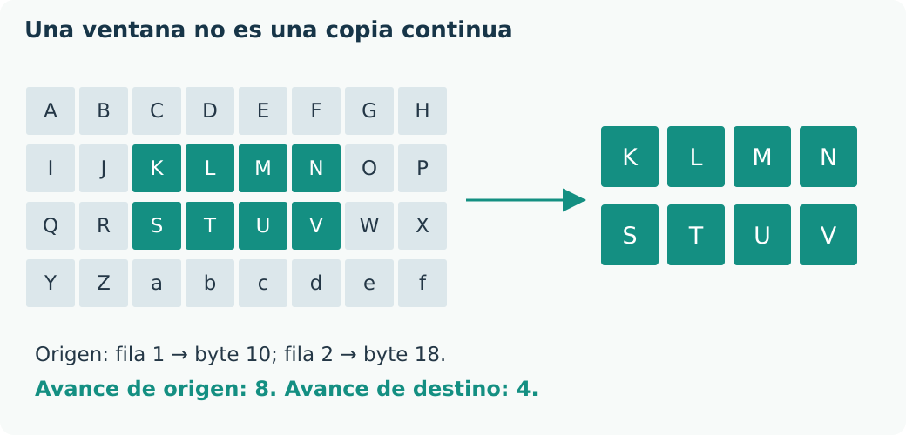

# 22. Copiar una ventana: el secreto es el salto de fila

**Vas a construir:** `bmp_draw_world_window`, entendiendo cada dirección que utiliza. **Laboratorio:** [chap21.c](../tutorial/ch21/chap21.c). Las flechas desplazan la cámara; Shift acelera el paso de 4 a 32. El tanque del ejercicio está fijo en `(228,140)`.




*La siguiente fila visible empieza después del stride del mapa, no después de la anchura copiada.*

## Stride significa cuánto avanzas para bajar una fila

Una imagen es un array lineal. En un mapa de anchura 640:

```text
offset(x,y) = y * 640 + x
```

En el buffer de pantalla:

```text
offset(x,y) = y * 320 + x
```

Los dos contienen píxeles de un byte, pero bajar una fila cuesta un número de bytes distinto. Ese salto se llama **stride**. Aquí coincide con la anchura porque los arrays internos no tienen relleno entre filas.

## Primero con un mundo diminuto

Supón un mapa de 8 × 4 y una ventana de 4 × 2 situada en `(2,1)`:

```text
Mapa almacenado:                 Ventana deseada:
A B C D E F G H                  K L M N
I J K L M N O P                  S T U V
Q R S T U V W X
Y Z a b c d e f

fila 0: origen 1*8+2 = 10 → destino 0
fila 1: origen 2*8+2 = 18 → destino 4
```

Una copia continua de 8 bytes desde K daría `K L M N O P Q R`. Tras N necesitas saltarte O, P, Q y R para alcanzar S. La solución es copiar por filas.

## Deducir el bucle real

Fragmento equivalente a la operación central de [bmp.c](../src/bmp.c); utiliza sus variables globales y no es un programa independiente:

```c
int row;
unsigned int destination_offset;
unsigned char huge *source;

destination_offset = 0;
for (row = 0; row < HEIGHT; row++) {
    source = buffer_original_background_bmp
           + (unsigned long)(camera_y + row) * (unsigned long)map_width
           + (unsigned long)camera_x;
    memcpy(destination + destination_offset, source, WIDTH);
    destination_offset = destination_offset + WIDTH;
}
```

La fila de mundo es `camera_y + row`. La columna inicial es `camera_x`. El destino empieza cada vez 320 bytes después; el origen, 640 en el mapa grande.

Se copian siempre `200 * 320 = 64000` bytes de píxeles. Tener cuatro veces más mundo aumenta el almacenamiento, pero no cuadruplica los píxeles presentados. Sí añade 200 llamadas y sus cálculos; no equivale a afirmar que tarda lo mismo que un único `memcpy`.

## Un recorrido que puedes auditar

Para cámara `(120,80)`:

| Fila de pantalla | Fila del mundo | Primer byte origen | Último byte origen | Primer byte destino |
|---|---|---|---|---|
| 0 | 80 | 51320 | 51639 | 0 |
| 1 | 81 | 51960 | 52279 | 320 |
| 199 | 279 | 178680 | 178999 | 63680 |

La última escritura es `63680 + 319 = 63999`. La última fila no empieza en 64000: ese es el tamaño total y la primera dirección fuera del buffer.

En la esquina inferior derecha, cámara `(320,200)`, el último origen es:

```text
(200+199)*640 + 320 + 319 = 255999
```

Es exactamente `640*400-1`. Este cálculo demuestra el límite para esas dimensiones sin depender de que una captura «parezca correcta».

## El contrato que el bucle necesita

- Mapa cargado y destino con al menos 64000 bytes.
- Anchura del mapa de al menos 320 y altura de al menos 200.
- `0 <= camera_x <= map_width-320` y lo mismo para Y con 200.
- Cálculo del offset en 32 bits antes de multiplicar.

La función real comprueba que exista el mapa, pero no valida todo este contrato en cada llamada. El resto de la inicialización debe cumplirlo.

Un mapa de 200 × 100 no queda soportado por poner la cámara a cero. Habría que copiar solo la intersección y rellenar el resto de la pantalla. Distingue un mapa exactamente del tamaño de pantalla de otro menor.

## Práctica

Haz en tu copia un patrón donde cada fila tenga un color distinto y cada 16 columnas haya una línea. Desplaza X y después Y. Si al mover X aparecen diagonales, inspecciona stride y offset BMP; si falla al bajar a determinadas filas, inspecciona el tamaño del cálculo y el tipo de puntero.

**Ejercicio:** cámara `(320,200)`, píxel de pantalla `(17,9)`. Calcula el offset de origen y el de destino.

**Solución:** mundo `(337,209)`, origen `209*640+337 = 134097`; destino `9*320+17 = 2897`.

[Anterior](ch21.md) · [Índice](README.md) · [Siguiente: memoria segmentada](ch23.md)
