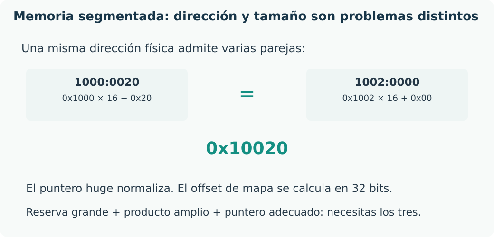

# 23. Guardar un mapa mayor de 64 KB

**Vas a comprender:** por qué una fórmula correcta puede fallar por el tipo numérico o por el puntero. **Fuentes:** [bmp_init_buffers y cargadores](../src/bmp.c), [tipos públicos](../header/bmp.h) y [chap23.c](../tutorial/ch23/chap23.c).




*Ampliar un resultado después de una multiplicación de 16 bits desbordada no la repara.*

## Tres problemas distintos

1. **Cuánto reservar:** el mapa necesita 256000 bytes.
2. **Cómo calcular una posición:** `399*640+639` necesita representar 255999.
3. **Cómo llegar a esa posición:** el puntero debe atravesar segmentos correctamente.

Resolver solo uno deja los otros dos pendientes. Una variable `long` no convierte un puntero `far` en `huge`; un puntero `huge` no arregla una multiplicación que ya se desbordó.

## El tipo del resultado no salva la operación anterior

En Turbo C, `int` tiene 16 bits y `long` tiene 32. Este fragmento explica el fallo; no lo copies como solución:

```c
int width;
int height;
unsigned long bytes;

width = 640;
height = 400;
bytes = width * height;
```

La multiplicación se evalúa con operandos `int`. Su resultado matemático excede 32767; el desbordamiento con signo no tiene un resultado válido garantizado por C. Asignarlo después a `unsigned long` llega tarde.

La operación que necesitas es:

```c
bytes = (unsigned long)width * (unsigned long)height;
```

El mismo principio se aplica al offset de cada fila. Convertir el resultado de `y*width` es demasiado tarde; convierte antes uno o ambos operandos.

## Segmento y desplazamiento

En modo real, una dirección física se obtiene como:

```text
dirección física = segmento * 16 + desplazamiento
```

`1000:0020` y `1002:0000` señalan el mismo byte físico, `0x10020`. El segmento es una base en unidades de 16 bytes y el desplazamiento tiene 16 bits.

| Tipo de puntero | Idea relevante para este proyecto |
|---|---|
| `near` | Desplazamiento dentro de un segmento implícito |
| `far` | Segmento y desplazamiento; su aritmética no ofrece recorrido general de arrays mayores de 64 KB |
| `huge` | Aritmética normalizada para recorrer objetos grandes atravesando segmentos |

El modelo `-mh` y las extensiones de Borland forman parte del entorno: este código no es C portable a cualquier compilador sin adaptaciones.

En una dirección huge normalizada, el desplazamiento queda pequeño. La rutina de ventana reconstruye el origen desde la base en cada fila y copia 320 bytes. Así evita empezar una copia cerca del final del segmento. **También la aritmética de un auténtico puntero `huge` normaliza al incrementarlo**; no es cierto que todo `source += map_width` vaya a fallar inevitablemente. El tipo y las conversiones importan.

## Reservar y liberar con la pareja correcta

Fragmento didáctico de reserva, usando `<alloc.h>`:

```c
unsigned char huge *world;
unsigned long bytes;

bytes = 640UL * 400UL;
world = (unsigned char huge *)farmalloc(bytes);
if (world == NULL) {
    /* Report the error and leave before drawing. */
    return;
}
/* Use the world here. */
farfree(world);
world = NULL;
```

`malloc` recibe un `size_t` de 16 bits en este entorno: no puedes pedirle 256000 bytes en una llamada. `farmalloc` permite expresar esa petición. Ambos compiten por memoria disponible; no son dos reservas infinitas e independientes.

## Presupuesto: suma y también contigüidad

| Recurso | Mapa 320 × 200 | Mapa 640 × 400 |
|---|---:|---:|
| Imagen del mundo | 64000 | 256000 |
| Máscara de un bit | 8000 | 32000 |
| Buffer de pantalla | 64000 | 64000 |
| Subtotal | 136000 | 352000 |

Faltan paletas, sprites, código, pila, estructuras de red, DMA y audio. Los cuatro efectos WAV actuales suman **180731 bytes de datos** a su frecuencia actual. La música principal ocupa 2719744 bytes de datos en disco y se lee con un buffer de 16384 bytes; no se reserva entera.

Tener 270000 bytes libres repartidos en dos huecos de 135000 no permite reservar un bloque continuo de 256000. Por eso importa la vida útil de los recursos. La intro libera sus buffers antes de que empiece la carga del juego, y la hoja de sprites se lee por filas en lugar de conservar otra imagen completa.

No confundas una recomendación de reservar primero lo grande con una descripción exacta de `main.c`: el juego llama a `init_players()` antes de `init_graphics()`. Para estudiar el orden real sigue la [lección 29](ch29.md).

## Práctica y solución

**Ejercicio:** ¿qué falla en `farmalloc((unsigned long)(640 * 400))` si esos literales se operan como `int` de 16 bits? ¿Cuánto ahorra la máscara respecto a una imagen de colisión de un byte por píxel?

**Solución:** el cast llega después del producto; escribe `640UL * 400UL`. La máscara ocupa 32000 frente a 256000, ahorro de 224000 bytes: 87,5 %. En la siguiente parte aprenderás a recuperar cada uno de esos bits.

[Anterior](ch22.md) · [Índice](README.md) · [Siguiente: recorte](ch24.md)
