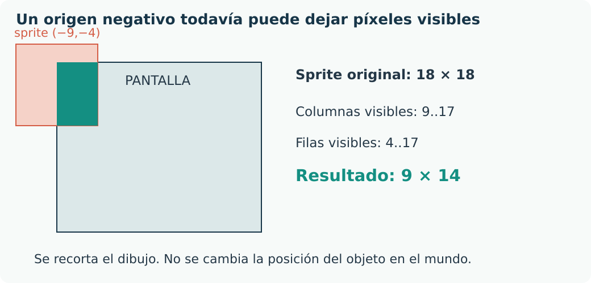

# 24. Dibujar medio tanque sin escribir fuera de la pantalla

**Vas a construir:** un recorte rectangular con coordenadas con signo. **Fuente:** las rutinas de sprites de [bmp.c](../src/bmp.c). Repasa antes [transparencia](ch07.md) y [coordenadas](ch21.md).




*La intersección conserva 126 píxeles geométricos, antes de descartar los transparentes.*

## Rechazar y recortar son decisiones diferentes

Un tanque de 18 × 18 con esquina X=-9 sigue teniendo 9 columnas visibles. Rechazar cualquier posición negativa lo haría desaparecer de golpe al llegar al borde. Dibujarlo entero escribiría antes del buffer.

El dibujo debe hallar la intersección de dos rectángulos: sprite y pantalla. Usaremos límites finales **excluidos**: `[0,320)` contiene 320 columnas, de 0 a 319. Esta convención hace que `fin-inicio` sea directamente la cantidad de píxeles.

## Calcular qué parte del sprite se conserva

Llama `dx,dy` a la esquina de destino y `w,h` a sus dimensiones. Las coordenadas locales dentro del sprite empiezan en cero.

```text
start_x = max(0, -dx)
start_y = max(0, -dy)
end_x   = min(w, 320-dx)
end_y   = min(h, 200-dy)
```

Si `start_x >= end_x` o `start_y >= end_y`, no hay píxeles visibles. Antes puedes rechazar casos completamente exteriores: `dx >= 320`, `dy >= 200`, `dx+w <= 0` o `dy+h <= 0`.

Las dimensiones y posiciones del juego caben holgadamente en `int`; una biblioteca para entradas arbitrariamente grandes tendría que evitar también el desbordamiento de `dx+w`.

## Un ejemplo en la esquina superior izquierda

Sprite 18 × 18, destino `(-9,-4)`:

```text
start_x = 9     end_x = 18     ancho visible = 9
start_y = 4     end_y = 18     alto visible = 14
primer origen  = 4*18 + 9 = 81
primer destino = (−4+4)*320 + (−9+9) = 0
```

El primer píxel visible no es el primero del sprite. Es su columna 9 y su fila 4. Ese detalle distingue recortar de mover el sprite hasta que quepa.

En la esquina contraria, destino `(315,198)`, sobreviven 5 columnas y 2 filas. El primer destino es 63675 y el último es 63999.

## Del cálculo al bucle

Fragmento para un sprite pequeño como los del juego; `start_*` y `end_*` ya se calcularon y validaron:

```c
int x;
int y;
unsigned int source_offset;
unsigned int destination_offset;
unsigned char color;

for (y = start_y; y < end_y; y++) {
    source_offset = (unsigned int)(y * sprite_width + start_x);
    destination_offset = (unsigned int)(dy + y) * WIDTH
                       + (unsigned int)(dx + start_x);
    for (x = start_x; x < end_x; x++) {
        color = sprite[source_offset];
        if (color != 0) {
            destination[destination_offset] = color;
        }
        source_offset++;
        destination_offset++;
    }
}
```

La conversión del destino a unsigned ocurre **después de demostrar que las coordenadas son válidas y antes del producto que puede superar 32767**. Así representa hasta 63999 sin un producto con signo de 16 bits.

El ejemplo supone sprites pequeños; el cálculo de origen debe ampliarse si rediseñas la rutina para imágenes mayores.

## Transparencia y silueta

El índice 0 del **origen** significa «no escribir». Para dibujar el contorno del radar, la variante de silueta escribe un color fijo —también puede ser 0— donde el origen no es transparente. Son dos decisiones distintas: que 0 no dibuje como origen no impide escribir negro en el destino.

## Tabla mínima de comprobación

| Esquina, sprite 18 × 18 | Resultado geométrico antes de transparencia |
|---|---|
| `(0,0)` | 18 × 18 |
| `(-17,0)` | 1 × 18 |
| `(-18,0)` | Nada |
| `(319,199)` | 1 × 1 |
| `(320,0)` | Nada |
| `(0,200)` | Nada |
| `(-9,-4)` | 9 × 14 |

**Ejercicio:** un sprite de 4 × 3 en `(-2,199)`. Calcula región local y primera dirección de destino.

**Solución:** columnas locales `[2,4)`, filas `[0,1)`, dos píxeles posibles. Destino `199*320 = 63680`. El último es 63681; no se llega a una fila 200.

[Anterior](ch23.md) · [Índice](README.md) · [Siguiente: cámara con zona muerta](ch25.md)
