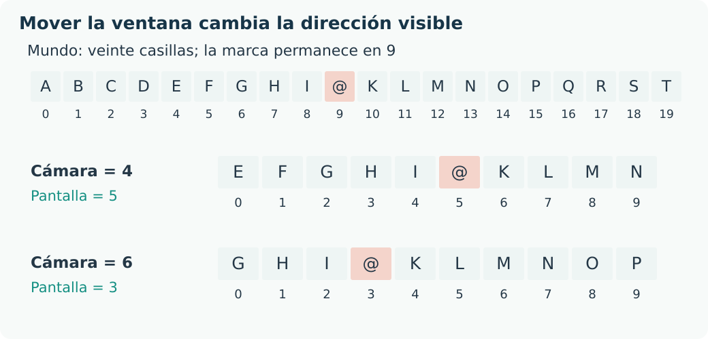
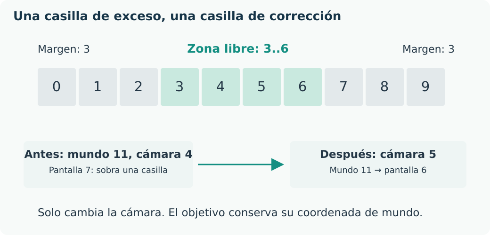

# 25A. Entender la cámara con una tira de papel

[Abrir esta guía como PDF independiente](pdf/camara_paso_a_paso.pdf).

Esta guía es una entrada más pausada a la [lección 25](ch25.md). Empieza sin tanques, sin VGA y sin redes: una fila de letras y una ventana de cartón bastan para entender el algoritmo. Después cambiaremos los tamaños y los nombres hasta reconocer el juego.

Trabaja en tres sesiones si lo necesitas: primero la ventana y la resta; después el seguimiento; finalmente la conexión con el código. No necesitas memorizar las fórmulas antes de entender qué cuenta cada una.

## 1. Un mundo de veinte casillas

Escribe veinte letras en una tira. Numera las casillas **desde cero**:

```text
Coordenada:  0  1  2  3  4  5  6  7  8  9
Letra:      A  B  C  D  E  F  G  H  I  J

Coordenada: 10 11 12 13 14 15 16 17 18 19
Letra:      K  L  M  N  O  P  Q  R  S  T
```

Es una sola fila; la hemos partido aquí para que quepa. La anchura es 20, pero la última coordenada es 19. La anchura cuenta **cuántas casillas hay**; la coordenada identifica **una de ellas**.

Ahora recorta una ventana que deje ver exactamente diez casillas seguidas. Si la apoyas al principio, verás `ABCDEFGHIJ`. Si la desplazas cuatro casillas a la derecha, verás `EFGHIJKLMN`.

La tira es el **mundo**. El agujero del cartón es la **pantalla**. La **cámara** guarda dónde empieza la ventana dentro del mundo. Con la segunda colocación, `camera_x = 4`, porque E ocupa la casilla 4.

La cámara no necesita almacenar otras diez letras. Con un número y la anchura de ventana ya sabemos qué parte de la tira mostrar.

## 2. La misma casilla tiene dos direcciones

Pon una marca `@` encima de la J. Su posición en el mundo es 9. No muevas esa marca durante este apartado.

Con la ventana empezando en 4, ves:

```text
Casilla de pantalla:  0 1 2 3 4 5 6 7 8 9
Contenido visible:   E F G H I @ K L M N
```

La marca está en el mundo en 9 y en la pantalla en 5. No son dos marcas ni dos posiciones físicas distintas: son dos maneras de indicar dónde está la misma marca.

La pantalla empieza a contar desde la primera casilla del agujero. Para saber cuántas casillas separan el comienzo de la ventana y la marca, restamos:

```text
posición en pantalla = posición en mundo - comienzo de ventana
                     = 9 - 4
                     = 5
```

En el código, esos nombres suelen ser `screen_x`, `world_x` y `camera_x`:

```c
screen_x = world_x - camera_x;
```



*La marca sigue en la casilla 9 del mundo. Cambiar la ventana de 4 a 6 cambia su posición visible de 5 a 3.*

## 3. Por qué el paisaje parece moverse al revés

Desplaza solamente el cartón: ahora empieza en la casilla 6. Se ve `GHI@KLMNOP` y la marca aparece en `9 - 6 = 3`.

La cámara avanzó dos casillas a la derecha. La marca se desplazó dos casillas **hacia la izquierda en la imagen**, aunque permaneció en el mismo lugar del papel. Eso explica el desplazamiento aparente del paisaje cuando una cámara sigue a un personaje.

Compara tres experimentos independientes. Todos parten de marca 9, cámara 4 y posición visible 5:

| Qué cambias | Mundo de la marca | Cámara | Pantalla de la marca |
|---|---:|---:|---:|
| Solo mueves la marca dos casillas | 11 | 4 | 7 |
| Solo mueves la ventana dos casillas | 9 | 6 | 3 |
| Mueves ambas dos casillas | 11 | 6 | 5 |

En la tercera fila la marca parece quieta en pantalla, pero sí se ha movido por el mundo. La ventana la ha acompañado exactamente lo mismo.

**Detente y predice:** marca en 13 y cámara en 6. ¿Qué casilla ocupa en pantalla? Es 7. Si te sale 19, has sumado las coordenadas en el sentido equivocado.

## 4. Cuándo algo queda fuera

Una pantalla de diez casillas tiene coordenadas válidas de 0 a 9. Para esta marca, que ocupa una sola casilla, basta comprobar:

```text
0 <= screen_x < 10
```

Si el mundo de la marca es 3 y la cámara es 6, su posición visible sería −3. El resultado tiene sentido: la marca está tres casillas antes del comienzo de la ventana. No se dibuja.

Con mundo 16 y cámara 6, da 10: está justo después de la última casilla visible. Tampoco se dibuja. El signo negativo aporta información; no lo sustituyas por un entero sin signo.

La operación inversa también sirve. Si señalas la casilla 7 de una pantalla cuya cámara vale 6, estás señalando la casilla `7 + 6 = 13` del mundo:

```text
Mundo → pantalla: restar cámara.
Pantalla → mundo: sumar cámara.
```

## 5. Un programa de consola que solo enseña la ventana

Este ejemplo completo utiliza C sencillo y no depende del proyecto. `world` es la tira de letras. `show_window` imprime diez posiciones y sustituye la letra por `@` cuando corresponde a la marca.

```c
#include <stdio.h>

void show_window(int camera_x, int point_x)
{
    char world[] = "ABCDEFGHIJKLMNOPQRST";
    int screen_x;
    int world_x;

    for (screen_x = 0; screen_x < 10; screen_x++) {
        world_x = camera_x + screen_x;
        if (world_x == point_x) {
            putchar('@');
        } else {
            putchar(world[world_x]);
        }
    }
    putchar('\n');
}

int main(void)
{
    show_window(4, 9);
    show_window(6, 9);
    return 0;
}
```

Su salida es:

```text
EFGHI@KLMN
GHI@KLMNOP
```

Aquí recorremos la pantalla para preguntar qué casilla del mundo necesita cada posición. Por eso usamos **suma** dentro del bucle. Al colocar un objeto conocido en el mundo usamos **resta**. Son las dos direcciones de la misma transformación.

El ejemplo supone cámara entre 0 y 10. Si le pasas 15, intentará consultar posiciones que no pertenecen a la tira. El siguiente apartado impone el límite que falta.

## 6. La ventana debe caber entera

Con cámara 10, la ventana muestra casillas del mundo 10 a 19: todavía cabe. Con cámara 11 necesitaría mostrar hasta la 20, que no existe.

```text
mayor cámara posible = anchura del mundo - anchura de pantalla
                     = 20 - 10
                     = 10
```

También hay un límite izquierdo: cero. Una cámara de −1 mostraría una casilla anterior al comienzo de la tira.

**Limitar**, o hacer *clamp*, significa corregir una propuesta que se sale del intervalo. La propuesta −2 se convierte en 0; la propuesta 7 conserva 7; la propuesta 14 se convierte en 10.

```c
if (camera_x < 0) {
    camera_x = 0;
}
if (camera_x > 10) {
    camera_x = 10;
}
```

No confundir el límite de cámara, 10, con la última casilla del mundo, 19. El primer número deja sitio para que quepa **toda la ventana**.

## 7. Elegir cuándo la ventana sigue a la marca

Hasta ahora alguien elegía la cámara a mano. Añadamos una regla automática: mientras la marca esté en las casillas de pantalla 3, 4, 5 o 6, la ventana se queda quieta.

Es una zona de libertad en el centro. Su nombre habitual es **zona muerta**: el movimiento dentro de ella no provoca movimiento de cámara. La marca sí puede moverse ahí.

```text
Pantalla:        0 1 2 | 3 4 5 6 | 7 8 9
Respuesta:       seguir|  quieta |seguir
Margen:          3 casillas     3 casillas
```

La marca mide una casilla. Por tanto, la última posición donde cabe sin entrar en el margen derecho es `10 - 3 - 1 = 6`.



*Una marca situada en 7 sobresale una casilla de la zona. Avanzar la cámara una casilla hace que aparezca en 6.*

### Si la marca se sale por la derecha

Con cámara 4 y marca en mundo 11, la marca aparece en `11 - 4 = 7`. Queremos que vuelva al límite permitido 6. Sobra una casilla.

Sumamos esa casilla a la cámara: `4 + (7 - 6) = 5`. La marca conserva mundo 11 y ahora aparece en `11 - 5 = 6`.

No estamos devolviendo la marca hacia atrás. Estamos desplazando la ventana hacia ella.

### Si se sale por la izquierda

Con cámara 6 y marca en mundo 8, aparece en 2. Falta una casilla para llegar al límite permitido 3.

Restamos esa casilla a la cámara: `6 - (3 - 2) = 5`. La marca ahora aparece en `8 - 5 = 3`.

### Si sigue dentro

Con cámara 6 y marca en mundo 11, aparece en 5. No necesitamos corregir nada. Conservar la cámara anterior forma parte del algoritmo; no hay que centrarla otra vez en cada vuelta.

## 8. La función pequeña, línea por línea

Esta función se puede añadir al ejemplo de consola, antes de `main`. Recibe la cámara anterior y devuelve la nueva. Sigue suponiendo mundo de 20, pantalla de 10 y marca de una casilla.

```c
int follow_point(int camera_x, int point_x)
{
    int screen_x;

    screen_x = point_x - camera_x;

    if (screen_x < 3) {
        camera_x = camera_x - (3 - screen_x);
    } else if (screen_x > 6) {
        camera_x = camera_x + (screen_x - 6);
    }

    if (camera_x < 0) {
        camera_x = 0;
    }
    if (camera_x > 10) {
        camera_x = 10;
    }

    return camera_x;
}
```

La primera resta **observa** dónde aparece la marca con la cámara anterior. Los dos primeros casos **proponen** una corrección. Los dos últimos `if` aseguran que la ventana cabe. El valor devuelto se **conserva** para el próximo movimiento.

Para usarla, puedes sustituir el `main` anterior por este:

```c
int main(void)
{
    int camera_x;
    int point_x;

    camera_x = 4;
    point_x = 11;
    camera_x = follow_point(camera_x, point_x);
    show_window(camera_x, point_x);
    printf("camera=%d screen=%d\n", camera_x,
           point_x - camera_x);
    return 0;
}
```

Resultado: `FGHIJK@MNO` y, debajo, `camera=5 screen=6`. Mantén también `#include <stdio.h>` y la función `show_window` del primer bloque. No debes dejar dos funciones `main` en el mismo archivo.

## 9. Seguir y luego dar la vuelta

Cada fila de esta tabla parte de la cámara **que dejó la anterior**. Las posiciones de la marca son una secuencia de prueba; puedes colocarlas con el dedo sobre la tira.

| Marca en mundo | Cámara anterior | Pantalla antes | Cámara nueva | Pantalla después |
|---:|---:|---:|---:|---:|
| 9 | 4 | 5 | 4 | 5 |
| 10 | 4 | 6 | 4 | 6 |
| 11 | 4 | 7 | 5 | 6 |
| 12 | 5 | 7 | 6 | 6 |
| 11 | 6 | 5 | 6 | 5 |
| 9 | 6 | 3 | 6 | 3 |
| 8 | 6 | 2 | 5 | 3 |

Al pasar de mundo 12 a mundo 11, la marca retrocede pero la ventana se queda en 6. La marca debe atravesar la zona central antes de empujar la ventana hacia la izquierda. Por eso el seguimiento depende de la cámara anterior, además de la posición del objetivo.

### Un caso donde no puede cumplir la zona

Marca en mundo 19, cámara 10. La posición visible es 9. La regla propondría cámara `10 + (9 - 6) = 13`, pero la ventana saldría del papel. El límite vuelve a dejarla en 10.

La marca permanece visible en 9, fuera de la zona central. Es el resultado correcto. La condición obligatoria es que la ventana quepa; la zona central se mantiene cuando queda mundo suficiente hacia ese lado.

## 10. Añadir altura no cambia la idea

Imagina ahora una hoja de 20 columnas y 12 filas, con una ventana de 10 × 6. Su cámara es una pareja `(camera_x, camera_y)`.

El origen está arriba a la izquierda. X aumenta hacia la derecha y Y **hacia abajo**, como las filas de una página.

```text
Marca en mundo: (9,7)
Cámara:         (4,3)
Pantalla:       (9-4, 7-3) = (5,4)
```

Cada eje hace su propia resta y su propio seguimiento. Los límites son X entre 0 y `20-10=10`; Y entre 0 y `12-6=6`. Mover la cámara vertical no altera la coordenada horizontal de la marca.

## 11. De la tira al juego: cambiar nombres y tamaños

| En el ejemplo | En el juego |
|---|---|
| Tira de 20 casillas | Mapa de 640 × 400 píxeles |
| Ventana de 10 casillas | Pantalla de 320 × 200 píxeles |
| Marca de una casilla | Sprite de tanque de 18 × 18 |
| `point_x` | `target_x`, normalmente `player1.position_x` o `player2.position_x` |
| Cámara entre 0 y 10 | X entre 0 y 320; Y entre 0 y 200 |
| Margen horizontal de 3 | Márgenes X=100 e Y=70 |
| `follow_point` | `bmp_camera_follow` en [src/bmp.c](../src/bmp.c) |
| `show_window` | Fondo con `bmp_draw_world_window`, luego sprites |

La diferencia importante es el tamaño del objetivo. En el juego su posición guarda la **esquina superior izquierda**, no el centro. Hay que reservar sitio para los dieciocho píxeles del tanque.

Por eso el límite derecho de su esquina es `320 - 100 - 18 = 202`. Si la esquina está en 202, sus columnas son 202 a 219. El margen derecho empieza en 220: el tanque todavía cabe entero.

La misma cuenta en Y da `200 - 70 - 18 = 112`. Su esquina puede circular por X=100..202 e Y=70..112 sin empujar la cámara.

## 12. Una vuelta real, explicada con las mismas cuatro preguntas

Supón mapa grande, cámara `(90,40)` y tanque objetivo `(188,155)`. Es un ejemplo de la función de cámara; aquí no estamos comprobando si un movimiento del tanque atraviesa una pared.

**¿Dónde aparece antes?** Restamos: `(188-90,155-40) = (98,115)`.

**¿Cuánto sobresale?** En X, 98 está dos píxeles antes de 100. En Y, 115 está tres píxeles después de 112.

**¿Qué ventana lo recoloca?** X necesita cámara `90-2=88`; Y necesita `40+3=43`. Ambas coordenadas caben en sus límites.

**¿Dónde lo dibujamos al final?** Con la cámara nueva: `(188-88,155-43) = (100,112)`.

Observa lo que conserva su valor: el tanque sigue en mundo `(188,155)`. El dibujo del fondo también debe usar cámara `(88,43)`. Usar la cámara vieja para el suelo y la nueva para el tanque haría que parecieran deslizarse uno respecto del otro.

## 13. Seguir no es lo mismo que colocar de golpe

`bmp_camera_follow` deja que el objetivo se desplace por la zona central. `bmp_camera_snap` calcula directamente una cámara centrada, sin utilizar la cámara anterior para decidir cuánto desplazarse.

Para centrar un tanque de 18 × 18 hay que centrar su **centro**, que está nueve píxeles después de su esquina:

```text
camera_x = target_x + 9 - 160
camera_y = target_y + 9 - 100
```

Con la salida P1 del mapa grande, `(166,299)`, sale `(15,208)`. El máximo Y es 200, así que la cámara definitiva es `(15,200)`. El tanque aparece en `(151,99)`; no puede quedar perfectamente centrado en Y sin mostrar ocho filas fuera del mapa.

En una reaparición interesa colocar la ventana de golpe cerca del nuevo objetivo. Durante el movimiento normal interesa conservar la zona de libertad. La [lección 25](ch25.md) sigue las llamadas exactas que toman esa decisión.

## 14. Prueba tu comprensión antes de continuar

Resuelve estos casos sin consultar las tablas. En los cuatro primeros usamos la tira de 20, ventana de 10, marca de una casilla y zona 3..6.

1. Cámara 5, marca 12. ¿Dónde aparece sin actualizar la cámara?
2. Aplica seguimiento al caso anterior. ¿Qué números cambian?
3. Ahora la marca retrocede a 10. ¿Retrocede también la cámara?
4. Cámara 0, marca 1. ¿Por qué no termina la marca en pantalla 3?
5. En el juego, ¿por qué se resta 18 al calcular 202?
6. Si ambas máquinas guardan el tanque en el mismo lugar del mundo pero usan cámaras distintas, ¿deben verse capturas iguales?

### Respuestas razonadas

1. Aparece en 7, porque `12-5=7`.
2. Sobra una casilla: cámara nueva 6, pantalla nueva 6. Mundo conserva 12.
3. Con cámara 6 aparece en 4, dentro de la zona. La cámara conserva 6.
4. Haría falta cámara −2. El límite la devuelve a 0 y la marca permanece en pantalla 1.
5. Porque la esquina necesita dejar espacio a toda la anchura del tanque. El borde 220 marca dónde empieza el margen, no dónde puede comenzar un tanque de 18.
6. No. Las reglas usan el mundo; la cámara decide la vista. Este es también el motivo por el que la cámara no entra en el checksum del estado compartido.

Continúa con [la lección 25 ampliada](ch25.md). Después abre el [laboratorio interactivo](camara.html): prueba primero «Manual: mover la ventana», cambiando solo la cámara; después «Zona muerta: seguir», cambiando la posición del tanque. Esos dos experimentos corresponden a los apartados 3 y 7 de esta guía.

[Índice](README.md) · [Continuar: cámara en el juego](ch25.md) · [Checksum desde cero](ch20-paso-a-paso.md)
