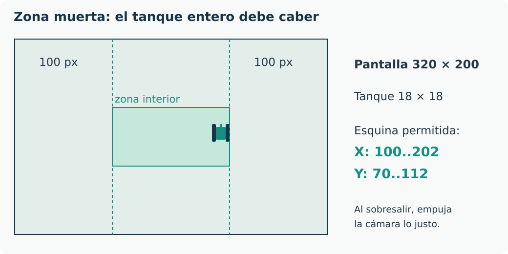
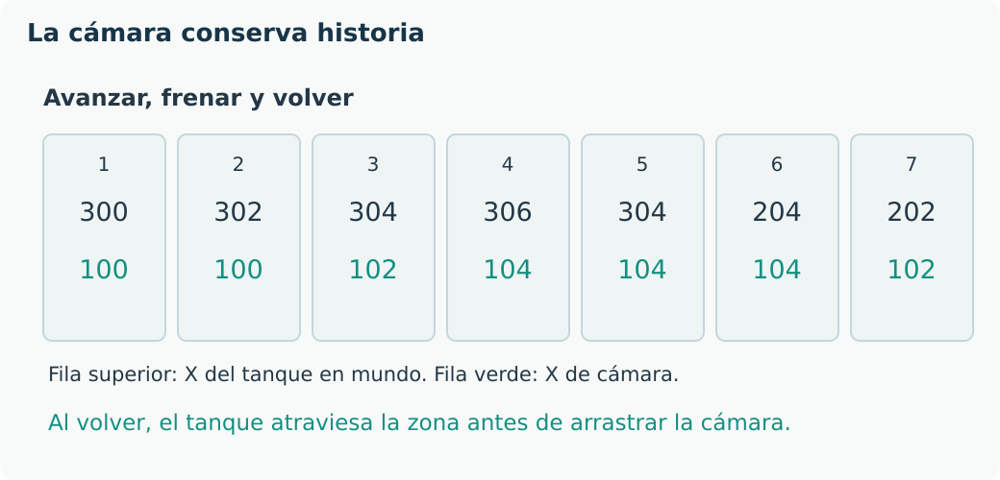
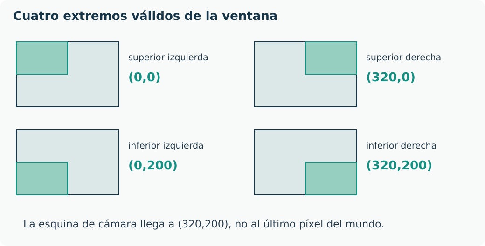

# 25. Construir y ajustar la cámara

**Vas a construir:** seguimiento con zona muerta, límites de mapa y centrado al reaparecer. **Laboratorio:** [chap22.c](../tutorial/ch22/chap22.c). C alterna cámara fija, seguimiento y centrado; las flechas mueven el tanque.

**Si todavía cuesta imaginar la cámara, empieza por [25A: una tira de papel y una ventana de diez casillas](ch25-paso-a-paso.md).** Incluye un programa de consola sin dependencias del juego. En esta lección aplicaremos exactamente ese razonamiento al motor real.

## Los tres datos que debes separar

`player1.position_x` guarda dónde está P1 **en el mundo**. `camera_x` guarda dónde empieza la ventana. La resta entre ambos calcula una posición temporal **para dibujar**. Solo el primero participa en las reglas de movimiento y colisión del tanque.

Por ejemplo, mundo X=304 y cámara X=102 dan pantalla X=202. Si guardases 202 de vuelta en `player1.position_x`, habrías trasladado físicamente el tanque 102 píxeles. Por eso la transformación se entrega al dibujo y no sustituye al estado del jugador.

Esta cámara solo traslada una ventana: no gira el mapa ni aumenta su escala. Un píxel del mundo ocupa un píxel de pantalla cuando queda visible.

## Antes de programar, decide el comportamiento

Queremos que el tanque pueda desplazarse por el centro sin mover el paisaje. Cuando alcanza un borde de esa región, la cámara acompaña su avance. Al detenerse, la cámara se detiene. No hay aceleración, interpolación ni inercia en este algoritmo.

La zona muerta se define mediante márgenes desde los bordes de pantalla: 100 píxeles en horizontal y 70 en vertical. El rectángulo físico interior es `[100,220) × [70,130)`.

El tanque mide 18 × 18 y debe caber entero dentro. Por tanto, su **esquina** puede moverse por:

```text
X mínima = 100
X máxima = 320 - 100 - 18 = 202
Y mínima = 70
Y máxima = 200 - 70 - 18 = 112
```

El origen puede estar exactamente en 202: el tanque termina en la columna 219. No confundas el borde físico 220 con la mayor X de su esquina.




*El borde físico derecho está en 220, pero la esquina del tanque solo puede llegar a 202.*

## Deducir cuánto mover la cámara

Si el tanque aparece en X=207, sobresale `207-202 = 5`. Sumar 5 a la cámara resta 5 a la posición de pantalla y lo deja en 202. Si aparece en X=96, restar 4 a la cámara lo devuelve a 100.

Fragmento de un eje, utilizando las constantes del proyecto:

```c
int screen_x;
int right_edge;

screen_x = target_x - camera_x;
right_edge = WIDTH - CAMERA_DEAD_ZONE_X - target_width;

if (screen_x < CAMERA_DEAD_ZONE_X) {
    camera_x = camera_x - (CAMERA_DEAD_ZONE_X - screen_x);
} else if (screen_x > right_edge) {
    camera_x = camera_x + (screen_x - right_edge);
}
```

Repite el razonamiento para Y. Después limita ambas coordenadas al mapa. `if`/`else if` expresa que, para una zona válida, el objetivo no puede salirse simultáneamente por ambos lados del mismo eje.

## Traza completa: avanzar y dar la vuelta

Mundo 640 × 400. Empezamos con cámara X=100, lejos de los límites. Cada fila usa la cámara resultante de la anterior:

| X del tanque en mundo | Cámara antes | X en pantalla antes | Corrección | Cámara después | X dibujada |
|---:|---:|---:|---:|---:|---:|
| 300 | 100 | 200 | 0 | 100 | 200 |
| 302 | 100 | 202 | 0 | 100 | 202 |
| 304 | 100 | 204 | +2 | 102 | 202 |
| 306 | 102 | 204 | +2 | 104 | 202 |
| 304 | 104 | 200 | 0 | 104 | 200 |
| 204 | 104 | 100 | 0 | 104 | 100 |
| 202 | 104 | 98 | −2 | 102 | 100 |

Al dar la vuelta, el tanque atraviesa la zona central antes de que la cámara retroceda. Ese espacio quieto es el efecto buscado.




*Traza numérica de la lección 25: la cámara no retrocede inmediatamente al invertir la marcha.*

## Los límites tienen la última palabra

La ventana debe permanecer dentro del mundo:

```text
0 <= camera_x <= map_width  - 320
0 <= camera_y <= map_height - 200
```

En el mapa grande, los máximos son `(320,200)`. Con cámara X=320 y tanque X=610, el seguimiento propondría X=408 para colocarlo en 202. El límite corrige a 320 y el tanque aparece en 290. Cerca del extremo del mundo **puede salir de la zona muerta**: no queda paisaje hacia el que desplazar la ventana.

No intentes arreglarlo moviendo el tanque ni leyendo más allá del mapa. La prioridad es ventana válida; la zona muerta se respeta cuando existe espacio suficiente.




*Restar el tamaño de pantalla al tamaño de mapa deja espacio para la ventana completa.*

## Snap: colocar la cámara al iniciar una ronda

En una reaparición no hay un recorrido anterior que conservar. Se centra el objetivo directamente:

```text
camera_x = target_x + target_width/2  - 320/2
camera_y = target_y + target_height/2 - 200/2
```

Después se aplican los mismos límites. Para los puntos de salida grandes:

| Objetivo | Cámara propuesta | Cámara limitada | Esquina visible del tanque |
|---|---|---|---|
| P1 `(166,299)` | `(15,208)` | `(15,200)` | `(151,99)` |
| P2 `(483,106)` | `(332,15)` | `(320,15)` | `(163,91)` |

El centro ideal de la esquina sería `(151,91)`. La diferencia de esos resultados nace de los bordes del mapa, no de un error de seguimiento.

Hay que hacer snap **después** de inicializar las dimensiones del mapa. Si todavía valen 320 × 200, el clamp devuelve `(0,0)` aunque estés preparando un mundo grande.

## Ajustar los márgenes sin invertir la intuición

| Margen X | Intervalo permitido de la esquina, tanque de 18 | Comportamiento |
|---:|---|---|
| 0 | `[0,302]` | Casi toda la pantalla; cámara tarda en seguir |
| 50 | `[50,252]` | Zona amplia |
| 100 | `[100,202]` | Configuración actual |
| 151 | `[151,151]` | Zona de recorrido cero; sigue el centro, salvo límites |
| 152 | `[152,150]` | Configuración invertida e inválida |

**Margen cero no centra la cámara.** Aumentar el margen reduce la zona. Para una zona con recorrido positivo necesitas `2*margin_x + target_width < WIDTH`; igualdad deja un único punto. En Y, el caso de igualdad es margen 91.

Una cámara con interpolación sería una ampliación posterior: cambia el ritmo del seguimiento y puede dejar al objetivo temporalmente fuera. No atribuyas ese comportamiento a la implementación actual.

## Integrarla sin desincronizar la partida

`update_camera()` elige el tanque local y llama a follow o snap. El render actualiza la cámara, copia el fondo, transforma los objetos y añade el HUD. Toda esa imagen usa la misma cámara: actualizarla entre fondo y tanque produciría un desplazamiento relativo falso.

Cada equipo puede seguir a su jugador. Cámara y tema son presentación; no se transmiten como estado de simulación ni se incorporan al checksum. El juego exige red para el mapa grande porque una sola ventana no permite seguir cómodamente a dos jugadores separados en un teclado.

## Recorrer las funciones del juego en orden

Abre [src/main.c](../src/main.c) y [src/bmp.c](../src/bmp.c). Busca los nombres de esta tabla, siguiendo el orden de arriba abajo durante un fotograma normal:

| Lugar | Qué decisión toma | Qué conserva |
|---|---|---|
| `draw_to_buffer` | Actualiza la cámara antes de componer la imagen | La misma cámara para todo ese dibujo |
| `update_camera(0)` | Elige P1 o P2 como objetivo local | Las posiciones de ambos tanques |
| `bmp_camera_follow` | Corrige solo el exceso sobre la zona | La cámara anterior mientras el objetivo permanece dentro |
| `bmp_camera_clamp` | Impide que la ventana salga del mundo | Una ventana válida, aunque no pueda centrar al tanque |
| `bmp_draw_world_window` | Copia el trozo de fondo elegido | El mapa completo en su buffer original |
| `draw_sprite_to_buffer` | Dibuja y recorta cada sprite en pantalla | Las coordenadas de mundo usadas por la simulación |

### 1. Elegir el objetivo es distinto de calcular el seguimiento

`update_camera` empieza con `target = &player1`. Si está en red y `local_player_is_1 == 0`, cambia a `&player2`. El puntero permite usar el mismo cálculo para cualquiera de los dos, sin copiar ni modificar sus estructuras.

Con `snap_to_target == 1`, llama a `bmp_camera_snap`; en el otro caso llama a `bmp_camera_follow`. Las dos reciben X, Y, anchura y altura del objetivo. `follow` no tiene que averiguar qué teclado o qué máquina controla ese tanque.

Durante el render normal, `draw_to_buffer` llama a `update_camera(0)` una sola vez antes del fondo. La preparación de la vista al inicio o reinicio utiliza `update_camera(1)` para colocarla de golpe.

### 2. Dibujar el fondo utiliza la transformación inversa

Después del seguimiento del ejercicio `(188,155)`, la cámara queda en `(88,43)`. El primer píxel de pantalla debe tomar el píxel de mundo `(88,43)`. El de pantalla `(10,2)` necesita el de mundo `(98,45)`.

```text
world_x = camera_x + screen_x
world_y = camera_y + screen_y
```

En `bmp_draw_world_window`, `row` es la fila **de pantalla**. Cada comienzo de fila del mapa se calcula con:

```text
origen = (camera_y + row) * map_width + camera_x
```

Con nuestra cámara y anchura de mundo 640, la fila 0 comienza en el byte 27608; la fila 1, en 28248. De cada una se copian 320 bytes. En el destino, esas filas comienzan en 0 y 320. El salto de fila del mundo es 640; el de pantalla, 320.

El código convierte a `unsigned long` **antes de multiplicar**, porque los desplazamientos del mapa pueden superar 65.535. Reconstruye el puntero `huge` desde la base en cada fila. El detalle de memoria está desarrollado en [22](ch22.md) y [23](ch23.md); la idea de cámara no cambia por utilizar ese tipo de puntero.

### 3. Dibujar el tanque utiliza la resta

Con la misma cámara `(88,43)`, el tanque de mundo `(188,155)` se dibuja en `(100,112)`. En la llamada real se transforma cada coordenada así:

```c
(int)player1.position_x - camera_x
(int)player1.position_y - camera_y
```

Son las expresiones de los argumentos de posición, no asignaciones a `player1`. El molde a `int` mantiene el resultado con signo. Si otro sprite tuviera X de mundo 83, obtendríamos `83-88=-5`: sus primeras cinco columnas quedarían fuera y habría que recortarlas. Para un sprite de anchura 18 quedarían trece columnas visibles, si Y permite verlo completo.

Tanques, balas y explosiones comparten esta transformación. El HUD, que incluye las cifras del radar, usa directamente coordenadas de pantalla porque debe quedarse en el mismo sitio del monitor.

## Cinco preguntas para localizar una confusión

| Si te preguntas… | Comprueba esto |
|---|---|
| «¿Por qué la cámara avanza y el paisaje retrocede?» | Al aumentar la cantidad que restas, disminuye la posición de pantalla |
| «¿Por qué el tanque no queda siempre en el centro?» | `follow` mantiene una zona; `snap` propone centrar y después limita |
| «¿Por qué el fondo y el tanque se separan?» | Ambos dibujos deben usar la misma cámara y el mismo frame |
| «¿Por qué al invertir la marcha no sigue enseguida?» | La posición vuelve al interior y la cámara conserva su valor anterior |
| «¿Por qué el mapa de 320 × 200 no se desplaza?» | Mundo menos pantalla vale cero en los dos ejes |

Para depurar, anota juntos **mundo del objetivo, cámara anterior, pantalla antes, cámara final y pantalla después**. Una sola coordenada aislada no permite distinguir movimiento real de movimiento aparente.

## Práctica y solución

**Ejercicio:** cámara `(90,40)`, tanque `(188,155)`. Calcula seguimiento completo en el mundo grande.

**Solución:** pantalla inicial `(98,115)`. X necesita −2; Y necesita +3. Cámara final `(88,43)`, tanque visible `(100,112)`. Ningún límite interviene.

Repite los casos del [laboratorio ampliado](LABS.md). Para aprobar esta lección debes explicar tanto cuándo la cámara se mueve como cuándo **debe quedarse quieta**, y por qué deja de seguir al llegar al final del mapa.

[Anterior](ch24.md) · [Índice](README.md) · [Siguiente: paredes en bits](ch26.md)
