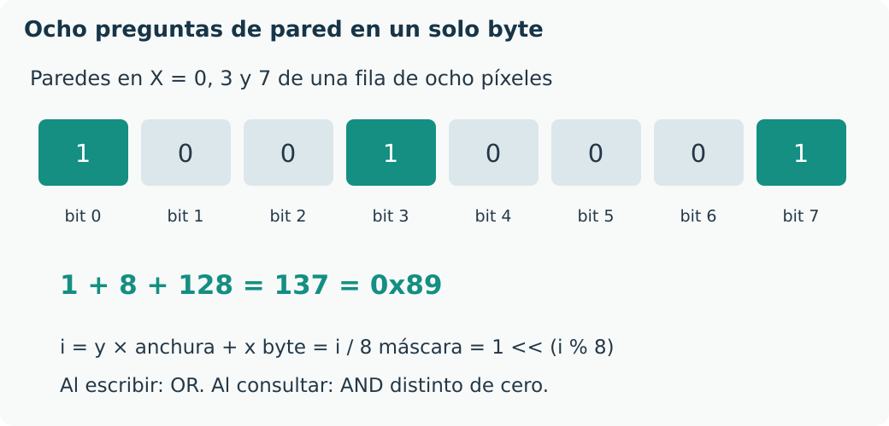

# 26. Un bit para cada pared

**Vas a construir:** una máscara compacta que conserva las colisiones de todo el mundo. **Laboratorio:** [chap23.c](../tutorial/ch23/chap23.c). **Código real:** `bmp_fill_background_collision_in_buffer()` y `bmp_is_wall()` en [bmp.c](../src/bmp.c).




*El píxel inicial usa el bit menos significativo; la escritura binaria habitual se muestra en orden inverso.*

## Una imagen para mirar, otra para decidir

El dibujo del escenario puede tener sombras, rejillas y manchas. Ninguna de ellas debería convertirse accidentalmente en una pared. El juego carga otra imagen, `bigcol.bmp`, donde el **índice 252** significa pared. Los demás índices significan suelo.

Importa el índice del píxel, no el RGB que ese índice muestra en el editor. Un editor que reordene la paleta puede conservar el aspecto y destruir la interpretación lógica.

Como solo hay dos respuestas, basta un bit: 0 para suelo, 1 para pared. Un byte guarda ocho respuestas.

```text
640 * 400 = 256000 píxeles
256000 / 8 = 32000 bytes
```

Para un número de píxeles no divisible por ocho, usa `(pixels+7)/8`. Una máscara de 10 píxeles necesita dos bytes, aunque sobren seis bits.

## Encontrar el byte y el bit

Primero convierte `(x,y)` en índice lineal del **mundo**:

```text
i = y * map_width + x
byte_index = i / 8        equivalente a i >> 3
bit_number = i % 8        equivalente a i & 7
bit_mask = 1 << bit_number
```

El código numera desde el bit menos significativo. Para una fila de ocho píxeles con pared en X=0, 3 y 7:

```text
x:                0 1 2 3 4 5 6 7
pared:            1 0 0 1 0 0 0 1
byte, bits 7..0:   1 0 0 0 1 0 0 1 = 0x89 = 137
```

La representación binaria escrita suele mostrar primero el bit 7; las X de la fila empiezan por el bit 0. No inviertas esa relación al depurar.

## Escribir y consultar

Para marcar una pared, conserva los otros bits mediante OR:

```c
mask[byte_index] = mask[byte_index] | bit_mask;
```

Para consultar, usa AND y compara con cero:

```c
if ((mask[byte_index] & bit_mask) != 0) {
    return 1;
}
return 0;
```

No uses `== 1`: una pared en el bit 7 devuelve 128 al hacer AND y sigue siendo pared. No uses una asignación directa de `bit_mask` al cargar: borraría las paredes anteriores del mismo byte.

En el mundo grande, `(639,399)` da índice 255999, byte 31999 y bit 7. Por eso el índice lineal es `unsigned long`, mientras que el índice de byte cabe en `unsigned int`. Esa elección deja de servir si amplías tanto el mundo que la máscara supera 65535 bytes.

## Cargar sin reservar otros 256000 bytes

El cargador lee una fila de la imagen en `map_line`, de hasta 640 bytes, y marca inmediatamente los bits correspondientes. Como el BMP está guardado de abajo arriba, la primera fila leída se asigna a `map_height-1`.

La máscara se pone a cero antes de cargar. Si vuelves a cargar sobre la misma reserva sin limpiarla, las paredes antiguas pueden permanecer: el OR añade bits, no los borra.

El mapa visual y el lógico deben tener las dimensiones esperadas. El cargador actual usa el formato fijo del proyecto y no constituye un validador general de BMP; una lectura incompleta puede dejar datos sin cargar. Valida tus recursos antes de incorporarlos.

## Fuera del mundo y máscara ausente

`bmp_is_wall` devuelve pared si X o Y están fuera del mapa. Así una consulta exterior no lee memoria ajena. Sin embargo, si la coordenada está dentro y el puntero de máscara es `NULL`, devuelve suelo. No confundas eso con una recuperación completa ante fallo de carga: el juego necesita una máscara válida para conservar sus reglas.

Nunca restes la cámara en esta función. Una pared no cambia de identidad cuando mueves la ventana.

## Práctica y solución

**Ejercicio:** mapa de anchura 640, consulta `(13,2)`. Calcula índice, byte y máscara. Supón que ese byte vale 32.

**Solución:** `i=1293`, byte 161, bit 5, máscara 32. `32 & 32` vale 32: hay pared. Si consultas `(12,2)`, obtienes bit 4 y `32 & 16 = 0`: suelo.

Como práctica en una copia, pinta una pared lógica pequeña sobre un suelo visual reconocible. Comprueba que bloquea aunque su dibujo no cambie. Después alinea ambos mapas: la separación es útil para programar, pero el jugador necesita poder leer dónde puede pasar.

[Anterior](ch25.md) · [Índice](README.md) · [Siguiente: diseñar un nivel](ch27.md)
