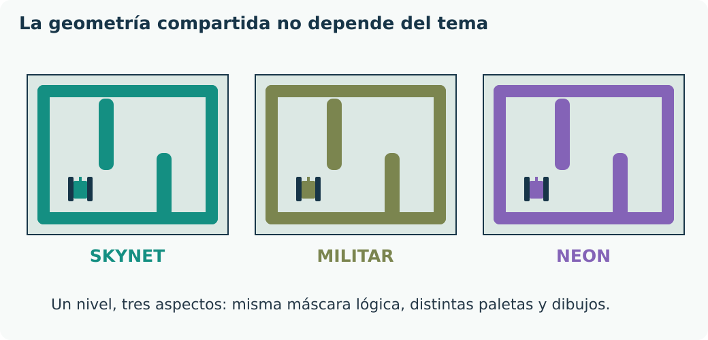

# 27. Diseñar mapas que se puedan jugar

**Vas a producir:** el diseño de un nivel y una lista concreta para comprobar sus recursos. Trabaja sobre copias; los recursos originales son la referencia. **Fuentes:** [res/15Level](../res/15Level), `init_graphics()` en [main.c](../src/main.c) y [players.c](../src/players.c).




*Esquema didáctico de tres aspectos sobre una misma distribución; no es una captura de un nivel del juego.*

## Dibuja primero las decisiones del jugador

Un nivel no empieza con una textura. Empieza con dos salidas, caminos que las conectan y lugares donde elegir. Esboza una ruta corta y expuesta, otra más larga con cobertura y algún espacio para girar. Una bifurcación que termina enseguida en una pared no ofrece la misma elección que dos rutas conectadas.

Usa inicialmente una cuadrícula en papel, por ejemplo de 16 píxeles por celda. El tanque mide 18, de modo que una celda no equivale a un pasillo válido. Para empezar, un corredor de 32 píxeles deja margen para el dibujo y para maniobrar; no es una regla del motor ni sustituye las pruebas de choque.

## Tres capas que deben coincidir

| Capa | Contiene | Comprueba |
|---|---|---|
| Geometría lógica | `bigcol.bmp`, pared en índice 252 | Conexión, pasos y salidas libres |
| Aspecto | `big.bmp` | Paredes visuales alineadas con las lógicas |
| Presentación del tema | Sprites y `numbers.bmp` | Índices compatibles con la paleta del mapa |

El motor no deduce paredes por luminosidad. Tampoco puede mostrar simultáneamente tres paletas independientes en modo 13h: hay una paleta VGA global.

## Organización que usa el juego

Los niveles 1–5 se buscan así, desde `bin`:

```text
..\res\15Level\SKYNET\NIVEL01\big.bmp
..\res\15Level\SKYNET\NIVEL01\bigcol.bmp
```

Las alternativas de tema son `MILITAR` y `NEON`; los directorios llegan a `NIVEL05`. El nivel 0 usa las imágenes de `res/` y su `bigcol.bmp` compartido. El mapa pequeño usa `cutre.bmp`, `cutrecol.bmp` y `sprites.bmp`.

Los 15 directorios de tema y nivel no significan 15 geometrías distintas: hay cinco niveles con tres aspectos. En los recursos revisados, los tres `bigcol.bmp` de un mismo nivel son idénticos byte a byte. Por eso se acuerda **nivel** por red, mientras cada equipo puede escoger su **tema**.

No cambies solo una máscara temática si quieres conservar esa libertad: los jugadores podrían ver paredes aparentemente equivalentes y simular choques distintos. El checksum no sustituye una validación previa de los recursos.

## Contrato de exportación BMP

Para estos mapas: 640 × 400, 8 bits indexados, sin compresión, cabecera DIB de 40 bytes, 256 entradas de paleta y píxeles desde el byte 1078. Las filas se guardan de abajo arriba. El tamaño habitual es `1078+256000 = 257078` bytes.

No basta con que el fichero termine en `.bmp`. Un BMP de 24 bits, una paleta acortada, RLE o una imagen de altura negativa no cumplen el contrato de estos cargadores.

Conserva nombres que funcionen en DOS 8.3. Si añades un sexto nivel, también debes ampliar análisis de argumentos y acuerdo de nivel: crear `NIVEL06` por sí solo no lo hace seleccionable.

## Los puntos de salida son datos del juego

En el mapa grande P1 empieza en `(166,299)`, mirando arriba, y P2 en `(483,106)`, mirando abajo. Comprueba el área completa de 18 × 18 y el espacio inmediato delante del cañón. El juego no busca automáticamente un lugar libre dentro del BMP.

Las colisiones del tanque consultan tres puntos delanteros, no cada píxel de su silueta. Las esquinas, cambios de dirección y pasos estrechos deben probarse desde ambos sentidos. Además, las balas avanzan 3 píxeles por actualización: un obstáculo lógico extremadamente fino puede quedar entre posiciones consultadas. Diseñar paredes con grosor razonable ayuda, pero la solución general a atravesar obstáculos rápidos sería una prueba de trayecto.

## Plan de validación del nivel

1. Recorre cada salida hacia el centro sin oponente. Anota bloqueos y entradas que no se leen bien visualmente.
2. Cruza cada puerta desde ambos lados; gira junto a sus cuatro esquinas.
3. Dispara paralelo a una pared, hacia ella y cerca de una esquina.
4. Lleva la cámara a los cuatro extremos y comprueba fondo, sprites y máscara.
5. Repite con el otro tanque. Después juega entre temas distintos del mismo nivel.
6. Reinicia una ronda lejos de las salidas: comprueba reaparición, snap y primer fotograma.

El registro debe decir qué posición y dirección fallaron, no solo «el mapa va mal». Un punto reproducible convierte una impresión en una tarea corregible.

## Práctica y solución

**Ejercicio:** haces dos versiones de un nivel. Cambias un muro de X=250 a X=260 en la máscara NEON, pero dejas SKYNET igual. ¿Puedes considerarlo solo un cambio de aspecto?

**Solución:** no. Las mismas entradas pueden detener un tanque en un equipo y permitirle avanzar en el otro. Debes mantener la geometría común o tratarlo como otro nivel acordado por ambos.

Entrega un croquis, las coordenadas de las salidas, tres rutas de prueba y una tabla de recursos. Esa es una especificación de nivel que otra persona puede verificar.

[Anterior](ch26.md) · [Índice](README.md) · [Siguiente: radar](ch28.md)
