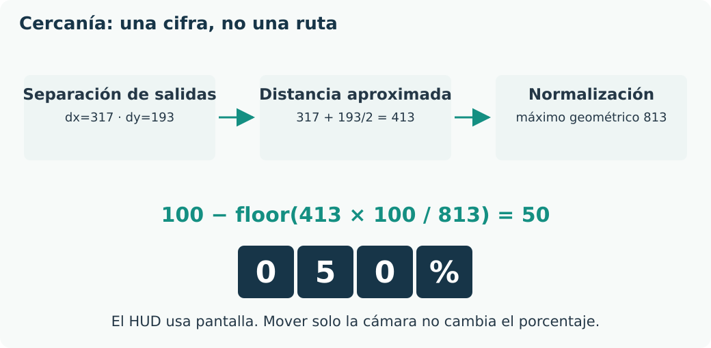

# 28. Un radar que orienta sin enseñar el mapa entero

**Vas a construir:** un porcentaje de cercanía dibujado con sprites. **Laboratorio:** [chap24.c](../tutorial/ch24/chap24.c), dos tanques sobre SKYNET nivel 1; flechas y WASD, T alterna contorno. Este laboratorio es local y no necesita IPX.




*La distancia ignora las paredes; indica separación geométrica aproximada.*

## Decide qué información quieres dar

El radar responde «¿me estoy acercando?». No dibuja la dirección del enemigo ni la ruta más corta entre paredes. Dos tanques separados por una pared pueden marcar una proximidad alta.

Es un elemento de pantalla: se dibuja al final, en coordenadas fijas. No resta la cámara y no altera la simulación.

## Distancia con cuentas enteras

Primero calcula diferencias absolutas entre posiciones de mundo. Como las posiciones son unsigned, convierte antes de restar:

```c
int dx;
int dy;

dx = (int)player1.position_x - (int)player2.position_x;
dy = (int)player1.position_y - (int)player2.position_y;
if (dx < 0) {
    dx = -dx;
}
if (dy < 0) {
    dy = -dy;
}
```

El radar aproxima la distancia usando `mayor + menor/2`. Para diferencias `(100,0)`, da 100; para `(100,100)`, da 150, frente a aproximadamente 141,42 de distancia euclídea. No es distancia de Manhattan, que daría 200 en ese último caso.

La aproximación continua puede sobreestimar hasta aproximadamente 11,8 %; la división entera añade redondeo. Sirve como indicador económico, no como regla exacta para impactos ni como búsqueda de caminos.

## Convertirla en porcentaje

Las esquinas de dos tanques de 18 × 18 pueden separarse geométricamente hasta 622 en X y 382 en Y dentro del mundo de 640 × 400:

```text
worst_distance = 622 + 382/2 = 813
percent = 100 - floor(distance*100/813)
```

Se limita después a 0–100. Las paredes pueden impedir alcanzar esos extremos geométricos; no prometas que cada nivel permitirá ver exactamente 0 % durante una partida normal.

| Separación absoluta | Distancia aproximada | Porcentaje |
|---|---:|---:|
| `(0,0)` | 0 | 100 |
| `(100,0)` | 100 | 88 |
| `(100,100)` | 150 | 82 |
| Salidas: `(317,193)` | 413 | 50 |
| `(622,382)` | 813 | 0 |

`distance` y el producto se calculan en `long`: 81300 no cabe en 16 bits unsigned. En el código actual, como `distance` ya es `long`, cambiar únicamente el literal `100L` por `100` no haría que el producto pasara a 16 bits. El tipo de **toda la expresión** importa.

## Del número a cuatro dibujos

Para un porcentaje `p`:

```text
centenas = p / 100
decenas  = (p / 10) % 10
unidades = p % 10
última celda = símbolo %
```

La hoja contiene 11 celdas de 18 × 18: cifras 0–9 y porcentaje. Se extraen de una imagen BMP de 320 × 200; no es un BMP de solo 198 × 18. La celda N empieza en X=`N*18`.

Las cifras avanzan 13 píxeles al colocarse. Cuatro celdas ocupan `3*13+18 = 57` píxeles. El HUD empieza en `(131,180)` y cabe en los 320 × 200. Un paso menor que 18 aprovecha el espacio transparente de las celdas.

## Contorno sin tapar las cifras vecinas

Se dibuja cada silueta en negro desplazada un píxel a izquierda, derecha, arriba y abajo. Primero se pintan **todos** los contornos y después **todas** las cifras. Si intercalases contorno y cifra por celda, el contorno siguiente podría tapar tinta de la anterior al solaparse los rectángulos.

Son 16 llamadas de silueta y 4 de sprite para cuatro símbolos. No hace falta guardar otra imagen para cada versión de contorno.

El radar se habilita en mapa grande con tema. Los números temáticos no comparten la paleta del mapa original y no existe una hoja ORIGINAL equivalente. Esa ausencia es un requisito de recursos, no un fallo matemático del porcentaje.

## Práctica y solución

Mantén un tanque quieto y mueve el otro horizontalmente: el valor debe subir al acercarte y bajar al alejarte. Cambia solo la cámara: el valor no debe cambiar. Alterna T sobre fondos claros y oscuros para valorar la legibilidad.

**Ejercicio:** P1 `(200,100)`, P2 `(260,180)`. Calcula las cuatro celdas.

**Solución:** diferencias 60 y 80, distancia `80+60/2=110`; porcentaje `100-floor(11000/813)=87`. Celdas `0`, `8`, `7`, `%`.

[Anterior](ch27.md) · [Índice](README.md) · [Siguiente: integración](ch29.md)
