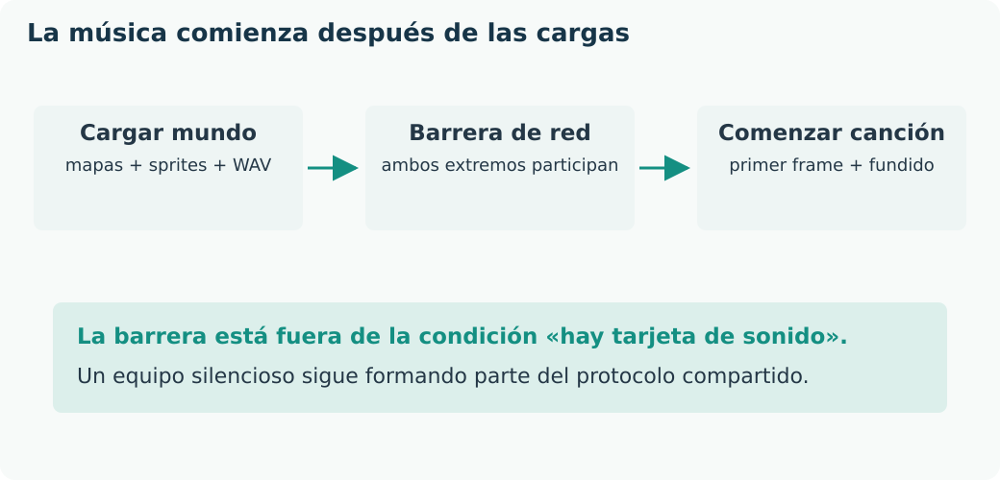

# 29. Integrar: el orden también es parte del programa

**Vas a comprender:** por qué módulos correctos por separado pueden fallar cuando se combinan. Abre [main.c](../src/main.c) y localiza su `main()`, `restart_game()`, render y limpieza.




*La barrera reduce diferencias de arranque debidas a carga, pero no constituye un reloj de audio compartido.*

## Dependencias, no una lista arbitraria

Una cámara no puede limitarse a unas dimensiones que todavía no se han establecido. Una música no debe consumir memoria durante la carga de una intro que ya ha terminado. Un fundido necesita una paleta y debe seguir atendiendo sonido y red.

Este es el orden relevante del arranque actual, omitiendo mensajes y comprobaciones intermedias:

```text
argumentos
  → IPX y descubrimiento, si hay red
  → acuerdo de nivel
  → acuerdo de intro: reproducir, esperar o saltar
  → instalar teclado y configurar pantalla
  → init_players()
  → init_graphics(): dimensiones, fondos, máscara, paleta, sprites
  → cargar cifras del radar
  → snap con las dimensiones definitivas
  → iniciar sonido y cargar efectos, si hay tarjeta
  → barrera de red después de las cargas
  → comenzar canción, preparar primer fotograma y fundido de entrada
  → bucle de partida
```

`init_players()` llama a un reinicio antes de cargar el mundo. El snap posterior es necesario porque ahora sí existen las dimensiones definitivas. No traslades todos los efectos visuales a `restart_game()`: también se llama durante ese arranque temprano.

## Fundir colores, no multiplicar todos los píxeles

La paleta contiene componentes de 0–63. Para un nivel de fundido `step` entre 0 y 32:

```text
componente visible = componente original * step / 32
```

Con componente 50 y paso 16 se escribe 25. Los 64000 índices de la imagen siguen iguales; cambia la interpretación de sus colores. Conserva la paleta original como referencia para no ir degradándola con redondeos acumulados.

Los bucles que incluyen ambos extremos, 0 y 32, hacen 33 iteraciones. A un retrazo nominal de 70 Hz representan aproximadamente 0,47 s por fundido, más cualquier trabajo que impida llegar al siguiente retrazo. La sincronización con retrazo no garantiza idéntico tiempo real en todas las máquinas.

En cada iteración se atiende `sound_update()` y, en red, `net_poll()`. Un bucle que solo espera hasta terminar puede dejar que el DMA repita audio o que se acumulen paquetes.

## Reiniciar una ronda sin enseñar el salto

La transición del bucle es: fundir a negro, restablecer la ronda, actualizar cámara, construir la imagen nueva y fundir a la paleta visible. La puntuación persiste; las balas y estados temporales se reinician.

El orden evita mostrar un fotograma del nuevo tanque con la cámara anterior. Si detectas un salto breve, inspecciona qué imagen estaba ya en VGA cuando empezaste a subir la paleta.

## Barrera: esperar cuando ya está todo cargado

Aunque ambos equipos acuerden un nivel al mismo tiempo, sus discos pueden tardar diferente en leer mapas y WAV. `net_wait_together()` se llama después de esas cargas y justo antes del comienzo de la música. Reduce el desfase de arranque atribuible a las cargas.

Está fuera del bloque que exige tarjeta de sonido: los dos extremos deben participar incluso si uno juega en silencio. Usa su propio plazo de espera, porque el tiempo transcurrido durante las cargas no debe confundirse con el plazo de esta fase.

La barrera no es un reloj de audio compartido. El transporte, la planificación y los osciladores pueden introducir diferencias; no demuestra sincronización perfecta de muestras ni corrige deriva durante toda la canción.

## Salir forma parte del resultado

Cada recurso adquirido necesita una salida correspondiente:

| Adquisición | Liberación o restauración |
|---|---|
| IRQ/DMA y sonidos | `sound_end()` |
| Socket IPX | `net_shutdown()` |
| Memoria de jugadores | Rutina de liberación de jugadores |
| Cifras del radar | `free_sprite_numbers()` |
| Hoja abierta y buffers BMP | Cerrar ficheros y liberar buffers del módulo |
| Vector de teclado | Restaurar el manejador anterior |
| Modo gráfico | Volver a texto |

En una reconstrucción, maneja también fallos parciales: si falla la tercera reserva, las dos primeras siguen necesitando liberación. El código actual imprime algunos errores de carga sin propagar un estado completo de inicialización; consulta las [erratas](ERRATAS.md) antes de tomarlo como patrón de recuperación universal.

## Práctica y solución

**Ejercicio:** mueves la barrera dentro de `if (sound_ready == 1)`. Un equipo tiene tarjeta y el otro no. ¿Qué dependencia has roto?

**Solución:** los extremos dejan de ejecutar el mismo protocolo de arranque. El equipo con tarjeta espera una participación que el otro omite. Las opciones de presentación no deben eliminar pasos necesarios de la coordinación compartida.

[Anterior](ch28.md) · [Índice](README.md) · [Siguiente: intro](ch30.md)
