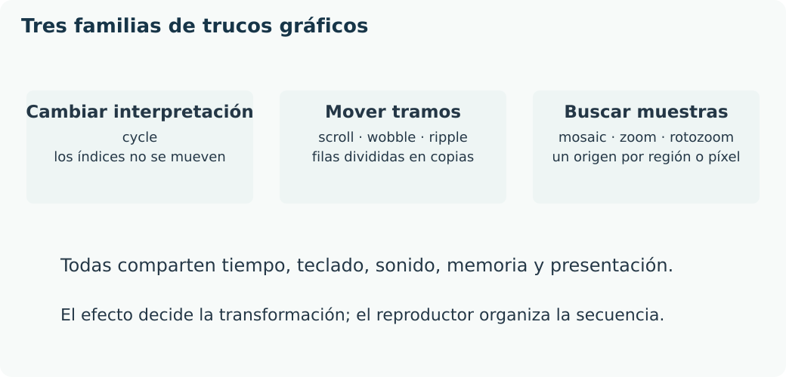

# 30. Una intro: diez maneras de transformar una imagen

**Vas a construir:** un reproductor común y, después, efectos pequeños que solo deciden cómo transformar una imagen. **Recorrido completo:** [demos/README.md](demos/README.md) y [bases matemáticas](demos/BASES.md).

*Elegir el trabajo por paleta, tramo o píxel permite entender el coste de cada efecto.*

## Un contrato para todos los efectos

Cada función recibe imagen original, buffer de pantalla, paleta y momento de finalización. Devuelve si hay que interrumpir la intro. El reproductor reserva y libera recursos, cambia de imagen y ejecuta los fundidos.

Esto separa dos problemas: «cómo se ve esta transformación» y «cómo transcurre la secuencia». Si cada efecto abriese su propio sonido y reservase sus imágenes, repetirías errores y complicarías la liberación.

El reproductor actual reserva dos buffers de 64000 bytes y una paleta de 768. Construye tablas de seno y offsets de fila, y reproduce `res/demo.wav`. Su dependencia externa comprende siete funciones BMP y cinco de sonido. Los detalles están en `demolib.h` y las declaraciones de `demos.c`.

## Elige el truco según lo que cambia

| Técnica | Efectos | Trabajo principal |
|---|---|---|
| Reinterpretar colores | cycle | Mover entradas de paleta; píxeles quietos |
| Copiar segmentos de filas | scroll, blinds, stripes, wobble, bounce, ripple | Calcular límites y copiar bloques |
| Repetir muestras | mosaic | Una muestra por bloque; rellenar su área |
| Muestrear otra coordenada | zoom, rotozoom | Transformación inversa de cada destino |

El orden pedagógico empieza por cycle y termina en rotozoom. El orden de reproducción es otro: rotozoom, wobble, blinds, zoom, stripes, cycle, scroll, ripple, mosaic y bounce, repetido según las imágenes disponibles.

## La matemática reaprovecha lo aprendido con la cámara

La cámara era una traslación: buscar en el mundo una coordenada desplazada. El zoom pregunta qué píxel original corresponde a una posición de destino escalada. El rotozoom añade rotación a esa búsqueda.

Ambos trabajan **desde el destino hacia el origen** para asignar una muestra a cada píxel visible. Si empujases cada píxel del origen hacia su destino ampliado, dejarías agujeros salvo que añadieras reglas de relleno.

Se usa una tabla de seno con 256 fases y valores escalados por 256. No necesitas saber trigonometría antes de abrir la explicación: las [bases](demos/BASES.md) construyen fase, amplitud y punto fijo con números pequeños.

## Presentación, sonido y red

`demo_show()` espera retrazo, copia el buffer y atiende `demo_sound()`. Cycle es una excepción deliberada: muestra la imagen inicialmente y después actualiza paleta, espera retrazo y atiende sonido sin volver a copiar los mismos píxeles.

`demo_sound()` llama también al callback de espera. El juego conecta ahí su servicio de red para conservar el enlace durante la intro y recibir ESC remoto. Los fundidos atienden ese servicio igualmente; no es una garantía de exactamente una llamada por fotograma visible.

En red, el rol de servidor del lanzador decide quién solicita mostrar la intro. El otro equipo espera si recibe el acuerdo. Esto es independiente de quién resulte P1 en la simulación.

## Duración y vida útil

`DEMO_DEFAULT_SECONDS` vale **7**. Con quince imágenes válidas hay quince intervalos de efecto, más entradas y salidas de paleta. Usando 127 ticks BIOS por intervalo y 66 retrazos por pareja de fundidos, el total nominal ronda dos minutos, más carga y trabajo de dibujo. No son quince efectos diferentes ni una duración exacta de siete segundos por imagen completa.

Si una imagen no puede abrirse, se salta y no avanza el índice de efecto. La asociación imagen/efecto posterior puede cambiar. Todos los recursos dinámicos de la intro se liberan antes de cargar el juego. Sin `-demo` se evita esa carga y reserva; el código enlazado y las tablas estáticas siguen formando parte del ejecutable.

## Práctica y solución

Completa los diez tutoriales de efectos. Después diseña una variación sobre uno sencillo: por ejemplo, scroll vertical a dos velocidades. Explica qué se recalcula por fotograma y qué se puede precalcular al comenzar.

**Ejercicio:** añades una función a `demo_effects[]` y su cabecera, pero el enlazador dice que falta su símbolo. ¿Qué pieza no has incorporado?

**Solución:** su archivo objeto debe compilarse y aparecer en las dependencias y el response file del [Makefile principal](../Makefile). El registro en una tabla C no sustituye la integración de compilación y enlace.

[Anterior](ch29.md) · [Índice](README.md) · [Siguiente: proyecto final](ch31.md)
