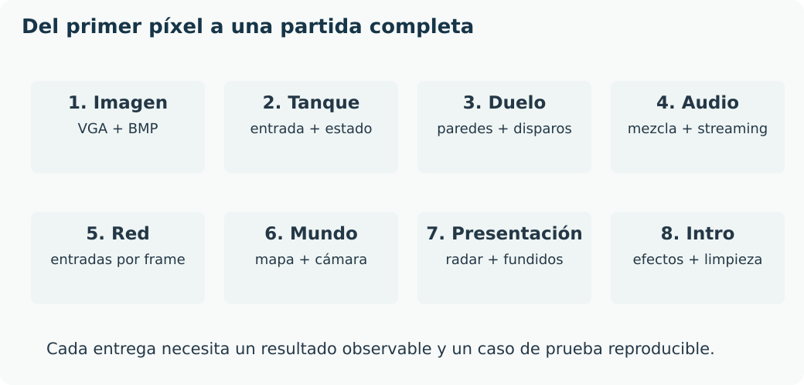

# 31. Tu juego, construido por entregas

Ya has estudiado las piezas. Ahora debes demostrar que puedes reunirlas, localizar un fallo y explicar por qué tu solución funciona. El objetivo no se cumple copiando todos los archivos y viendo una pantalla: se cumple cuando puedes reconstruir las responsabilidades y comprobar sus relaciones.

Trabaja en una copia propia. Conserva el repositorio como referencia y los laboratorios como experimentos pequeños. Los programas existentes enlazan módulos del juego, por lo que modificar un módulo compartido puede cambiar varios capítulos: registra qué tocaste y recompila los objetivos afectados en tu entorno DOS.




*La reconstrucción se organiza por comportamientos verificables, no por cantidad de archivos copiados.*

## Entregas y criterios de aceptación

| Entrega | Construye | Demuestra que está terminada |
|---|---|---|
| 1. Imagen | Modo 13h, carga BMP y buffer | Patrón correcto, colores correctos y salida a texto |
| 2. Tanque | Sprite, entrada mantenida, orientación | Dos teclas simultáneas, límites y animación explicables |
| 3. Duelo local | Máscara, dos tanques, balas, rondas | Paredes, impacto, pulsación única y puntuación persistente |
| 4. Sonido | DMA, efectos, mezcla y streaming | Movimiento y disparo se oyen juntos; silencio opcional; salida limpia |
| 5. Red | Descubrimiento y lockstep | Misma simulación por frame; retardo conocido; desconexión visible |
| 6. Mundo grande | Ventana, huge, máscara, clipping, cámara | Cuatro bordes correctos; objetos invisibles siguen activos |
| 7. Presentación | Temas, radar y fundidos | Geometría común, HUD fijo y reinicios sin imagen intermedia incoherente |
| 8. Intro | Reproductor y efectos | ESC local/remoto, sonido atendido y memoria liberada antes del juego |

Cada entrega termina con una nota corta: entradas de prueba, resultado esperado, resultado observado y diferencia pendiente. Si una parte falla, reduce el caso al laboratorio correspondiente antes de cambiar varias capas a la vez.

## Organización recomendada para tu reconstrucción

Usa los módulos existentes como ejemplo de responsabilidades: `bmp` transforma recursos gráficos y dibuja; `players` guarda y actualiza datos del tanque; `sound` administra audio; `net` transporta mensajes; `lockstep` coordina entradas. `main` conoce las reglas y ordena la partida.

Escribe para cada función tres cosas antes de implementarla: qué recibe, qué modifica y qué condiciones necesita. Por ejemplo:

```text
Función: dibujar ventana
Recibe: destino de 64000 bytes
Lee: mapa completo, dimensiones, cámara válida
Modifica: solo el destino
No decide: movimiento, paredes ni jugador local
```

Esta ficha te obliga a distinguir un dato de presentación de uno compartido. La misma disciplina sirve para `apply_input`: recibe bits y estado de mundo; no debe depender de qué cámara tenga esta máquina.

## Matriz final de pruebas manuales

1. **Local, mapa pequeño:** ambos jugadores, disparo mantenido, choques, ronda ganada y empate.
2. **Sin sonido disponible:** el juego continúa y la red participa en las mismas barreras.
3. **Dos instancias, mapa pequeño:** compara estado por número de frame; cierra una y observa la salida de la otra.
4. **Mapa grande, mismo nivel y distintos temas:** muros equivalentes, cámaras independientes y radar estable al mover solo la cámara.
5. **Extremos del mundo:** sprites parcialmente visibles, balas fuera de ventana y reinicio desde una esquina opuesta.
6. **Intro:** final natural, ESC temprano, imagen ausente en una copia de prueba y espera del cliente.
7. **Recursos inválidos en una copia:** fichero ausente o formato incorrecto; tu reconstrucción debe informar y salir de forma controlada.
8. **Repetición:** varias rondas y nuevas ejecuciones sin dejar teclado, vídeo o sonido en un estado incorrecto.

No basta con «no se ha caído». Para el render, usa los offsets del [laboratorio](LABS.md); para red, compara frames; para sonido, considera los 46,44 ms disponibles por mitad de DMA. Las pruebas necesitan una propiedad observable.

## Tres retos de graduación

**Cámara configurable.** Añade márgenes como parámetros en tu copia, rechaza zonas invertidas y demuestra los casos margen cero, zona de un punto y mapa pequeño. Conserva el comportamiento actual con 100/70.

**Nivel propio.** Entrega un mapa visual y una geometría de colisión, con salidas libres y una ruta verificable entre ellas. Haz tres temas solo cuando la geometría esté validada. Explica por qué no cambia el checksum al cambiar de aspecto.

**Efecto propio.** Escribe una transformación de intro con el contrato existente. Documenta su coordenada de origen, sus límites numéricos y cuánto trabajo haces por fila y por píxel. Integra su objeto en el enlace.

## Cómo saber si has pasado de lector a autor

Debes poder responder, sin mirar el código: por qué `y*640` necesita ampliarse antes de multiplicar; por qué una X negativa no implica invisibilidad total; por qué la cámara no entra en el checksum; por qué 16 KB de música no autorizan a bloquear el bucle 0,37 s; y por qué una paleta necesita 768 bytes aunque solo haya 256 colores.

Si una respuesta se atasca, vuelve a su lección y reconstruye el ejemplo numérico. Tu entrega final incluye el juego, instrucciones de construcción y ejecución, un mapa de módulos y un registro de pruebas. Así otra persona puede usarlo, estudiarlo y continuar tu trabajo.

[Anterior](ch30.md) · [Índice](README.md) · [Laboratorios con soluciones](LABS.md)
