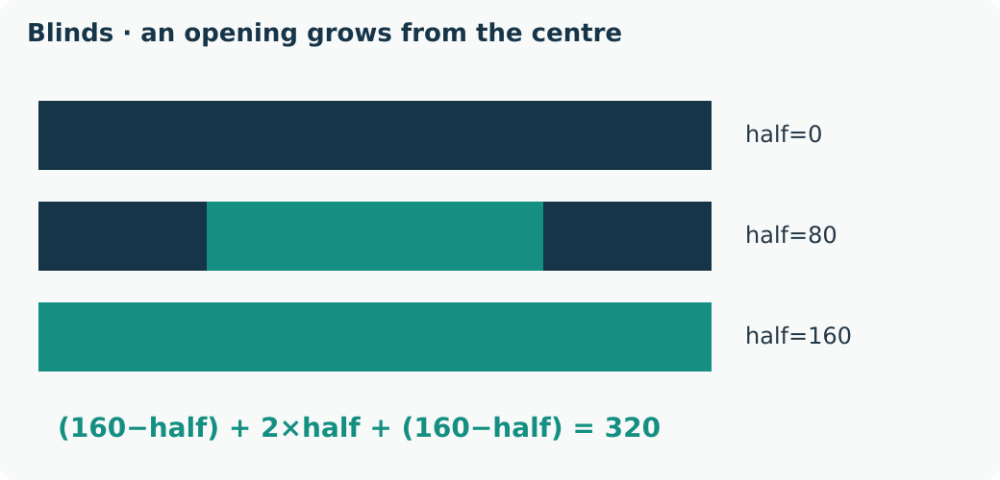

# blinds — Derive a centred opening

*[Español](README.md)* · **Lesson 3 of 10** · [Source](../../../../demos/blinds/blinds.c) · [Shared foundations](../../BASES-EN.md)




*Widen the product to long before multiplying by 160 on Turbo C.*

## What you will learn

Map a sine value to a width, share one calculation across several rows and audit intermediate arithmetic on Turbo C.

**Actual source discrepancy:** the product computing `half` can overflow a signed 16-bit `int`. The widened formula below is an educational correction; the original C file remains unchanged.

## One opening, three spans

The screen contains 20 strips of 10 rows. Each reveals a centred window while covering both sides with black. Source pixels keep their original positions.

`half` is half the visible width. Each black border is `160-half` pixels and the visible span is `2*half`. Their sum is always 320.

| Sine | Sine + 256 | Mathematical product ×160 | Half | Visible width |
|---:|---:|---:|---:|---:|
| −256 | 0 | 0 | 0 | 0 |
| 0 | 256 | 40960 | 80 | 160 |
| 256 | 512 | 81920 | 160 | 320 |

Both 40960 and 81920 exceed signed 16-bit range. Dividing or clamping afterwards does not repair prior overflow. Widen **before** multiplying:

```c
half = (int)(((long)(demo_sin(phase + slat * BLINDS_STAGGER)
                    + DEMO_ONE) * (DEMO_WIDTH / 2))
             / (DEMO_ONE * 2L));
```

With correct arithmetic and the existing table, this maps exactly into 0–160. Clamping provides additional protection when parameters change; it is not an overflow remedy.

## From one strip to twenty

A strip samples `phase + slat*6`. Neighbours use nearby points on the same wave. Phase advances by 3 per frame and repeats after 256 frames. Setting the stagger to zero makes all strips open together.

For every row:

```text
fill [0,160-half) black
copy [160-half,160+half) from the identical source position
fill [160+half,320) black
```

At full opening, both fills have zero length; at full closure, the copy has zero length. No negative length is valid.

## Cost and strip limits

One frame uses 20 sine lookups and 200 × (two fills + one copy). Those spans write 64000 buffer bytes in total, followed by presentation.

The current loops require `BLINDS_SLAT` to divide 200. Height 11 leaves two rows untouched. Height 4 produces **50** strips, not 40. Arbitrary strip heights require clipping the final strip.

## Workshop with answer

**Predict:** sine=128. **Answer:** half=120, visible width=240 and 40 black pixels on either side.

**Practice:** freeze the phase in a working copy and verify minimum, zero and maximum sine using the widened calculation. Then enable animation and finally strip staggering. This separates arithmetic errors from motion errors.

**Extension:** open from the left instead of the centre. Prove that the visible and black spans still cover exactly 320 pixels.

---

[Previous: scroll](../../scroll/doc/README-EN.md) · [Next: stripes](../../stripes/doc/README-EN.md) · [Index](../../README-EN.md)
