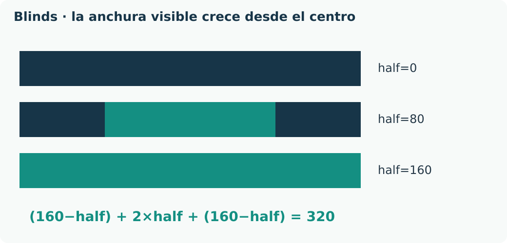

# blinds — Deducir la apertura de una persiana

*[English](README-EN.md)* · **Lección 3 de 10** · [Código](../../../../demos/blinds/blinds.c) · [Bases comunes](../../BASES.md)




*El cálculo necesita ampliar a long antes de multiplicar por 160 en Turbo C.*

## Lo que vas a aprender

Transformar un seno en una anchura, compartir un cálculo entre varias filas y revisar el rango de los productos en Turbo C.

**Discrepancia real del código:** el producto que calcula `half` puede superar un `int` de 16 bits. La fórmula ampliada de este documento explica cómo debe calcularse; el archivo C original no se ha modificado. Consulta también las [erratas del curso](../../../ERRATAS.md).

## Una abertura centrada

La pantalla se divide en 20 tiras de 10 filas. En cada tira se conserva una ventana central y se pinta negro a sus lados. La imagen no se escala ni se desplaza: solo cambia cuánto se descubre.

```text
half = 0:    [---------------negro----------------]
half = 80:   [---80 negro---|160 imagen|---80 negro---]
half = 160:  [---------------imagen---------------]
```

`half` es la mitad de la anchura visible, no la anchura negra. Las dos regiones negras miden `160-half`; la región visible mide `2*half`. La suma es siempre 320.

## Convertir el seno paso a paso

El seno vale −256..256. Sumando 256 da 0..512. Multiplicando por 160 y dividiendo por 512 obtenemos 0..160:

| Seno | Seno + 256 | Producto matemático | Half | Anchura visible |
|---:|---:|---:|---:|---:|
| −256 | 0 | 0 | 0 | 0 |
| 0 | 256 | 40960 | 80 | 160 |
| 256 | 512 | 81920 | 160 | 320 |

La columna del producto descubre el problema: tanto 40960 como 81920 exceden 32767. La división posterior y el clamp no reparan un desbordamiento anterior.

Fragmento propuesto para una copia de estudio, ensanchando antes del producto:

```c
half = (int)(((long)(demo_sin(phase + slat * BLINDS_STAGGER)
                    + DEMO_ONE) * (DEMO_WIDTH / 2))
             / (DEMO_ONE * 2L));
```

Con esta tabla y aritmética correcta, el resultado ya cae entre 0 y 160. El clamp es una defensa adicional al cambiar parámetros, no una cura para overflow ni una necesidad causada por redondeo fuera de esos extremos.

## De una tira a veinte

La fase de la tira es `phase + slat*6`. Vecinas usan puntos cercanos de la misma onda y por eso se abren de manera escalonada. `phase` avanza 3 cada frame; su periodo es 256 frames. Con desfase cero todas las tiras se abren juntas.

Cada fila realiza:

```text
rellenar [0,160-half) con negro
copiar [160-half,160+half) desde la misma posición de image
rellenar [160+half,320) con negro
```

Las regiones finales son excluidas. En apertura total los rellenos tienen longitud cero. En cierre total la copia tiene longitud cero. Nunca debe aparecer una longitud negativa.

## Coste y límites de las tiras

Por frame hay 20 consultas de seno y 200 × (dos rellenos + una copia). En total se escriben 64000 bytes al buffer, repartidos entre negro e imagen; después se presenta.

`BLINDS_SLAT` debe dividir 200 con los bucles actuales. Con 11 se dibujan 18 tiras y quedan 2 filas sin actualizar. Con 4 salen **50** tiras, no 40. Admitir cualquier altura requiere recortar la última tira.

## Taller con respuesta

**Predice:** seno=128. **Respuesta:** `half=(384*160)/512=120`; quedan 40 píxeles negros a cada lado y 240 visibles.

**Práctica:** fija temporalmente la fase en una copia y verifica seno mínimo, cero y máximo usando la fórmula ampliada. Después activa animación y finalmente desfase entre tiras. Así separas error numérico, apertura y movimiento.

**Ampliación:** diseña una persiana que se abra desde la izquierda. Conserva una sola región visible de longitud 0–320 y demuestra que visible + negro sigue sumando una fila completa.

---

[Anterior: scroll](../../scroll/doc/README.md) · [Siguiente: stripes](../../stripes/doc/README.md) · [Índice](../../README.md)
