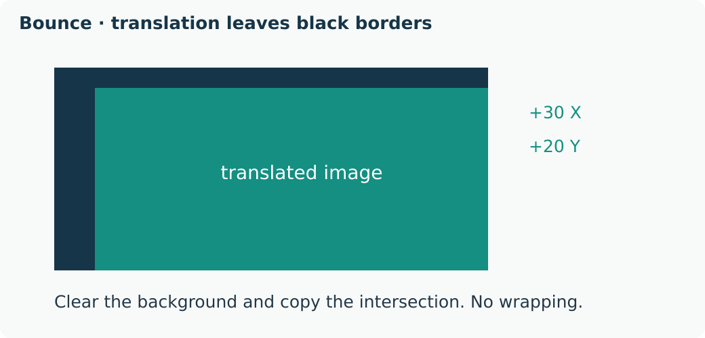

# bounce — Translate an image and clip its edges

*[Español](README.md)* · **Lesson 6 of 10** · [Source](../../../../demos/bounce/bounce.c) · [Shared foundations](../../BASES-EN.md)




*A schematic image moves right and down and is clipped to the viewport.*

## What you will learn

Apply sprite clipping to a full image and distinguish a calculated trajectory from simulated physical bounces.

The source does not collide with walls and reverse velocity. It directly computes:

```text
offset_x = sine(angle_x)*90/256
offset_y = cosine(angle_y)*60/256
angle_x advances by 3; angle_y by 5
```

The initial offset is `(0,60)`: the picture begins 60 pixels down. Both phases repeat together after **256 frames**, about 3.66 seconds at 70 fps. The path is a discrete Lissajous trajectory with a definite short period.

## Translate without wrapping

Unlike scroll, departing pixels do not reappear at the opposite edge. Clear `screen` to black, then copy the visible intersection.

For screen row Y, use `source_y=y-offset_y`. If it is outside 0–199, leave the row black. At vertical offset 20, screen row 20 reads source row 0 and the first 20 rows stay black.

| X offset | Destination start | Source start | Width |
|---:|---:|---:|---:|
| +30 | 30 | 0 | 290 |
| 0 | 0 | 0 | 320 |
| −30 | 0 | 30 | 290 |

Keep positions signed while finding those spans. Construct pointers and convert offsets only after validating the source row and positive copy width.

## Numeric limits and trajectory changes

The current sine products reach 23040 and 15360, fitting signed 16-bit arithmetic. An amplitude of 200 reaches 51200 and requires widening before multiplication. The later `copy_width <= 0` guard cannot repair prior overflow.

Setting both phase speeds to 4 produces an **ellipse**, because X uses sine and Y uses cosine. It does not produce a diagonal. Using sine on both axes with identical phases would produce a straight-line path.

## Cost

Each frame clears 64000 bytes and copies up to 200 visible row spans. Offset `(30,20)` copies `290*180=52200` additional bytes before VGA presentation. Only two sine/cosine lookups are needed; most work is memory movement.

## Workshop with answer

**Predict:** offset `(−12,7)`. **Answer:** source X=12..319 and Y=0..192; destination X=0..307 and Y=7..199. The visible rectangle is 308 ×193, with black above and on the right.

**Practice:** freeze motion and test `(0,0)`, `(30,20)` and `(−30,−20)` in a working copy. Grid lines should remain straight without stretching or wrapping.

**Extension:** replace the phase model with position and velocity reversed at limits. That would simulate bounces; describe its additional state and different trajectory.

---

[Previous: wobble](../../wobble/doc/README-EN.md) · [Next: ripple](../../ripple/doc/README-EN.md) · [Index](../../README-EN.md)
