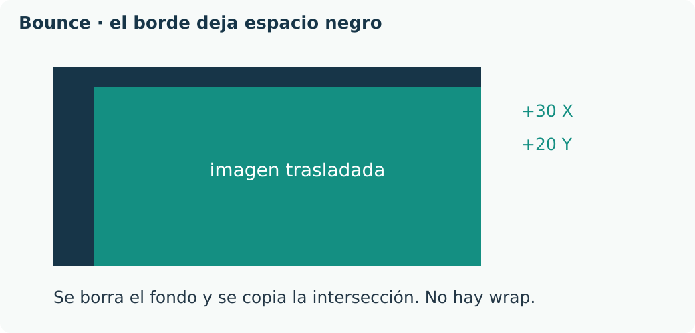

# bounce — Trasladar, recortar y dejar ver el fondo

*[English](README-EN.md)* · **Lección 6 de 10** · [Código](../../../../demos/bounce/bounce.c) · [Bases comunes](../../BASES.md)




*Ejemplo proporcional de una imagen desplazada hacia derecha y abajo, con recorte.*

## Lo que vas a aprender

Aplicar el recorte de un sprite a una imagen completa y distinguir una trayectoria calculada de una simulación física de rebotes.

## No hay velocidad que choque con una pared

El nombre sugiere rebote, pero el código no detecta un borde y cambia el signo de una velocidad. Calcula dos desplazamientos independientes:

```text
offset_x = seno(angle_x) * 90 / 256
offset_y = coseno(angle_y) * 60 / 256
angle_x avanza 3; angle_y avanza 5
```

X oscila entre −90 y 90; Y entre −60 y 60. Al principio seno(0)=0 y coseno(0)=256, así que la imagen comienza desplazada **60 píxeles hacia abajo**. No empieza centrada verticalmente.

Las dos oscilaciones componen una trayectoria de Lissajous. Como las fases enteras trabajan módulo 256 y 3 y 5 son coprimos con 256, el par se repite tras **256 frames**, aproximadamente 3,66 s a 70 fps. No es una trayectoria que tarde muchísimo en cerrarse.

## Una traslación sin envoltorio

A diferencia de scroll, lo que sale por un borde no entra por el otro. Se pone `screen` a negro y se copia solo la parte visible. Para cada fila de pantalla:

```text
source_y = y - offset_y
si source_y está fuera de 0..199, dejar negro
```

Con offset Y=20, las primeras veinte filas quedan negras y la fila de pantalla 20 lee la fila original 0. El signo menos expresa que estamos buscando el origen de un píxel de destino.

## Dos casos horizontales

| Desplazamiento X | Primer destino | Primer origen | Anchura |
|---:|---:|---:|---:|
| +30 | 30 | 0 | 290 |
| 0 | 0 | 0 | 320 |
| −30 | 0 | 30 | 290 |

Fragmento central, con variables `int` declaradas previamente:

```c
if (offset_x >= 0) {
    destination_x = offset_x;
    source_x = 0;
    copy_width = DEMO_WIDTH - offset_x;
} else {
    destination_x = 0;
    source_x = -offset_x;
    copy_width = DEMO_WIDTH + offset_x;
}
```

Solo cuando la fila y la anchura son válidas se construyen los punteros y se convierte a unsigned. Con coordenadas negativas convertidas antes, la supuesta esquina izquierda se convierte en una dirección enorme.

## Qué se puede cambiar con seguridad numérica

Los productos actuales alcanzan 23040 y 15360: caben en signed int de 16 bits. Subir una amplitud a 200 produce hasta 51200 y necesita ampliar a `long` antes de multiplicar. El chequeo `copy_width <= 0` no arregla ese desbordamiento anterior.

Igualar ambas velocidades a 4 produce una **elipse**, porque X usa seno y Y coseno. No produce una diagonal. Con seno en ambos ejes y fases iguales, sí obtendrías una trayectoria lineal. Esta diferencia permite entender para qué sirve el cuarto de vuelta del coseno.

## Trabajo por frame

Se borran 64000 bytes y se copian hasta 200 filas visibles. Con desplazamiento `(30,20)`, se copian `290*180=52200` bytes además del borrado. Después se presenta el buffer. Solo hay dos consultas de seno/coseno por frame; el coste está principalmente en mover memoria.

## Taller con respuesta

**Predice:** offset `(−12,7)`. ¿Qué parte se ve? **Respuesta:** origen X=12..319 y Y=0..192; destino X=0..307 y Y=7..199. Rectángulo 308 × 193; negro arriba y a la derecha.

**Práctica:** congela las fases y prueba `(0,0)`, `(30,20)` y `(−30,−20)` como desplazamientos en tu copia. Debe mantenerse cada línea recta de la imagen; no se estira ni se envuelve.

**Ampliación:** sustituye la tabla por posición y velocidad con inversión al llegar a límites. Esa nueva versión sí simularía rebotes. Explica qué estado adicional necesita y por qué su trayectoria difiere de la actual.

---

[Anterior: wobble](../../wobble/doc/README.md) · [Siguiente: ripple](../../ripple/doc/README.md) · [Índice](../../README.md)
