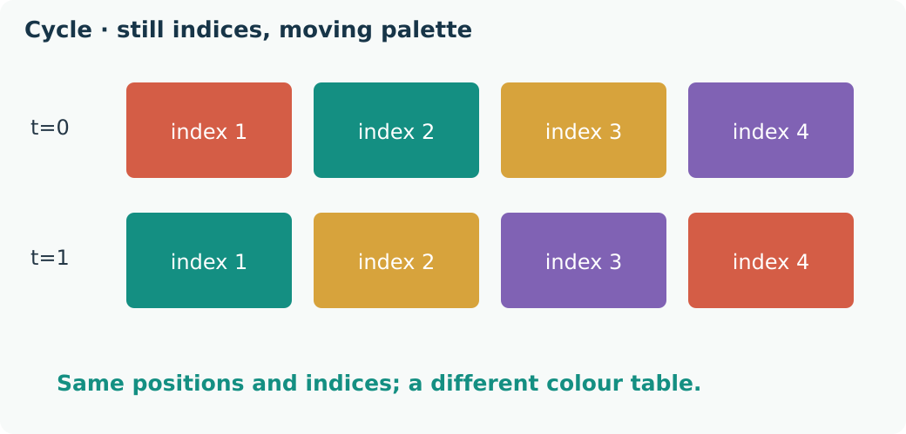

# cycle — Animate colours while pixels stay still

*[Español](README.md)* · **Lesson 1 of 10** · [Source](../../../../demos/cycle/cycle.c) · [Shared foundations](../../BASES-EN.md)




*A permutation changes the colour assigned to each index.*

## What you will learn

Separate colour indices from RGB values, rotate whole palette entries and keep audio serviced when the image needs no reconstruction.

## Start with four entries

A pixel containing 37 selects palette entry 37. Changing that entry changes every matching pixel without moving one byte of image data.

```text
index       0       1       2       3
before      black   red     green   blue
after       black   green   blue    red
pixels      1 1 2 3 0 remain 1 1 2 3 0
```

The real effect rotates entries 1–255 and preserves entry 0 for black borders. A deliberately ordered colour ramp can suggest flowing water; an arbitrary photograph usually produces colour changes rather than coherent motion.

## Follow four decisions in the source

1. Copy `image` into `screen` and call `demo_show()` once.
2. Wait for retrace and count frames.
3. Every `CYCLE_EVERY=3`, save the first entry, move following entries down and place the saved one last.
4. Write the palette and call `demo_sound()` for audio and the host callback.

Entries are three-byte BGR groups scaled to 0–63; the DAC writer emits RGB. Move all three components together. Rotating individual bytes would mix channels from different colours.

The forward loop reads the next entry before overwriting the current one. To reverse the rotation, save the last entry and traverse backwards.

## Period and cost

The 255-entry permutation needs 255 rotations to return. At one rotation every three frames that is **765 frames**, or about 10.93 seconds at a sustained 70 fps. The current seven-second effect interval normally ends before that. With `CYCLE_EVERY=1`, the nominal period is 3.64 seconds. Repeated colours can make the visible pattern repeat sooner.

After initial presentation, no further 64000-byte pixel copies are needed. Each rotation shifts 254 entries and restores one: 765 array bytes written, plus the small saved copy. The DAC function writes 768 colour components and selects the starting index; there are not 1024 colour components.

## Limits and ownership

The palette remains rotated on exit. The player fades using its current contents, then loads the next image's palette. It does not secretly restore the original on ESC.

Changing `CYCLE_FIRST` to zero while keeping `CYCLE_COUNT=255` includes black but excludes another entry. Keep the complete range consistent and ensure `FIRST+COUNT <= 256`.

## Workshop with answer

**Predict:** movable palette `[A,B,C,D]`, image indices `[1,4,2]`. After two left rotations, which colours appear?

**Answer:** palette `[C,D,A,B]`, displayed colours `[C,B,D]`.

**Practice:** use four labelled bands with consecutive indices and rotate only their entries. Colours should change while band positions and widths remain fixed. A changing black background indicates a wrong range; unrelated channel changes suggest a wrong three-byte step.

**Extension:** design separate water and light ramps with independent counters. Explain why both animations still require no pixel movement.

---

[Next: scroll](../../scroll/doc/README-EN.md) · [Index](../../README-EN.md)
