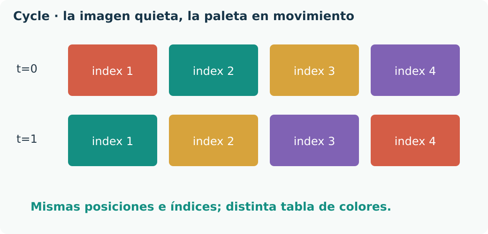

# cycle — Animar colores sin mover los píxeles

*[English](README-EN.md)* · **Lección 1 de 10** · [Código](../../../../demos/cycle/cycle.c) · [Bases comunes](../../BASES.md)




*Una permutación cambia el aspecto de todos los píxeles con cada índice.*

## Lo que vas a aprender

Separar índice y color, girar un array de entradas completas y mantener el audio cuando no hay que reconstruir la pantalla. Lee primero las bases comunes si es tu primer efecto.

## De una tabla pequeña al DAC

Un píxel cuyo byte vale 37 no contiene rojo ni azul: consulta la entrada 37 de la paleta. Si cambia esa entrada, cambian todos los píxeles de índice 37 sin modificar sus posiciones.

Supón esta paleta diminuta:

```text
índice      0       1       2       3
antes       negro   rojo    verde   azul
después     negro   verde   azul    rojo

píxeles     1 1 2 3 0       siguen siendo 1 1 2 3 0
aspecto     R R V A negro   pasa a V V A R negro
```

El efecto real gira las entradas 1–255. Deja quieta la 0 para conservar el negro de los bordes. Una imagen dibujada con una rampa de índices puede parecer agua en movimiento; una fotografía arbitraria suele cambiar de colores sin sugerir un desplazamiento coherente.

## Sigue el código en cuatro decisiones

1. Copia `image` en `screen` y llama a `demo_show()` una vez.
2. Espera retrazo en cada iteración y cuenta frames.
3. Cada `CYCLE_EVERY=3`, guarda los tres componentes de la primera entrada, mueve las siguientes hacia abajo y coloca la guardada al final.
4. Escribe la paleta y llama a `demo_sound()` para atender audio y callback.

Las entradas se almacenan en grupos de tres bytes BGR adaptados a 0–63; la función de escritura los entrega al DAC en orden RGB. Mover un solo byte mezclaría canales de colores diferentes. El fragmento conceptual completo es:

```text
guardar entrada 1
para entrada = 1 hasta 254:
    entrada actual = entrada siguiente, sus tres componentes
entrada 255 = entrada guardada
```

Se recorre de menor a mayor porque se lee la siguiente entrada antes de sobrescribirla. Para girar en el otro sentido tendrías que guardar la última y recorrer al revés.

## Cuánto dura una vuelta

Hay 255 entradas móviles. Una vuelta de la permutación necesita 255 giros; con un giro cada tres frames son **765 frames**, aproximadamente 10,93 s si se sostienen 70 fps. Con el intervalo de efecto actual de siete segundos normalmente no se completa esa vuelta. Con `CYCLE_EVERY=1` serían aproximadamente 3,64 s.

Una paleta con colores repetidos puede mostrar un periodo visual menor. Distingue que la tabla vuelva a su orden original de que dos capturas parezcan iguales.

## Trabajo y límites

Después de la presentación inicial no se copian de nuevo 64000 píxeles. En cada giro se trasladan 254 entradas y se restaura una: 765 bytes de escritura en el array, además del pequeño guardado. La rutina DAC escribe 768 componentes y selecciona el índice de inicio; no son 1024 componentes.

El efecto deja la paleta girada. El reproductor funde usando la paleta actual y carga la de la siguiente imagen. No hay una restauración secreta de la paleta original al salir con ESC.

Cambiar `CYCLE_FIRST` a 0 conservando `CYCLE_COUNT=255` incluiría negro pero dejaría otra entrada fuera. Para girar las 256 entradas, el rango completo debe ser coherente. Nunca dejes que `FIRST+COUNT` supere 256.

## Taller con respuesta

**Predice:** paleta móvil `[A,B,C,D]`, índices de imagen `[1,4,2]`. ¿Qué colores aparecen tras dos giros hacia la izquierda?

**Respuesta:** paleta `[C,D,A,B]`, colores `[C,B,D]`.

**Práctica:** usa una imagen de prueba con cuatro franjas de índices consecutivos y gira solo ese rango. Deben cambiar de color sin cambiar de anchura ni posición. Si cambia el negro exterior, revisa el rango. Si solo cambian canales sueltos, revisa el paso de tres bytes.

**Ampliación:** define dos rampas independientes, por ejemplo agua y luces. Explica cómo dos contadores permiten animarlas a ritmos diferentes sin mover píxeles.

---

[Siguiente: scroll](../../scroll/doc/README.md) · [Índice](../../README.md)
