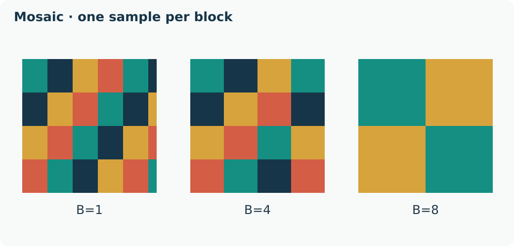

# mosaic — One sample colours an entire block

*[Español](README.md)* · **Lesson 8 of 10** · [Source](../../../../demos/mosaic/mosaic.c) · [Shared foundations](../../BASES-EN.md)




*A 16 × 16 teaching pattern sampled at each block’s top-left corner.*

## What you will learn

Rebuild an image by regions, clip partial blocks and recognise when an unchanged result can be reused.

Each block takes its top-left pixel:

```text
A B C D      A A A A
E F G H  →   A A A A
I J K L      A A A A
M N O P      A A A A
```

This is sampling, not averaging. Averaging palette indices does not generally average their colours.

## Size from phase

`block=1+(sine(phase)+256)*39/512` produces 1 at minimum sine,20 at zero and 40 at maximum. Initial phase is zero, so the effect starts at block 20. Phase advances by 2 and repeats after 128 frames.

The initial 1 prevents a zero step in the block loops. The present maximum intermediate product is 19968, within signed 16-bit range.

## Render partial rectangles

At each block origin, use `width=min(block,320-x)` and `height=min(block,200-y)`. Read one source pixel and fill the resulting rectangle row by row.

Block 30 produces 11 ×7 blocks with partial widths/heights of 20 at the edges. Block 40 produces 8 ×5 complete blocks. Partial edge blocks are explicitly supported.

## Cache an identical result

`last_block=-1` forces the first rebuild. If the size repeats, the image and sampling grid are unchanged, so reuse `screen` while still presenting and servicing audio. If another parameter changed the sampled result, block size alone would no longer be a valid cache key.

The actual table sampled every second phase yields **78 size transitions and 50 repeated sizes in a closed 128-frame cycle**: approximately 39.1% of reconstructions can be skipped, not 93%. Startup forces a first draw and partial intervals have different proportions.

Block 1 has a separate identity optimisation: one 64000-byte copy replaces 64000 one-byte fills.

## Cost and bounds

A rebuilt frame with B>1 reads `ceil(320/B)*ceil(200/B)` samples and performs `ceil(320/B)*200` row fills, covering 64000 bytes. At B=40 this means 40 samples and 1600 fills.

Changing the maximum to 100 makes the intermediate product 50688 and requires `long` before multiplication. It would create 4 ×2=8 blocks, not four.

## Workshop with answer

**Predict:** B=17, last origin `(306,187)`. **Answer:** width 14, height 13,182 output pixels from one sample.

**Practice:** freeze sizes 1,20,30 and 40. Verify identity, block counts and trimmed edges, then enable the sine and count size transitions.

**Extension:** use independently sized rectangular blocks. Both dimensions must be part of the reuse decision.

---

[Previous: ripple](../../ripple/doc/README-EN.md) · [Next: zoom](../../zoom/doc/README-EN.md) · [Index](../../README-EN.md)
