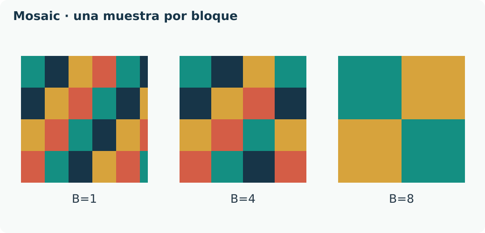

# mosaic — Un píxel decide el color de todo un bloque

*[English](README-EN.md)* · **Lección 8 de 10** · [Código](../../../../demos/mosaic/mosaic.c) · [Bases comunes](../../BASES.md)




*Patrón didáctico de 16 × 16: cada bloque conserva la muestra de su esquina superior izquierda.*

## Lo que vas a aprender

Reconstruir una imagen por regiones, tratar bloques parciales y reconocer cuándo un resultado puede reutilizarse sin volver a calcularlo.

## Muestrear no es promediar

Cada bloque usa el color de su esquina superior izquierda:

```text
origen 4x4           resultado de un bloque 4x4
A B C D             A A A A
E F G H             A A A A
I J K L             A A A A
M N O P             A A A A
```

No se promedian índices. El promedio de los índices 10 y 20 no tiene por qué representar una mezcla de sus colores: una paleta puede ordenarlos arbitrariamente. Promediar colores necesitaría trabajar con componentes y decidir cómo volver a un índice.

## Convertir fase en tamaño

```text
block = 1 + (seno(phase)+256)*39/512
```

Con seno−256 el bloque mide 1; con seno 0 mide 20; con seno 256 mide 40. El frame inicial tiene fase 0, por lo que empieza en 20, no en el máximo 40. Phase avanza 2 y recorre un ciclo de 128 frames.

El `1+` evita un bloque cero, que impediría avanzar en `x += block` y `y += block`. El producto máximo actual es 512*39=19968 y cabe en `int` de 16 bits.

## Recorrer rectángulos

Para cada esquina de bloque `(x,y)`:

1. Calcula `width=min(block,320-x)` y `height=min(block,200-y)`.
2. Lee el color en `image[demo_row[y]+x]`.
3. Rellena `height` filas de `width` píxeles con ese color.

Con bloque 30 hay 11 columnas y 7 filas de bloques: el último mide 20 de ancho y 20 de alto. Con bloque 40 salen 8×5=40 bloques exactos. Los bloques parciales son normales y están tratados; no son corrupción del borde.

## Reutilizar un resultado idéntico

`last_block` empieza en−1 para forzar el primer dibujo. Si el nuevo tamaño coincide, `screen` ya contiene exactamente el resultado deseado: se presenta y se atiende sonido, pero no se reconstruye el mosaico.

Esta optimización es válida porque no cambia la imagen ni la posición de la cuadrícula. Si animases también el origen de muestreo, comparar solo `block` dejaría de ser suficiente.

La tabla actual, recorrida de dos en dos, produce **78 cambios de tamaño y 50 repeticiones en un ciclo cerrado de 128 frames**. El ahorro de reconstrucciones en ese ciclo es aproximadamente 39,1 %, no 93 %. En el arranque se fuerza el primer dibujo y en un intervalo parcial la proporción puede variar.

El caso `block==1` se resuelve con una copia de 64000 bytes en vez de 64000 rellenos de un byte. Son dos optimizaciones diferentes: reutilizar un resultado previo y escoger una operación mejor para la identidad.

## Trabajo y parámetros

Cuando se reconstruye con bloque B mayor que 1, se leen `ceil(320/B)*ceil(200/B)` muestras y se hacen `ceil(320/B)*200` rellenos de fila. Siempre se cubren 64000 bytes. Con B=40:40 muestras y 1600 rellenos. Aunque solo haya 40 colores muestreados, el buffer completo sigue escribiéndose.

Subir el máximo a 100 da un producto de 512*99=50688: necesita `long` antes de multiplicar. Y una imagen 320×200 tendría 4×2=8 bloques, no cuatro. No cambies la constante sin revisar las cuentas intermedias.

## Taller con respuesta

**Predice:** bloque 17, esquina final `(306,187)`. **Respuesta:** anchura 14, altura 13 y 182 píxeles rellenados con una sola muestra.

**Práctica:** fija B en 1,20,30 y 40. Verifica la imagen original, el número de bloques y los restos. Después activa el seno y cuenta cambios de tamaño para comprobar cuándo se reutiliza el frame.

**Ampliación:** usa bloques rectangulares de anchura y altura independientes. La clave de caché debe contener ambos tamaños; de lo contrario podrías reutilizar una imagen que ya no corresponde a la configuración.

---

[Anterior: ripple](../../ripple/doc/README.md) · [Siguiente: zoom](../../zoom/doc/README.md) · [Índice](../../README.md)
