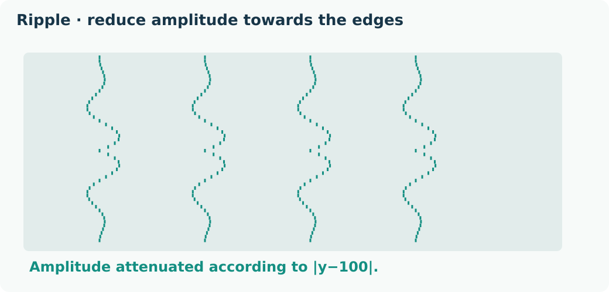

# ripple — Let a wave weaken towards the edges

*[Español](README.md)* · **Lesson 7 of 10** · [Source](../../../../demos/ripple/ripple.c) · [Shared foundations](../../BASES-EN.md)




*A continuous illustration; rows at equal distance share displacement.*

## What you will learn

Use distance from a centre line and an amplitude envelope. This is a row deformation, not a two-dimensional circular water simulation.

```text
distance = abs(y-100)
amplitude = 20*(100-distance)/100
shift = sine(phase + distance*4)*amplitude/256
```

Rows 50 and 150 have the same distance, amplitude and phase, so they shift equally. Amplitude is the maximum possible displacement, not the current displacement itself.

## Build the envelope

| Row | Distance | Integer amplitude |
|---:|---:|---:|
| 0 | 100 | 0 |
| 25 | 75 | 5 |
| 50 | 50 | 10 |
| 100 | 0 | 20 |
| 150 | 50 | 10 |
| 199 | 99 | 0 |

The final row reaches zero through integer truncation. The centre line is 100 while row indices run 0–199, so the two boundaries are not perfectly symmetric.

Without attenuation, the edges would move as strongly as the centre. This would still differ from ordinary wobble because phase depends on absolute distance rather than Y directly.

## Derive propagation direction

Phase advances by−5. Following a crest means keeping `phase+4*distance` approximately constant. A phase decrease of 5 requires distance to increase by 1.25, so the crest moves outward. Reversing speed to+5 moves it inward.

This reasoning describes an ideal continuous pattern; rows and integer samples quantise it. The spatial wavelength is 64 rows of distance. Temporal phase repeats after 256 frames.

## Render and count the work

Displacement stays in−20..20. Add 320 to a negative value and perform scroll's two circular copies. A zero-amplitude row copies unchanged.

Attenuation adds one multiplication and one division per row; displacement adds another product and scale reduction. A frame uses 200 sine lookups and 400 span copies covering 64000 bytes, followed by presentation.

Larger amplitudes require reviewing signed 16-bit products and the one-addition wrap assumption. A quadratic envelope is a visual design choice, not automatically a more physically accurate model.

## Workshop with answer

**Predict:** row 50, sampled sine 128. **Answer:** distance 50, amplitude 10, displacement 5. Row 150 produces the same displacement.

**Practice:** use vertical grid lines. Compare speeds−5 and+5, then remove attenuation alone. Distinguish reversing travel from strengthening edge motion.

**Extension:** propose a truly circular wave. Its distance would depend on both X and Y, requiring per-pixel sampling rather than two row copies. Explain the extra work before implementing it.

---

[Previous: bounce](../../bounce/doc/README-EN.md) · [Next: mosaic](../../mosaic/doc/README-EN.md) · [Index](../../README-EN.md)
