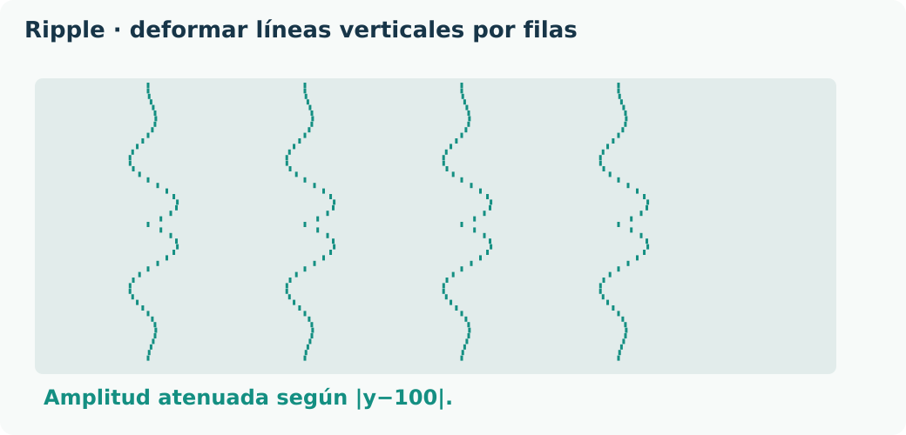

# ripple — Una onda que pierde fuerza hacia los bordes

*[English](README-EN.md)* · **Lección 7 de 10** · [Código](../../../../demos/ripple/ripple.c) · [Bases comunes](../../BASES.md)




*Esquema continuo para leer la forma de la onda; la implementación usa la tabla entera.*

## Lo que vas a aprender

Usar distancia al centro y una envolvente de amplitud. El efecto transforma filas: no calcula una onda circular bidimensional ni simula la física de un estanque.

## Cambiar la variable espacial

Wobble usa directamente Y en la fase. Ripple usa la distancia de la fila a la línea central Y=100:

```text
distance = abs(y-100)
amplitude = 20*(100-distance)/100
shift = seno(phase + distance*4)*amplitude/256
```

Las filas 50 y 150 tienen la misma distancia, amplitud y fase. Se desplazan igual. Esa simetría hace que la deformación parezca nacer del centro hacia arriba y abajo.

La amplitud se calcula antes que el desplazamiento. Es un máximo permitido; no es la posición que necesariamente tendrá esa fila.

## Construir la envolvente

| Fila | Distancia | Amplitud entera |
|---:|---:|---:|
| 0 | 100 | 0 |
| 25 | 75 | 5 |
| 50 | 50 | 10 |
| 100 | 0 | 20 |
| 150 | 50 | 10 |
| 199 | 99 | 0 |

En la última fila sale cero por truncamiento de `20/100`. La línea central está en 100, mientras la imagen contiene 0..199: la geometría de índices no es perfectamente simétrica entre los dos extremos.

Sin la envolvente, seguirías teniendo una onda basada en distancia, pero el borde ondularía con la misma fuerza que el centro. Con amplitud constante tampoco se convierte exactamente en el wobble original, cuya fase depende de Y y no de su valor absoluto respecto al centro.

## Deducir la dirección de propagación

La fase avanza−5 por frame. Para seguir una cresta debes mantener aproximadamente constante `phase+4*distance`. Si phase baja 5, distance debe subir 1,25 para compensarlo: la cresta se aleja del centro.

Con velocidad+5 ocurre lo contrario. Este razonamiento describe el desplazamiento de un patrón continuo ideal; las filas y la tabla enteras lo cuantizan. No es una velocidad de fluido ni una ley física de atenuación.

La longitud espacial de una vuelta es 64 filas de distancia (`256/4`). La fase temporal vuelve tras 256 frames porque 5 y 256 son coprimos.

## Dibujar la fila

El desplazamiento queda entre−20 y 20. Si es negativo se suma 320, y se usan las dos copias circulares de scroll. Una fila de amplitud cero se copia sin desplazamiento. La imagen original no cambia.

La atenuación hace un producto y una división por fila; el desplazamiento añade otro producto y una reducción de escala. No son dos multiplicaciones adicionales de atenuación. El frame realiza 200 consultas de seno y 400 copias que cubren 64000 bytes, más presentación.

## Parámetros y límites

La amplitud actual 20 mantiene pequeños los productos. Si la aumentas, revisa `amplitude*256` en 16 bits y el rango que puede envolver una sola suma. Si cambias el centro, modifica también la distancia máxima de cada lado o acepta una envolvente asimétrica deliberada.

Una caída cuadrática sería una elección visual: no se vuelve automáticamente «más física». Para probarla, define primero una fracción de distancia normalizada y eleva esa fracción al cuadrado ampliando los productos.

## Taller con respuesta

**Predice:** fila 50, seno consultado 128. **Respuesta:** distancia 50, amplitud 10, desplazamiento 5. Fila 150 produce el mismo desplazamiento.

**Práctica:** dibuja líneas verticales en una imagen de prueba. Compara velocidad−5 y+5; después elimina solo la atenuación. Debes distinguir inversión del recorrido de aumento de fuerza en los extremos.

**Ampliación:** propone una onda circular de verdad. Necesitaría una distancia dependiente de X e Y y desplazamientos por píxel, por lo que ya no bastan dos copias por fila. Explica ese aumento de coste antes de implementarla.

---

[Anterior: bounce](../../bounce/doc/README.md) · [Siguiente: mosaic](../../mosaic/doc/README.md) · [Índice](../../README.md)
