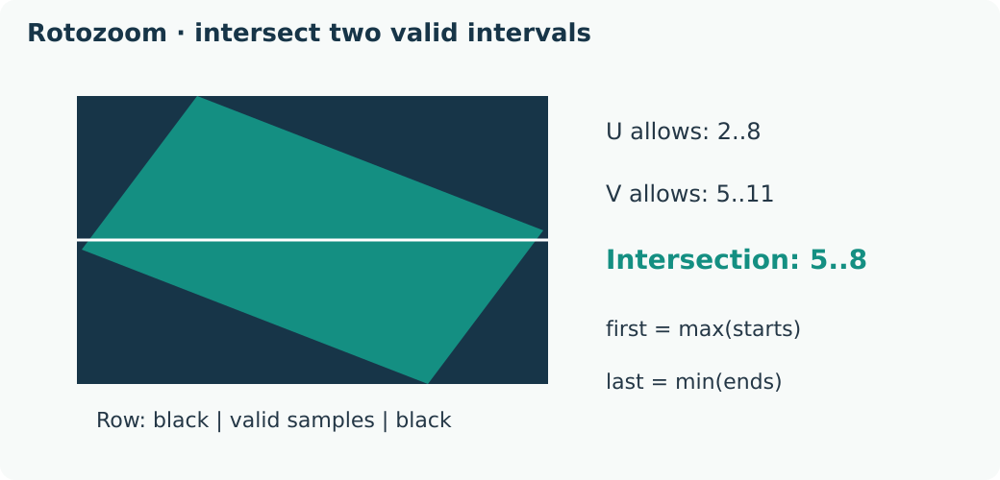

# rotozoom — Rotation, scaling and one visible span per row

*[Español](README.md)* · **Lesson 10 of 10** · [Source](../../../../demos/rotozoom/rotozoom.c) · [Shared foundations](../../BASES-EN.md)




*A source pixel must satisfy both the U and V bounds.*

## What you will learn

Build a transform from two directions, replace repeated products with increments and solve valid intervals before sampling pixels. Complete zoom first.

## Derive signs from the implementation

With centre `(160,100)`, sine s, cosine c and inverse step S:

```text
u=160+S*(c*(x-160)-s*(y-100))
v=100+S*(s*(x-160)+c*(y-100))
```

These signs match the executed increments `du_dy=-dv_dx`, `dv_dy=du_dx`. The original introductory source comment shows different signs. Inverse sampling also means the visible image rotation is inverse to the destination-to-source coordinate rotation; remember that screen Y increases downward.

```c
du_dx = ((long)demo_cos(angle) * scale) >> DEMO_SHIFT;
dv_dx = ((long)demo_sin(angle) * scale) >> DEMO_SHIFT;
du_dy = -dv_dx;
dv_dy = du_dx;
```

Subtract 160 horizontal increments and 100 vertical increments from the source centre to obtain the source corner. Advance U/V by the horizontal increments per pixel and the row origin by the vertical increments per row.

This removes four products per pixel from direct evaluation. Sampling still requires coordinate conversion, memory reads/writes and row lookup; two additions are the coordinate update, not the entire pixel cost.

## Check two orientations

At scale 256 and phase 0, U=X and V=Y: identity. At scale 256 and phase 64, `u=260-y`, `v=x-60`; destination `(170,100)` reads source `(160,110)`. The centre remains fixed.

Scale ranges 128..512, representing inverse steps 0.5..2. Rotation phase advances 2 and breathing phase 1; their combined phase state repeats after 256 frames.

## Solve the visible interval

For each source coordinate, `rotozoom_span` solves:

```text
0 <= start+x*step < limit
```

All quantities use fixed point; U's limit is 320*256 and V's is 200*256. The strict upper bound explains `limit-1` in integer formulas.

For positive step, take start−5, step 3 and limit 10. Values are−5,−2,1,4,7,10, so valid X is 2..4. The lower bound uses ceiling division `(5+3-1)/3=2`; the upper bound uses `(10-1+5)/3=4`.

For negative step, take start 14, step−3 and limit 10:14,11,8,5,2,−1, again yielding 2..4. The implementation changes sign to divide nonnegative quantities, avoiding C 89's negative-division rounding variation.

For step 0, either start is valid and the whole row qualifies, or no X qualifies. This explicit branch avoids division by zero. Zero scale would be a visual degeneracy, not an inevitable division failure.

## Intersect both coordinates

If U allows 2..8 and V allows 5..11, keep 5..8. Take the larger first endpoint and smaller last endpoint, then restrict to screen columns 0..319. Empty intersections become black rows; otherwise fill the borders and sample the interior.

Both source coordinates must be valid. The single-span property follows from convexity; it is not true for arbitrary nonconvex shapes or nonlinear per-pixel deformations.

## Cost and pitfalls

There are frame-level increments, up to two span calculations per row and samples only inside the valid region. Zoom's single column table does not generally apply because source U changes between rows.

Changing `du_dy` to positive `dv_dx` is not always a mirror: it changes the matrix and may shear or become singular. When sine equals cosine, its two directions coincide.

## Workshop with answer

**Predict:** U allows 3..20 and V allows 8..12. **Answer:** five pixels, X=8..12. This helper uses inclusive endpoints.

**Practice:** test identity at angle 0, then a quarter turn at phase 64 with a labelled arrow. Enumerate the positive, negative and zero-step span examples before enabling animation.

**Extension:** compare the interval renderer against per-pixel U/V bounds checks for identical integer increments. They should produce exactly matching colour indices, which is stronger evidence than similar-looking animation.

---

[Previous: zoom](../../zoom/doc/README-EN.md) · [Index](../../README-EN.md)
