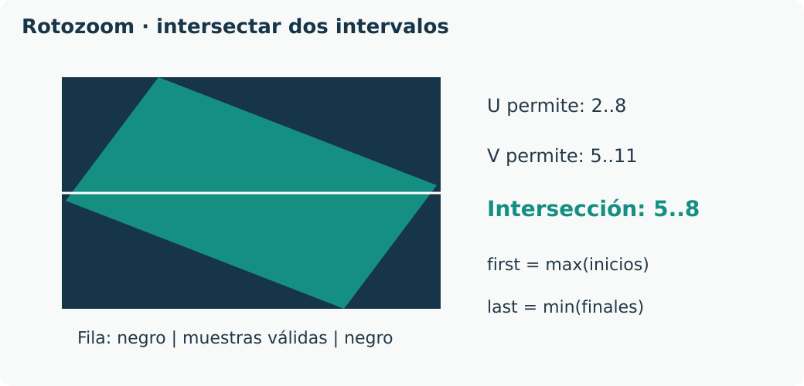

# rotozoom — Rotación, escala y un tramo visible por fila

*[English](README-EN.md)* · **Lección 10 de 10** · [Código](../../../../demos/rotozoom/rotozoom.c) · [Bases comunes](../../BASES.md)




*El tramo visible necesita cumplir simultáneamente los límites de U y de V.*

## Lo que vas a aprender

Construir una transformación a partir de dos direcciones, sustituir productos repetidos por incrementos y resolver intervalos antes del bucle de píxeles. Completa zoom y las bases de punto fijo antes de esta lección.

## Deriva los signos del código

Para destino `(x,y)`, centro `(160,100)`, seno s, coseno c y paso inverso S:

```text
u = 160 + S * ( c*(x-160) - s*(y-100))
v = 100 + S * ( s*(x-160) + c*(y-100))
```

Estos signos corresponden a los incrementos reales: `du_dy=-dv_dx` y `dv_dy=du_dx`. El comentario introductorio del archivo original presenta otros signos; para deducir la imagen sigue las operaciones ejecutadas.

Como es una búsqueda de origen desde destino, el giro visual de la imagen es el inverso del giro con que calculas esas coordenadas de origen. Prueba una flecha para distinguir ambos, teniendo en cuenta que Y crece hacia abajo.

## Una transformación lineal cambia siempre lo mismo

Dentro de un frame:

```c
du_dx = ((long)demo_cos(angle) * scale) >> DEMO_SHIFT;
dv_dx = ((long)demo_sin(angle) * scale) >> DEMO_SHIFT;
du_dy = -dv_dx;
dv_dy = du_dx;
```

Los dos primeros valores indican qué cambia en el origen al avanzar una columna de pantalla. Los dos últimos indican qué cambia al bajar una fila. Se calculan una vez y se suman después:

```text
origen de la esquina = centro de imagen
                    - 160 * dirección horizontal
                    - 100 * dirección vertical
por cada píxel: u += du_dx; v += dv_dx
por cada fila: origen_fila += dirección vertical
```

Esto elimina cuatro multiplicaciones por píxel de una evaluación directa. El bucle todavía hace lecturas, escritura, conversión de coordenadas y acceso a tabla de filas: «dos sumas» describe la actualización de coordenadas, no todo el coste del píxel.

## Comprueba dos orientaciones

Con S=1 y fase 0: c=1, s=0. Sale u=x, v=y: identidad.

Con S=1 y fase 64: c=0, s=1. Sale `u=260-y`, `v=x-60`. Por ejemplo, destino `(170,100)` lee origen `(160,110)`. El centro sigue leyendo `(160,100)`.

La escala oscila entre 128 y 512, es decir paso 0,5..2. El giro avanza 2 y la respiración 1: sus fases repiten conjuntamente tras 256 frames. La imagen puede presentar simetrías con periodos visuales menores.

## Recortar antes de muestrear

En una fila, cada coordenada sigue una recta: `start+x*step`. La función `rotozoom_span` busca los X para los que:

```text
0 <= start + x*step < limit
```

`start`, `step` y `limit` usan punto fijo. Para U, `limit=320*256`; para V, `200*256`. El final superior es excluido, por eso aparecen expresiones con `limit-1` al trabajar con enteros.

### Paso positivo

Ejemplo en unidades pequeñas: start=−5, step=3, limit=10. Valores para X=0..5:−5,−2,1,4,7,10. El tramo válido es X=2..4.

```text
first = ceil(5/3) = (5+3-1)/3 = 2
last  = floor((10-1+5)/3) = 4
```

La fórmula de techo `(a+b-1)/b` se usa con a≥0 y b>0. El código separa los casos para evitar depender del redondeo de divisiones negativas en C 89.

### Paso negativo o cero

Con start 14, step−3 y limit 10: valores 14,11,8,5,2,−1; tramo 2..4. Se usa `down=-step` y divisiones positivas.

Con step 0, todos los X leen el mismo valor: si start está dentro, vale toda la fila; si está fuera, no vale ninguno. Esta rama evita dividir por cero. Escala cero sería una degeneración visual; no un fallo inevitable de división en esta función.

## Intersecar U y V

Si U permite X=2..8 y V permite X=5..11, el tramo final es 5..8:

```text
first = max(first_u,first_v)
last  = min(last_u,last_v)
```

Después se limita a 0..319. Si first>last, se rellena la fila de negro. En caso contrario, se rellenan bordes y se muestrea solo el tramo válido. Tanto U como V deben pertenecer a la imagen; uno solo no basta.

La intersección es un tramo porque el rectángulo transformado es convexo. No generalices esa propiedad a cualquier cuadrilátero no convexo ni a una deformación arbitraria por píxel.

## Trabajo, trampas y taller

Se calculan los incrementos una vez, hasta dos intervalos por fila y se muestrean únicamente los píxeles interiores. Una tabla de columnas como zoom no sirve en general: al bajar de fila cambia también U.

Cambiar `du_dy=-dv_dx` por `du_dy=dv_dx` altera la matriz. No da siempre un espejo: puede producir cizallamiento o degenerar; para seno=coseno sus dos direcciones coinciden.

**Predice:** U válido 3..20, V válido 8..12. **Respuesta:** cinco píxeles, X=8..12. Se usan extremos inclusivos en esta función, a diferencia de los intervalos excluidos de algunas otras lecciones.

**Práctica:** fija escala 256 y ángulo 0 para comprobar identidad; después ángulo 64 para comprobar el giro con una flecha. Valida los tres ejemplos de `span` anteriores enumerando X. Solo entonces activa respiración y giro.

**Ampliación:** compara en tu copia el tramo calculado con una versión que verifica U y V por cada píxel. Deben producir exactamente los mismos índices de color para los mismos incrementos enteros. Esa equivalencia es una prueba más fuerte que decir que ambas animaciones se parecen.

---

[Anterior: zoom](../../zoom/doc/README.md) · [Índice](../../README.md)
