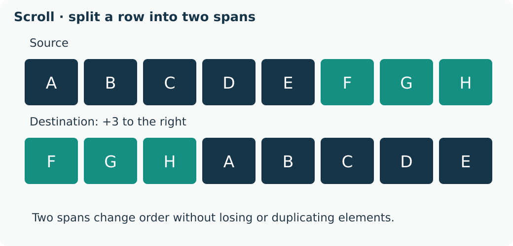

# scroll — Move an image with two row copies

*[Español](README.md)* · **Lesson 2 of 10** · [Source](../../../../demos/scroll/scroll.c) · [Shared foundations](../../BASES-EN.md)




*FGH wraps to the beginning while ABCDE moves three positions right.*

## What you will learn

Turn circular movement into contiguous spans and distinguish visible movement from the direction of source sampling.

```text
original:    A B C D E F G H
shift right: 3
result:      F G H A B C D E

copy source [0,5) to destination [3,8)
copy source [5,8) to destination [0,3)
```

The destination spans do not overlap and cover the row. No per-pixel modulo is required.

## Generalise to 320 pixels

For `offset_x` in 0–319:

```c
memcpy(screen + destination_row + offset_x,
       image + source_row,
       DEMO_WIDTH - offset_x);
memcpy(screen + destination_row,
       image + source_row + DEMO_WIDTH - offset_x,
       offset_x);
```

The first copy moves the beginning right; the second wraps the end around to the left. At offset zero, the second copy has zero length, which is valid in this use.

## Vertical sampling reverses the visible direction

Source row is `y+offset_y`, subtracting 200 when necessary. Both operands are in 0–199, so the sum is at most 398 and one subtraction suffices.

With `offset_y=1`, screen row zero reads original row one: the picture moves **up**. Increasing X moves it **right**. The current diagonal is right and up, as determined by the actual copies.

Each frame selects a source row, performs the two horizontal copies for all 200 rows, presents and services audio. X advances every frame; Y advances every third frame.

## Wrapping and period

The source resets offsets to zero after crossing the limit. That works with its current unit increments. For arbitrary larger speeds it can lose a remainder: 319+3 should wrap to 2 rather than 0.

X repeats after 320 frames; Y including its counter repeats after 600. Their combined state repeats after 4800 frames, about 68.57 seconds at 70 fps. With vertical movement every frame, the combined period would be 1600 frames.

## Cost and diagnostics

There are 400 row-copy calls covering 64000 bytes, followed by another 64000-byte VGA transfer in `demo_show`. The exact machine instructions used by `memcpy` depend on compiler, library and memory model.

Removing the second copy leaves previous buffer contents in the missing region; those contents are not necessarily black. Unexpected diagonal lines suggest a stride error. A discontinuity at larger speeds suggests a discarded wrap remainder.

## Workshop with answer

**Predict:** `ABCDEFGH` shifted right by 7. **Answer:** `BCDEFGHA`, equivalent to one step left.

**Practice:** use numbered rows and a horizontal arrow. Freeze Y to establish horizontal direction; freeze X to establish vertical direction. Then enable both.

**Extension:** support negative speeds. Prove offsets are in range before pointer arithmetic and that the two copy lengths always sum to 320.

---

[Previous: cycle](../../cycle/doc/README-EN.md) · [Next: blinds](../../blinds/doc/README-EN.md) · [Index](../../README-EN.md)
