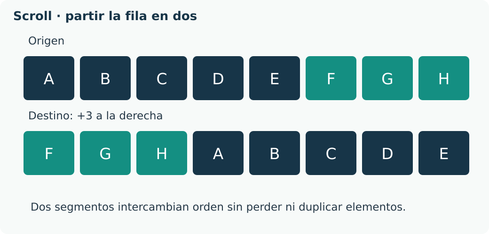

# scroll — Desplazar una imagen con dos copias por fila

*[English](README-EN.md)* · **Lección 2 de 10** · [Código](../../../../demos/scroll/scroll.c) · [Bases comunes](../../BASES.md)




*FGH se envuelve al principio; ABCDE se copia desplazado tres posiciones.*

## Lo que vas a aprender

Convertir un desplazamiento circular en dos tramos contiguos, separar movimiento visible de coordenada de origen y demostrar por qué basta una corrección de rango.

## Hazlo primero con ocho letras

```text
original:       A B C D E F G H
desplazamiento: 3 hacia la derecha
resultado:      F G H A B C D E

copia 1: origen [0,5) → destino [3,8)
copia 2: origen [5,8) → destino [0,3)
```

No se ha calculado un módulo por letra. Cortamos una fila y cambiamos el orden de dos segmentos. Los intervalos de destino no se solapan y cubren las ocho posiciones.

## Generalizar a 320 píxeles

Para un desplazamiento `offset_x` entre 0 y 319, los tamaños son `320-offset_x` y `offset_x`:

```c
memcpy(screen + destination_row + offset_x,
       image + source_row,
       DEMO_WIDTH - offset_x);
memcpy(screen + destination_row,
       image + source_row + DEMO_WIDTH - offset_x,
       offset_x);
```

El primer tramo mueve el principio de la imagen a la derecha. El segundo trae su final a la izquierda. Con desplazamiento cero, la segunda copia tiene longitud cero, lo cual es válido en este uso.

## Ahora la dimensión vertical

La fila de origen es `y+offset_y`. Si llega a 200, se resta 200. Como `y` y `offset_y` están entre 0 y 199, su suma no supera 398: una resta basta.

Con `offset_y=1`, la pantalla muestra primero la antigua fila 1. La imagen se mueve **hacia arriba**. En cambio, al aumentar `offset_x`, las copias anteriores la mueven **a la derecha**. La diagonal actual es derecha y arriba; el signo se deduce de las copias, no del nombre del contador.

## Un frame completo

```text
para cada y de pantalla:
    source_y = y + offset_y, envuelto a 0..199
    source_row = tabla[source_y]
    destination_row = tabla[y]
    copiar los dos segmentos horizontales
presentar y atender sonido
avanzar X un píxel
avanzar Y cada tres frames
```

La imagen original permanece intacta. Tras X=319, el siguiente paso vuelve a cero. El código reinicia a cero al rebasar el límite: con paso uno conserva el ciclo correctamente, pero para velocidades arbitrarias mayores puede perder el resto. Si 319+3 da 322, un envoltorio general debe conservar 2, no 0.

## Trabajo y periodo

Hay 200 filas con dos `memcpy`: 400 llamadas que, en total, copian 64000 bytes al buffer. Después `demo_show` copia otros 64000 a VGA. No hay una operación C de módulo por píxel. La implementación concreta de `memcpy` depende de biblioteca, modelo de memoria y compilador; no se deduce una única instrucción de máquina del nombre.

X vuelve cada 320 frames; el estado de Y y su contador, cada 600. Ambos coinciden cada 4800 frames, unos 68,57 s a 70 fps, más que la duración normal del efecto. Con avance vertical cada frame, el periodo conjunto sería 1600 frames.

## Taller con respuesta

**Predice:** fila `ABCDEFGH`, desplazamiento 7. **Respuesta:** `BCDEFGHA`; una posición a la izquierda equivale a siete a la derecha.

**Práctica:** usa filas numeradas y una flecha horizontal. Congela Y para confirmar la dirección de X; congela X para confirmar Y. Después reactiva ambos.

**Diagnóstico:** quitar la segunda copia deja una región con el contenido anterior de `screen`; no tiene por qué ser negra. Líneas diagonales inesperadas sugieren stride incorrecto. Un salto al aumentar mucho la velocidad sugiere que se descartó el resto al envolver.

**Ampliación:** añade velocidades negativas. Antes de copiar, demuestra que los dos offsets quedan en sus rangos y que las dos longitudes siguen sumando 320.

---

[Anterior: cycle](../../cycle/doc/README.md) · [Siguiente: blinds](../../blinds/doc/README.md) · [Índice](../../README.md)
