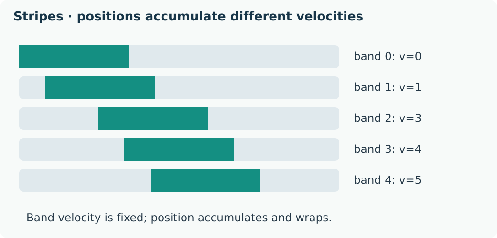

# stripes — Give each band its own velocity

*[Español](README.md)* · **Lesson 4 of 10** · [Source](../../../../demos/stripes/stripes.c) · [Shared foundations](../../BASES-EN.md)




*The first five bands, shown schematically after several updates.*

## What you will learn

Distinguish accumulated position from velocity, assign a table-driven pattern and prove that wrapping preserves bounds.

Scroll has one horizontal offset. Stripes has 25 offsets, one per eight-row band. Each band uses the same two circular row copies but advances at its own speed:

```text
next offset = current offset + velocity
band velocity = sine(band*11) * 6 / 256
```

The source uses arithmetic `>> 8`; review negative signed-shift behaviour when porting. Velocities are **constant during this effect**, even though the loop recomputes them. Positions may realign; velocities do not gradually become equal.

## Work through the table

| Band | Phase | Table sine | Resulting velocity |
|---:|---:|---:|---:|
| 0 | 0 | 0 | 0 |
| 1 | 11 | 68 | 1 |
| 2 | 22 | 132 | 3 |
| 3 | 33 | 185 | 4 |
| 4 | 44 | 226 | 5 |

Band zero stays still; the sequence does not begin at +6.

## Prove the wrap

```c
while (offset[stripe] < 0) {
    offset[stripe] = offset[stripe] + DEMO_WIDTH;
}
while (offset[stripe] >= DEMO_WIDTH) {
    offset[stripe] = offset[stripe] - DEMO_WIDTH;
}
```

Previous offsets lie in 0–319 and current speeds in −6..6, so candidates lie in −6..325. At most one correction is needed with these constants. The loops support larger changes; they are not necessary merely because many frames have elapsed. Every frame restores the invariant.

Examples: 318+4 wraps to 2; 1−3 wraps to 318.

## Why a phase spacing of 11?

11 is coprime with 256, so sufficiently many steps visit all phases before repeating. A spacing of 64 visits only four. Coprimality matters, not primality by itself. With 25 bands, only part of that phase sequence is sampled.

## Cost and limits

Each frame performs 400 span copies covering 64000 buffer bytes, plus 25 sine lookups and offset updates. Fixed velocities could be precalculated once; the current implementation calculates them in the loop.

Band height must divide 200 with the current loops, or the final partial band needs explicit clipping. Increasing speed amplitude also requires checking the intermediate sine product against 16-bit limits.

## Workshop with answer

**Predict:** velocity 5, initial offset 0, ten updates. **Answer:** offset 50; velocity remains 5.

**Practice:** change phase spacing to 64 and predict the repeated speeds: 0,+6,0,−6. Use an image with labelled bands to verify them.

**Extension:** add a time-varying phase to the sine. Velocity now changes and can reverse. Explain how accumulating that velocity differs from wobble's direct calculation of an oscillating position.

---

[Previous: blinds](../../blinds/doc/README-EN.md) · [Next: wobble](../../wobble/doc/README-EN.md) · [Index](../../README-EN.md)
