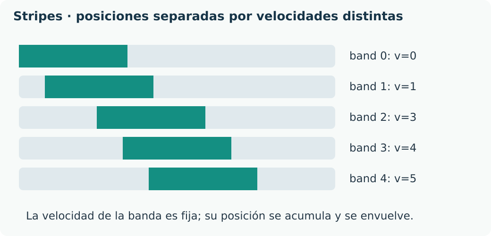

# stripes — Una velocidad para cada banda

*[English](README-EN.md)* · **Lección 4 de 10** · [Código](../../../../demos/stripes/stripes.c) · [Bases comunes](../../BASES.md)




*Esquema de desplazamientos tras varios pasos, mostrando las primeras cinco bandas.*

## Lo que vas a aprender

Distinguir velocidad y posición acumulada, asignar un patrón con una tabla y demostrar que el envoltorio conserva su rango.

## La diferencia con scroll

Scroll guarda un desplazamiento horizontal para toda la imagen. Stripes guarda uno por banda: 25 bandas de 8 filas. Cada banda reutiliza las dos copias circulares de scroll, pero avanza a su propia velocidad.

```text
posición siguiente = posición actual + velocidad
velocidad de banda = seno(banda*11) * 6 / 256
```

El código usa desplazamiento aritmético `>> 8`, cuya interpretación de negativos debes revisar al portar C. La velocidad de cada banda es **constante durante el efecto**, aunque el código vuelva a calcularla. No cambian de velocidad hasta «coincidir»: lo que vuelve a coincidir, si ocurre, son sus posiciones envueltas.

## Lee los primeros números de la tabla

Con fase `stripe*11`:

| Banda | Fase | Seno de tabla | Velocidad con el desplazamiento usado |
|---:|---:|---:|---:|
| 0 | 0 | 0 | 0 |
| 1 | 11 | 68 | 1 |
| 2 | 22 | 132 | 3 |
| 3 | 33 | 185 | 4 |
| 4 | 44 | 226 | 5 |

La banda cero permanece quieta. El patrón no empieza en +6. Para cada banda, suma esa velocidad a su offset en cada iteración y después envuélvelo al intervalo 0–319.

## Por qué funciona el wrap

```c
while (offset[stripe] < 0) {
    offset[stripe] = offset[stripe] + DEMO_WIDTH;
}
while (offset[stripe] >= DEMO_WIDTH) {
    offset[stripe] = offset[stripe] - DEMO_WIDTH;
}
```

Con los valores actuales, el offset anterior está en 0–319 y la velocidad en −6..6. El candidato está en −6..325: como máximo hace falta una corrección. Los `while` permiten más vueltas con otros parámetros, pero no son imprescindibles «porque han pasado cientos de frames»: cada frame vuelve a dejar el estado acotado.

Ejemplo: offset=318, velocidad=4 → candidato 322 → offset 2. Con offset 1 y velocidad−3 → candidato−2 → offset 318.

## Qué aporta el 11

11 es coprimo con 256: al recorrer suficientes índices, el salto visita todas las fases antes de repetirse. Un salto 64 visitaría solo cuatro fases. No hace falta que todo salto adecuado sea primo: lo relevante es compartir divisores con 256.

En solo 25 bandas se usa una parte de esa secuencia. Filas de una misma banda comparten velocidad y offset; filas de bandas vecinas pueden separarse visiblemente.

## Trabajo y posibles mejoras

Hay 400 copias de tramos y 64000 bytes reconstruidos por frame. Se consultan 25 senos y se actualizan 25 offsets. Como las velocidades no cambian, se podrían precalcular una vez al entrar en el efecto; la implementación actual las calcula en su bucle.

`STRIPES_HEIGHT` debe cubrir todas las filas con la división entera actual. Si escoges una altura que no divide 200, añade tratamiento del resto. Aumentar la amplitud exige volver a comprobar el producto del seno en 16 bits, no solo el rango del offset.

## Taller con respuesta

**Predice:** banda con velocidad 5, offset inicial 0, diez actualizaciones. **Respuesta:** offset 50. La velocidad sigue siendo 5; no se ha convertido en 50.

**Práctica:** cambia el salto de fase a 64 y escribe las velocidades esperadas: 0, +6, 0, −6, repetidas. Comprueba el patrón con una imagen que marque las bandas.

**Ampliación:** suma una fase temporal dentro del seno. Ahora la velocidad cambia y puede invertir el sentido. Describe la diferencia entre ese modelo acumulativo y wobble, que calcula directamente una posición oscilante sin acumularla.

---

[Anterior: blinds](../../blinds/doc/README.md) · [Siguiente: wobble](../../wobble/doc/README.md) · [Índice](../../README.md)
